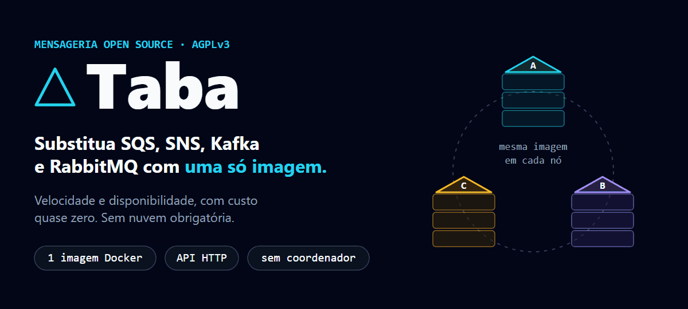
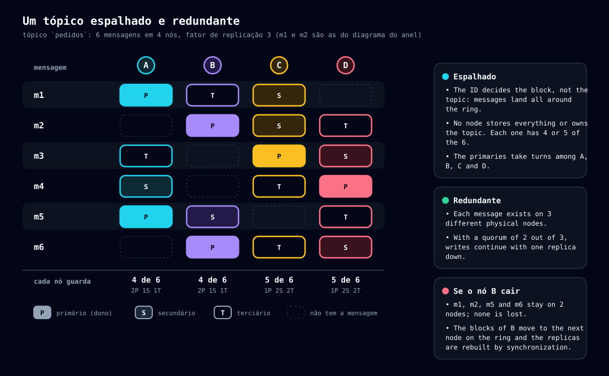

<p align="center">
  
</p>

🇺🇸 [English](README.md) | 🇧🇷 **Português (Brasil)**

[](https://github.com/rafaelpontani/taba/actions/workflows/release.yml) [](https://scorecard.dev/viewer/?uri=github.com/rafaelpontani/taba) [](#verificando-um-release)

O **Taba** é um **cluster de mensageria self-hosted, com escala horizontal**: filas (como o SQS) e pub/sub (como o SNS) na mesma API HTTP, a partir de **uma única imagem Docker**. Adicione um nó e o cluster se rebalanceia sozinho; retire um e ele entrega o seu trabalho antes de sair, sem downtime. Toda mensagem é replicada entre os nós e mantida em memória, com **backup contínuo no S3**. Vêm junto um **Helm chart**, uma **interface de terminal** e pacotes publicados.

Se você quer fugir da cobrança por mensagem, de um cluster de brokers para operar ou da dependência de uma nuvem, o Taba é para você.

## Em resumo

| | |
|---|---|
| **Tópicos** | Filas (uma mensagem para um consumidor, reentrega quando não confirmada, dead-letter), filas **FIFO** (ordem por grupo e deduplicação) e distribuidores (pub/sub por prefixo de nome) |
| **Cluster** | 3 ou mais nós idênticos, **sem coordenador e sem ponto único de falha**. Um nó que falha é excluído por votação; quando se recupera, volta sozinho |
| **Escala** | **Horizontal**, nos dois sentidos: um nó novo assume a sua parte dos tópicos; um nó que sai faz o drain antes. Autoscaling com KEDA no Kubernetes |
| **Durabilidade** | Cada mensagem é confirmada por um **quorum** de nós (3 cópias por padrão) e copiada **continuamente para o S3** (AWS, SeaweedFS, MinIO, Ceph...) |
| **Implantação** | Uma imagem Docker (58 MB), Docker Compose ou o **Helm chart** em `oci://ghcr.io/rafaelpontani/charts/taba` |
| **Operação** | `taba-cli`, uma linha de comando com **interface de terminal em tela cheia** (saúde do cluster, tópicos, gráficos das filas), além de métricas Prometheus e OpenTelemetry |
| **Clientes** | HTTP simples, de qualquer linguagem; conectores prontos para Rust (crates.io) e C#/.NET (nuget.org) |
| **Licença** | Servidor AGPLv3, conectores Apache-2.0 |

## Por que o Taba

**Rápido por padrão.** As mensagens são gravadas e servidas da **memória**, replicadas entre os nós; o disco só entra quando a memória enche. O consumidor lê o que já está na RAM, sem tuning e sem configuração extra. A memória não é dividida igualmente: os tópicos mais lidos mantêm mais mensagens quentes.

**Custo de operação baixo.**
- **Nada cobrado por mensagem:** você paga as máquinas, e só.
- **Pouco para rodar:** sem cluster de brokers, sem coordenador (ZooKeeper, etcd), sem banco de dados externo. Cada nó usa cerca de **35 MiB de RAM** atendendo a carga de demonstração mostrada abaixo.
- **Ninguém rebalanceia à mão:** aumente ou diminua o cluster e ele move os blocos dos tópicos entre os nós sozinho, sem parar. Na redução, o nó que sai faz o drain antes, um nó de cada vez.
- **Backup quase sem custo de S3:** uma mensagem consumida antes de a janela do backup fechar (60 s por padrão) **nunca vai para o S3**, então o tráfego rápido quase não gera requisições ao bucket. O que fica é enviado em segmentos.

**Confiável.**
- Uma escrita só é confirmada depois que um **quorum** de nós a guarda em memória.
- Os nós **se monitoram** e excluem por votação o que falha; ele **volta sozinho** quando se recupera.
- O **backup no S3 nunca atrasa uma escrita** e permite que um cluster inteiro que caiu **se restaure sozinho** ao subir (só a última janela do backup fica em risco).
- Todo candidato é validado de ponta a ponta antes de virar release final: um cluster de três nós com nós caindo, fazendo drain e voltando, **sem perda de mensagens confirmadas**, mais backup e restauração no S3 ([docker/validate.sh](docker/validate.sh)).

## Veja funcionando

A interface de terminal do `taba-cli` (`taba-cli tui`) no cluster do Compose, sob uma carga de demonstração ([doc/diagrams/scripts/capture-tui.sh](doc/diagrams/scripts/capture-tui.sh)):

| Saúde do cluster | Tópicos, com os gráficos da fila selecionada |
|---|---|
|  |  |
| **Fluxo de publicação e consumo de uma fila** | **Um nó em detalhe, com o seu backup no S3** |
|  |  |

Tudo o que a interface faz também pode ser feito com comandos de uma linha ([doc/pt-BR/20b-cli-ui.md](doc/pt-BR/20b-cli-ui.md)).

## Experimente em um minuto

Com Docker, um cluster de três nós (atrás de um HAProxy de exemplo) sobe com um comando. Um contêiner de inicialização cria o certificado do cluster e o token raiz, o primeiro nó forma o cluster e os outros dois entram:

```bash
docker compose up -d              # três nós "healthy" em cerca de um minuto (imagens públicas do Docker Hub)
```

Para construir as imagens a partir deste repositório (desenvolvimento): `docker compose -f docker-compose.yml -f docker-compose.dev.yml up --build -d`.

Depois, com o [`taba-cli`](doc/pt-BR/20-cli.md), que já vem no Compose apontado para o cluster (e com o token raiz):

```bash
docker compose run --rm taba-cli cluster status -o table             # os três nós, sem condições
docker compose run --rm taba-cli topic create orders --type queue
echo '{"order": 9001}' | docker compose run --rm -T taba-cli publish orders --stdin
docker compose run --rm taba-cli consume orders --wait 5 --ack      # recebe e confirma
```


A API de cliente também está em `http://localhost:8080` para qualquer cliente HTTP (com `Authorization: Bearer <token raiz>`; o token está no volume `secrets`: `docker compose run --rm --entrypoint cat taba-cli /secrets/root-token`; no Git Bash do Windows, prefixe o comando com `MSYS_NO_PATHCONV=1`). O Compose já sobe o backup no S3, num SeaweedFS ao lado do cluster. `docker compose down -v` apaga tudo. O HAProxy é só um exemplo: qualquer balanceador serve. Para um único nó, sem cluster, veja [Desenvolva em um nó](#desenvolva-em-um-nó).

**Quer um cluster já populado para testar?** O `docker/seed-demo.sh` apaga tudo, sobe o cluster, cria um **token `admin`** local (`local-admin`, o jeito certo de usar o Taba: o token raiz só serve para criá-lo e não é usado fora dos contêineres) e o grava em `docker/.local/admin-token` (ignorado pelo git), aponta o perfil `local_admin` do `taba-cli` instalado na sua máquina para `http://localhost:8080` e esse token (atualiza o perfil se existir, senão o cria como padrão; `--no-profile` pula essa parte) e enche o cluster de filas (equilibradas, barulhenta e FIFO) e distribuidores, com 100.000 mensagens cada. Depois, `taba-cli topic list` já funciona. Detalhes em [Dados de demonstração](doc/pt-BR/25-testes.md#dados-de-demonstração-dockerseed-demosh).

> **Cuidado em produção:** pare e atualize os nós **um de cada vez** (`docker compose stop` envia `SIGTERM`, que dispara um *drain* ordenado). Perder **dois nós seguidos** trava um cluster de 3 nós. Parar **todos** os nós de uma vez perde as mensagens e os tópicos, a não ser que o backup no S3 esteja ligado: aí o cluster se restaura sozinho ao subir, menos a última janela do backup. Veja o [guia de operação](doc/pt-BR/23-operacao.md).

## Taba × as alternativas

| | **Taba** | SQS + SNS | Kafka | RabbitMQ |
|---|---|---|---|---|
| **Onde roda** | Em qualquer lugar: máquina, VM, Docker, Kubernetes | Só na AWS | Onde você hospedar, ou como serviço gerenciado | Onde você hospedar, ou como serviço gerenciado |
| **O que operar** | A mesma imagem em 3 nós (1 para desenvolvimento) | Nada (gerenciado) | Brokers e coordenação de metadados | Um broker (mais nós para alta disponibilidade) |
| **Fila e pub/sub** | Na mesma API HTTP | Dois serviços separados | Tópicos e grupos de consumidores | Filas e exchanges |
| **Alta disponibilidade** | Embutida: replicação por quorum, votação e volta automática | Gerenciada pela AWS | Partições replicadas | Quorum queues num cluster |
| **Escala** | Adicione ou retire um nó: ele se rebalanceia sozinho | Automática (gerenciada) | Brokers e partições, redistribuídas à mão ou por ferramentas | Nós do cluster; líderes das filas rebalanceados por comando |
| **Backup** | Contínuo no S3, restaurado ao subir | Gerenciado pela AWS | Replicação; backup com ferramentas externas | Exportação de definições; mensagens com ferramentas externas |
| **Desenvolvimento local** | A mesma imagem da produção | Um emulador (LocalStack) ou uma conta AWS | O mesmo software, mais pesado | O mesmo software |
| **Cobrança** | Sem cobrança por mensagem: só infraestrutura | Por requisição | Infraestrutura, ou um plano gerenciado | Infraestrutura, ou um plano gerenciado |

## Perguntas frequentes

**O Taba é um servidor único?** Não. É um cluster de nós idênticos, sem coordenador. Três nós são o mínimo recomendado para produção; um nó é o perfil de um nó, para desenvolvimento.

**Ele escala horizontalmente?** Sim. Os tópicos são divididos em blocos num anel de hash consistente; um nó novo assume a sua parte e um nó que sai entrega a sua parte antes. No Kubernetes, o chart pode escalar com KEDA.

**O que acontece se um nó cair?** Os outros detectam, o excluem por votação e continuam atendendo pelas réplicas. Quando ele volta, é readmitido e sincronizado. Com 3 nós, o cluster sobrevive a um nó de cada vez.

**Ele suporta S3?** Sim, como backup contínuo de mensagens, tópicos e tokens em qualquer S3 que respeite escritas condicionais (AWS S3, SeaweedFS, MinIO, Ceph). O Compose já sobe com ele ligado, num SeaweedFS. Detalhes em [doc/pt-BR/33-backup-s3.md](doc/pt-BR/33-backup-s3.md).

**Tem Helm chart?** Sim: `oci://ghcr.io/rafaelpontani/charts/taba`, com backup no S3, Ingress, Prometheus, OpenTelemetry e autoscaling com KEDA como opções ([Rode no Kubernetes](#rode-no-kubernetes-helm)).

**Tem interface de usuário?** Sim, no terminal: `taba-cli tui` ([Veja funcionando](#veja-funcionando)). Não há painel web; para gráficos de longo prazo, use as métricas do Prometheus.

**Está em produção?** Sim. Toda versão é publicada no Docker Hub, GHCR, crates.io, nuget.org e GitHub Releases, assinada e com proveniência ([Verificando um release](#verificando-um-release)).

## Limites

O que limita um cluster Taba é o hardware que você dá a ele, não um número fixo:

- **Quantos nós:** o código não tem máximo. Cada nó assume uma parte do anel de hash (128 posições virtuais por nó). Os testes automatizados rodam clusters de até 5 nós, e todo candidato a release é validado de ponta a ponta no Compose.
- **Quanto dado:** cada mensagem fica em 3 nós (`replication.factor`), então o cluster guarda cerca da soma da memória e do disco dos nós dividida por 3. A memória pode ter um teto por nó (`memory.limit`); acima dele, as mensagens transbordam para o disco local.
- **Tamanho da mensagem:** 5 MB por padrão, configurável por tópico.
- **Mínimo para produção:** 3 nós. Perder **dois nós seguidos** num cluster de 3 nós trava o cluster (não há quorum), e os nós devem ser parados e atualizados **um de cada vez**.

O que o Taba não faz:

- **Não substitui um protocolo:** o Taba fala HTTP. Não há compatibilidade com os protocolos AMQP, MQTT ou Kafka, então trocar de broker significa trocar o cliente.
- **Não é uma plataforma de streaming:** processamento de streams e reprodução do histórico de mensagens estão fora do escopo. Para filas e pub/sub, sim; para reler o passado, não.
- **Fora do escopo por enquanto:** interface web, autenticação avançada (OAuth/OIDC) e multirregião.
- **Ainda por vir:** os conectores das demais linguagens, o contrato OpenAPI e benchmarks publicados. Veja o [roadmap](doc/pt-BR/32-roadmap.md) e os [problemas conhecidos](doc/pt-BR/36-problemas-conhecidos.md).

## Desenvolva em um nó

Para desenvolver, um contêiner basta (um cluster de um nó, dados dentro do contêiner, **sem autenticação e sem token raiz**, então nunca deve ficar exposto numa rede):

```bash
docker run -d --name taba-dev -p 8080:8080 -e TABA_REPLICATION_FACTOR=1 rafaelpontani/taba

# o taba-cli (Linux, macOS, Git Bash; no PowerShell: scripts/install-cli.ps1). Por padrão usa http://127.0.0.1:8080 sem token
curl -fsSL https://raw.githubusercontent.com/rafaelpontani/taba/main/scripts/install-cli.sh | sh

taba-cli topic create orders --type queue
echo '{"order": 9001}' | taba-cli publish orders --stdin
taba-cli consume orders --wait 5 --ack
docker rm -f taba-dev                  # apaga o nó e os dados
```

O [`scripts/install-cli.sh`](scripts/install-cli.sh) baixa o binário do último Release final, confere o SHA256 contra o `SHA256SUMS` e o coloca em `~/.local/bin` (no macOS, no Git Bash/MINGW64 e no Windows os Releases não têm binário, então ele roda `cargo install taba-cli` ou, sem cargo, instala um `taba-cli` que executa a imagem Docker; o [`scripts/install-cli.ps1`](scripts/install-cli.ps1) faz o mesmo no PowerShell; `TABA_CLI_VERSION=0.1.1` escolhe a versão, `TABA_CLI_DIR=/usr/local/bin` a pasta). Sem instalar nada, a imagem também serve: `docker run --rm -e TABA_CLI_URL=http://host.docker.internal:8080 rafaelpontani/taba-cli topic list`. Tokens (raiz e `admin`) só existem com autenticação, ou seja, no cluster: o Compose acima ou o [Helm](#rode-no-kubernetes-helm) abaixo.

## Rode no Kubernetes (Helm)

O chart Helm está em [deploy/helm/taba/](deploy/helm/taba/). Precisa de Kubernetes 1.27+ e de uma `StorageClass` padrão.

```bash
# um cluster de 3 nós (o certificado do cluster e o token raiz são gerados uma vez, num Secret)
helm install taba oci://ghcr.io/rafaelpontani/charts/taba -n taba --create-namespace
# ou, de um clone deste repositório: helm install taba deploy/helm/taba -n taba --create-namespace
helm test taba -n taba
kubectl -n taba get secret taba-secrets -o jsonpath='{.data.root-token}' | base64 -d     # o token raiz
kubectl -n taba port-forward svc/taba 8080:8080                                          # a API em http://localhost:8080
```

Configurações comuns (todas opcionais, combine como precisar):

```bash
# um único nó para desenvolvimento (replication.factor=1: sem autenticação, sem TLS de cluster)
helm install taba deploy/helm/taba -n taba --create-namespace --set config.replication.factor=1

# expor a API por um Ingress (use qualquer controlador de Ingress mantido)
helm upgrade --install taba deploy/helm/taba -n taba \
  --set ingress.enabled=true --set ingress.className=nginx --set 'ingress.hosts[0].host=taba.example.com' \
  --set 'ingress.hosts[0].paths[0].path=/' --set 'ingress.hosts[0].paths[0].pathType=Prefix'

# backup em S3: um SeaweedFS embutido (para testes) ou o seu bucket (AWS, Ceph, ...)
helm upgrade --install taba deploy/helm/taba -n taba --set seaweedfs.enabled=true
helm upgrade --install taba deploy/helm/taba -n taba --set backup.s3.bucket=meu-bucket --set backup.s3.region=us-east-1

# métricas: um ServiceMonitor, um Prometheus ou um Telegraf próprios, ou push OTLP
helm upgrade --install taba deploy/helm/taba -n taba --set collector.type=prometheus
helm upgrade --install taba deploy/helm/taba -n taba --set otel.endpoint=http://otel-collector:4317

# autoscaling com KEDA (precisa do KEDA e de um Prometheus; nunca abaixo de 3 nós, reduz um nó de cada vez)
helm upgrade --install taba deploy/helm/taba -n taba \
  --set autoscaling.enabled=true --set autoscaling.prometheus.serverAddress=http://prometheus:9090
```

Para obter o token raiz e criar um token `admin` com o `taba-cli` (sem instalar nada: ele roda como um pod descartável):

```bash
ROOT=$(kubectl -n taba get secret taba-secrets -o jsonpath='{.data.root-token}' | base64 -d | tr -d '\n')

kubectl -n taba run taba-cli --rm -i --restart=Never --image=rafaelpontani/taba-cli:latest \
  --env TABA_CLI_URL=http://taba:8080 --env TABA_CLI_TOKEN="$ROOT" \
  -- token create --name ci-admin --permission admin --token-only
# imprime tb_<id>.<segredo>: o segredo aparece uma única vez, guarde-o (o cluster guarda só o hash)
```

Só o token raiz cria, altera ou revoga tokens `admin` e para o cluster; guarde-o num cofre e use o `admin` (ou um mais restrito, como `--permission publish,consume --prefix pedidos-`) no dia a dia. Mais em [doc/pt-BR/20-cli.md](doc/pt-BR/20-cli.md) e [doc/pt-BR/14-seguranca.md](doc/pt-BR/14-seguranca.md).

Qualquer parâmetro do nó vai em `config`, num arquivo de values (por exemplo `config.message.max-bytes`). Todos os values, o que o chart cria, as validações que ele faz e as regras de segurança do autoscaling estão em [doc/pt-BR/34-chart-helm.md](doc/pt-BR/34-chart-helm.md) (em inglês: [doc/en-US/34-helm-chart.md](doc/en-US/34-helm-chart.md)); os modos de operação, cada um com seus testes em bash, estão em [doc/pt-BR/35-chart-helm-casos-de-uso.md](doc/pt-BR/35-chart-helm-casos-de-uso.md).

## A API em quatro chamadas

Tudo é HTTP. O contrato formal (OpenAPI) ainda não está definido; as chamadas abaixo estão descritas na [referência da API de cliente](doc/pt-BR/16-api-cliente.md).

| O que você quer | Chamada |
|---|---|
| Criar um tópico (Fila ou Distribuidor) | `POST /topics` |
| Publicar uma mensagem | `POST /topics/{topic}/messages` |
| Receber mensagens (long polling de até 20 s) | `GET /topics/{topic}/messages` |
| Confirmar o consumo (ack) | `DELETE /topics/{topic}/messages/{id}` |

Se o consumidor não confirmar a tempo, a mensagem volta a ficar disponível e é entregue de novo, como no SQS (a invisibilidade padrão é 120 s e pode ser ajustada).

## Conectores

A API é HTTP, então qualquer linguagem já fala com o Taba pelo cliente HTTP que tem. Além disso, o projeto oferece **conectores fáceis de usar** para as principais linguagens, para publicar e consumir mensagens em poucas linhas. Eles não têm dependências externas e rodam em versões antigas, de até 15 anos, desde que a plataforma fale **TLS 1.2 ou superior** (veja a [versão base](doc/pt-BR/21-conectores.md) de cada um):

| Linguagem | Pasta | Versão base | Estado | Exemplo de uso |
|---|---|---|---|---|
| Java | `connectors/java/` | Java 11 | [pronto](connectors/java/README.md) (nove operações bloqueantes e com `CompletableFuture`, `subscribe`) | [README](connectors/java/README.md) |
| C# | `connectors/csharp/` | .NET Framework 4.6.1 e .NET 5, 6, 8 e 10 | [pronto](connectors/csharp/README.md) (nove operações assíncronas e síncronas, `subscribe`) | [exemplo de console](examples/csharp-console/) |
| Python | `connectors/python/` | 3.9 | [pronto](connectors/python/README.md) (clientes síncrono e `asyncio`, `subscribe`) | [README](connectors/python/README.md) |
| PHP | `connectors/php/` | 5.6 | planejado | TODO |
| Ruby | `connectors/ruby/` | 2.0 | planejado | TODO |
| Node.js | `connectors/node/` | 18 | [pronto](connectors/node/README.md) (nove operações com `Promise`, `subscribe`, tipos incluídos) | [README](connectors/node/README.md) |
| Go | `connectors/go/` | 1.7 | planejado | TODO |
| Rust | `connectors/rust/client/` | 1.70 | síncrono pronto ([README](connectors/rust/client/README.md)) | [exemplo](connectors/rust/client/README.md) |
| C | `connectors/c/` | C89 | planejado | TODO |
| C++ | `connectors/cpp/` | C++03 | planejado | TODO |

O `taba-cli`, a linha de comando de cliente ([connectors/rust/cli](connectors/rust/cli/README.md)), está pronto e é o caminho mais curto para experimentar um cluster.

As outras linguagens usam o próprio cliente HTTP ou a biblioteca C. O desenho está no [guia dos conectores](doc/pt-BR/21-conectores.md).

<!-- TODO: adicionar exemplos de uso (criar tópico, publicar, consumir com long polling e ack) para cada linguagem, quando os conectores existirem. -->

> As versões base são propostas e podem mudar até serem confirmadas (pendência D68, veja as [pendências](doc/pt-BR/31-pendencias.md)).

## Como funciona por dentro

**Taba** vem de **T**ópicos **A**ssíncronos **B**alanceados e **A**utogeridos. Em tupi, *taba* é a **aldeia**: cada nó é uma oca, o cluster é a aldeia, e as mensagens circulam entre elas sem que você precise cuidar disso.


| Letra | Promessa | Como o Taba cumpre |
|---|---|---|
| **T**ópicos | Uma API enxuta, com fila (entrega única) e distribuição por prefixo num só lugar. | Você envia a um tópico com verbos HTTP e escolhe o tipo: Tópico Fila ou Tópico Distribuidor. |
| **A**ssíncrono | O produtor envia e segue em frente. | Uma escrita é confirmada em memória por um número configurável de nós; o disco só entra no overflow. |
| **B**alanceado | Nenhum nó carrega tudo sozinho. | Um anel de hash consistente divide os tópicos em blocos e os replica em vários nós. |
| **A**utogerido | Sem coordenador e sem operação manual. | Os nós se descobrem, se monitoram e votam para tirar quem falha. Quando o nó volta, é readmitido. |


*O anel de hash divide o trabalho entre os nós.*



*Um tópico espalhado pelo cluster e replicado: se um nó cai, a aldeia continua de pé.*

## Verificando um release

Toda versão é compilada e publicada só pelo [workflow de release](.github/workflows/release.yml), a partir do commit da sua tag, depois de todos os testes passarem. Cada artefato pode ser conferido de forma independente, sem confiar na palavra deste repositório:

| Artefato | Onde | Prova |
|---|---|---|
| Imagens `taba` e `taba-cli` | Docker Hub (`rafaelpontani/…`) e GHCR (`ghcr.io/rafaelpontani/…`) | Proveniência SLSA, SBOM, assinatura cosign; label `org.opencontainers.image.revision` = commit |
| Binários, pacotes NuGet, chart | [GitHub Releases](https://github.com/rafaelpontani/taba/releases) (imutáveis) | `SHA256SUMS` e uma atestação por arquivo |
| Crates `taba-client`, `taba-cli` | crates.io | Trusted Publishing a partir do workflow; `.cargo_vcs_info.json` com o commit |
| Pacotes `Taba.Client*` | nuget.org | Trusted Publishing; `<repository commit>` e o link da Release no `.nuspec`; SourceLink |
| Chart Helm | `oci://ghcr.io/rafaelpontani/charts/taba` | Assinatura cosign e atestação; `appVersion` = a versão |

```bash
# imagens (qualquer tag: 0.1.0, 0.1, 0, latest... todas apontam para o mesmo digest)
gh attestation verify oci://ghcr.io/rafaelpontani/taba:latest -R rafaelpontani/taba
cosign verify ghcr.io/rafaelpontani/taba:latest \
  --certificate-identity-regexp '^https://github.com/rafaelpontani/taba/.github/workflows/release.yml@refs/heads/(main|release)$' \
  --certificate-oidc-issuer https://token.actions.githubusercontent.com

# arquivos de uma Release
VERSION=0.1.1
gh release download "v$VERSION" -R rafaelpontani/taba && sha256sum -c SHA256SUMS
gh attestation verify "taba-$VERSION-x86_64-unknown-linux-musl" -R rafaelpontani/taba

# o commit dentro do binário
docker run --rm rafaelpontani/taba:latest --version     # taba 0.1.1 (commit <sha>)
```

Versões: a `main` publica as finais (`v0.1.0`) e a `release` publica as candidatas (`v0.1.0-rc.N`). As tags flutuantes (`v0.1`, `v0`, `latest`, `0.1-rc`, `rc`...) só andam para a maior versão da sua linha. O fluxo completo está em [CI/CD e releases](doc/pt-BR/27-ci-cd.md); para relatar uma vulnerabilidade, veja o [SECURITY.md](SECURITY.md).

## Documentação

A documentação está em [doc/](doc/README.md), uma pasta por idioma: comece em [doc/pt-BR/README.md](doc/pt-BR/README.md) para português do Brasil (resumos para IA estão em [llms.txt](llms.txt), em inglês, e em [doc/pt-BR/llms.txt](doc/pt-BR/llms.txt)) ou em [doc/en-US/README.md](doc/en-US/README.md) para inglês. As duas pastas têm o mesmo conteúdo e toda mudança vai para todas. Outros idiomas entrarão como pastas irmãs. O código, os identificadores, as rotas, as chaves de configuração e os códigos de erro estão em inglês.

## Licença

- **Servidor** (`crates/`, a imagem `taba`, o chart Helm e o resto do repositório): [GNU AGPLv3](LICENSE).
- **Conectores** (`connectors/`: `taba-client`, `taba-cli` e os pacotes `Taba.Client*`): [Apache-2.0](connectors/LICENSE).

Contribuições são bem-vindas: veja o [CONTRIBUTING.md](CONTRIBUTING.md) (em inglês). Um pull request entra depois que o autor assina o [CLA](CLA.md), uma única vez.
