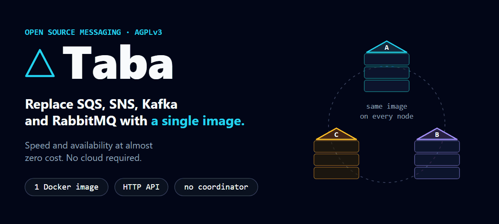
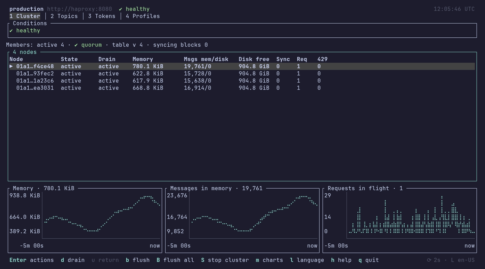
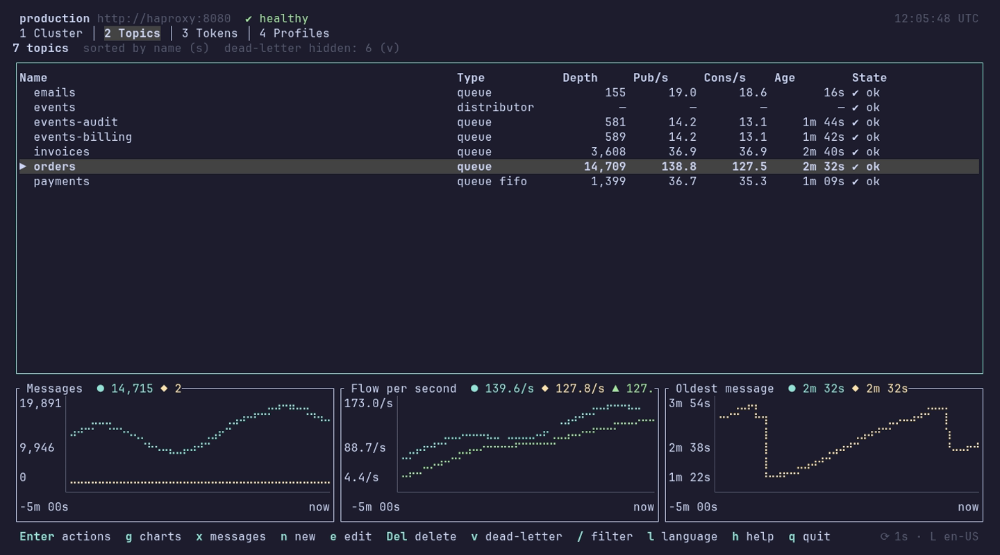
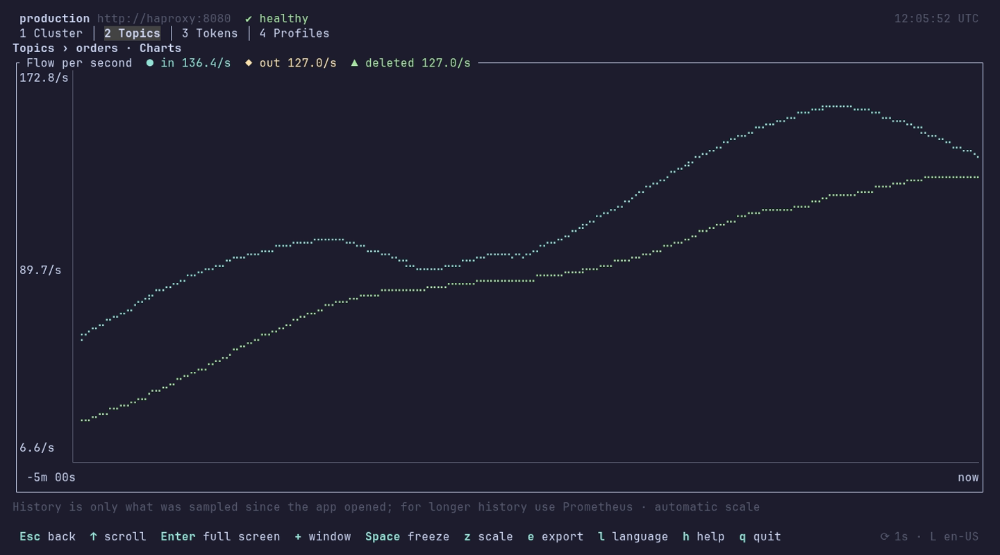
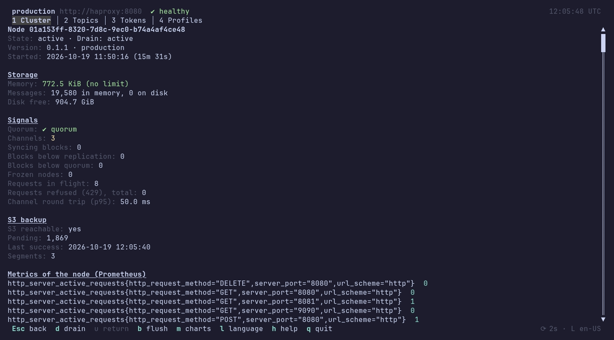

<p align="center">
  
</p>

🇺🇸 **English** | 🇧🇷 [Português (Brasil)](README-pt-BR.md)

[](https://github.com/rafaelpontani/taba/actions/workflows/release.yml) [](https://scorecard.dev/viewer/?uri=github.com/rafaelpontani/taba) [](#verifying-a-release)

**Taba** is a **self-hosted, horizontally scalable messaging cluster**: queues (like SQS) and pub/sub (like SNS) behind one HTTP API, from **a single Docker image**. Add a node and the cluster rebalances itself; remove one and it hands its work over before leaving, with no downtime. Every message is replicated across nodes and kept in memory, with a **continuous backup to S3**. A **Helm chart**, a **terminal UI** and published packages come with it.

If you want to get away from per-message billing, from a cluster of brokers to operate, or from depending on a cloud, Taba is for you.

## At a glance

| | |
|---|---|
| **Topics** | Queues (one consumer per message, redelivery when not confirmed, dead-letter), **FIFO** queues (order per group and deduplication) and distributors (pub/sub by name prefix) |
| **Cluster** | 3 or more identical nodes, **no coordinator and no single point of failure**. A node that fails is voted out; when it recovers it rejoins by itself |
| **Scaling** | **Horizontal**, in both directions: a new node takes its share of the topics; a leaving node drains first. Autoscaling with KEDA on Kubernetes |
| **Durability** | Each message is confirmed by a **quorum** of nodes (3 copies by default) and backed up **continuously to S3** (AWS, SeaweedFS, MinIO, Ceph...) |
| **Deployment** | One Docker image (58 MB), Docker Compose, or the **Helm chart** at `oci://ghcr.io/rafaelpontani/charts/taba` |
| **Operation** | `taba-cli`, a command line with a **full-screen terminal UI** (cluster health, topics, queue charts), plus Prometheus and OpenTelemetry metrics |
| **Clients** | Plain HTTP from any language; ready connectors for Rust (crates.io) and C#/.NET (nuget.org) |
| **License** | Server AGPLv3, connectors Apache-2.0 |

## Why Taba

**Fast by default.** Messages are written to and served from **memory**, replicated across the nodes; the disk only comes in when memory fills up. Consumers read what is already in RAM, with no tuning and no extra configuration. Memory is not split equally: topics with the most reads keep the most messages hot.

**Low operating cost.**
- **Nothing billed per message:** you pay for the machines, nothing else.
- **Little to run:** no broker cluster, no coordinator (ZooKeeper, etcd), no external database. Each node uses about **35 MiB of RAM** while serving the demo load shown below.
- **No one rebalances by hand:** scale out or in and the cluster moves the blocks of topics between nodes by itself, without stopping. Scaling down drains the leaving node first, one node at a time.
- **Backup with almost no S3 cost:** a message consumed before the backup window closes (60 s by default) **never goes to S3**, so fast traffic generates almost no requests to the bucket. What stays is sent in segments.

**Reliable.**
- A write is only confirmed after a **quorum** of nodes holds it in memory.
- Nodes **monitor each other** and vote out the one that fails; it **rejoins by itself** when it comes back.
- The **S3 backup never delays a write** and lets a whole cluster that went down **restore itself** at start (only the last backup window is at risk).
- Every candidate is validated end to end before it becomes a final release: a three-node cluster with nodes crashing, draining and returning, **with no loss of confirmed messages**, plus S3 backup and restore ([docker/validate.sh](docker/validate.sh)).

## See it running

The `taba-cli` terminal UI (`taba-cli tui`) on the Compose cluster, under a demo load ([doc/diagrams/scripts/capture-tui.sh](doc/diagrams/scripts/capture-tui.sh)):

| Cluster health | Topics, with the charts of the selected queue |
|---|---|
|  |  |
| **Publish and consume flow of a queue** | **A node in detail, with its S3 backup** |
|  |  |

Everything the interface does can also be done with one-line commands ([doc/en-US/20b-cli-ui.md](doc/en-US/20b-cli-ui.md)).

## Try it in a minute

With Docker, a three-node cluster (behind an example HAProxy) starts with one command. An init container creates the cluster certificate and the root token, the first node forms the cluster and the other two join:

```bash
docker compose up -d              # three "healthy" nodes in about a minute (public images from Docker Hub)
```

To build the images from this repository instead (for development): `docker compose -f docker-compose.yml -f docker-compose.dev.yml up --build -d`.

Then, with the [`taba-cli`](doc/en-US/20-cli.md), which already ships in the Compose file pointed at the cluster (and with the root token):

```bash
docker compose run --rm taba-cli cluster status -o table             # the three nodes, no conditions
docker compose run --rm taba-cli topic create orders --type queue
echo '{"order": 9001}' | docker compose run --rm -T taba-cli publish orders --stdin
docker compose run --rm taba-cli consume orders --wait 5 --ack      # receive and confirm
```


The client API is also at `http://localhost:8080` for any HTTP client (with `Authorization: Bearer <root token>`; the token is in the `secrets` volume: `docker compose run --rm --entrypoint cat taba-cli /secrets/root-token`; on Windows Git Bash prefix the command with `MSYS_NO_PATHCONV=1`). The Compose file already starts the S3 backup, in a SeaweedFS next to the cluster. `docker compose down -v` deletes everything. HAProxy is just an example: any load balancer works. For a single node, with no cluster, see [Develop on one node](#develop-on-one-node).

> **Careful in production:** stop and update nodes **one at a time** (`docker compose stop` sends `SIGTERM`, which triggers a graceful *drain*). Losing **two nodes in a row** locks a 3-node cluster. Stopping **all** nodes at once loses the messages and topics, unless the S3 backup is on: then the cluster restores itself at start, except for the last backup window. See the [operations guide](doc/en-US/23-operations.md).

## Taba vs. the alternatives

| | **Taba** | SQS + SNS | Kafka | RabbitMQ |
|---|---|---|---|---|
| **Where it runs** | Anywhere: machine, VM, Docker, Kubernetes | AWS only | Wherever you host it, or as a managed service | Wherever you host it, or as a managed service |
| **What to run** | The same image on 3 nodes (1 for dev) | Nothing (managed) | Brokers and metadata coordination | A broker (more nodes for high availability) |
| **Queue and pub/sub** | In the same HTTP API | Two separate services | Topics and consumer groups | Queues and exchanges |
| **High availability** | Built in: replication by quorum, vote and automatic rejoin | Managed by AWS | Replicated partitions | Quorum queues on a cluster |
| **Scaling** | Add or remove a node: it rebalances by itself | Automatic (managed) | Brokers and partitions, reassigned by hand or by tools | Nodes in the cluster; queue leaders rebalanced by command |
| **Backup** | Continuous to S3, restored at start | Managed by AWS | Replication; backup with external tools | Definitions export; messages with external tools |
| **Local development** | The same image as production | An emulator (LocalStack) or an AWS account | The same software, heavier | The same software |
| **Billing** | No per-message billing: infrastructure only | Per request | Infrastructure, or a managed plan | Infrastructure, or a managed plan |

## Common questions

**Is Taba a single server?** No. It is a cluster of identical nodes with no coordinator. Three nodes are the recommended minimum for production; one node is the one-node profile, for development.

**Does it scale horizontally?** Yes. The topics are split into blocks on a consistent-hash ring; a new node takes over its share and a node that leaves hands its share over first. On Kubernetes the chart can scale with KEDA.

**What happens if a node goes down?** The others detect it, vote it out and keep serving from the replicas. When it comes back it is re-admitted and synchronized. With 3 nodes the cluster survives one node at a time.

**Does it support S3?** Yes, as a continuous backup of messages, topics and tokens to any S3 that honors conditional writes (AWS S3, SeaweedFS, MinIO, Ceph). The Compose file already starts with it on, in a SeaweedFS. Details in [doc/en-US/33-s3-backup.md](doc/en-US/33-s3-backup.md).

**Is there a Helm chart?** Yes: `oci://ghcr.io/rafaelpontani/charts/taba`, with the S3 backup, Ingress, Prometheus, OpenTelemetry and KEDA autoscaling as options ([Run it on Kubernetes](#run-it-on-kubernetes-helm)).

**Is there a user interface?** Yes, in the terminal: `taba-cli tui` ([See it running](#see-it-running)). There is no web dashboard; for long-term charts, use the Prometheus metrics.

**Is it in production?** Yes. Every version is published to Docker Hub, GHCR, crates.io, nuget.org and GitHub Releases, signed and with provenance ([Verifying a release](#verifying-a-release)).

## Limits

What limits a Taba cluster is the hardware you give it, not a fixed number:

- **How many nodes:** the code has no maximum. Each node takes a share of the hash ring (128 virtual positions per node). The automated tests run clusters of up to 5 nodes, and every candidate release is validated end to end on Compose.
- **How much data:** each message is kept on 3 nodes (`replication.factor`), so the cluster holds about the sum of the nodes' memory and disk divided by 3. Memory can be capped per node (`memory.limit`); above it, messages overflow to the local disk.
- **Message size:** 5 MB by default, configurable per topic.
- **Minimum for production:** 3 nodes. Losing **two nodes in a row** in a 3-node cluster locks the cluster (there is no quorum), and nodes must be stopped and updated **one at a time**.

What Taba does not do:

- **Not a protocol replacement:** Taba speaks HTTP. There is no AMQP, MQTT or Kafka protocol compatibility, so switching brokers means switching the client.
- **Not a streaming platform:** stream processing and replaying message history are out of scope. For queues and pub/sub, yes; for re-reading the past, no.
- **Out of scope for now:** a web interface, advanced authentication (OAuth/OIDC) and multi-region.
- **Still to come:** the connectors for the other languages, the OpenAPI contract and published benchmarks. See the [roadmap](doc/en-US/32-roadmap.md) and the [known issues](doc/en-US/36-known-issues.md).

## Develop on one node

For development, one container is enough (a cluster of one, data inside the container, **no authentication and no root token**, so it must never face a network):

```bash
docker run -d --name taba-dev -p 8080:8080 -e TABA_REPLICATION_FACTOR=1 rafaelpontani/taba

# the taba-cli (Linux, macOS, Git Bash; on PowerShell: scripts/install-cli.ps1). It uses http://127.0.0.1:8080 with no token by default
curl -fsSL https://raw.githubusercontent.com/rafaelpontani/taba/main/scripts/install-cli.sh | sh

taba-cli topic create orders --type queue
echo '{"order": 9001}' | taba-cli publish orders --stdin
taba-cli consume orders --wait 5 --ack
docker rm -f taba-dev                  # deletes the node and its data
```

[`scripts/install-cli.sh`](scripts/install-cli.sh) downloads the binary of the latest final Release, checks its SHA256 against `SHA256SUMS` and puts it in `~/.local/bin` (on macOS, Git Bash/MINGW64 and Windows the Releases have no binary, so it runs `cargo install taba-cli` or, without cargo, installs a `taba-cli` that runs the Docker image; [`scripts/install-cli.ps1`](scripts/install-cli.ps1) does the same for PowerShell; `TABA_CLI_VERSION=0.1.1` picks a version, `TABA_CLI_DIR=/usr/local/bin` the folder). Without installing anything, the image works too: `docker run --rm -e TABA_CLI_URL=http://host.docker.internal:8080 rafaelpontani/taba-cli topic list`. Tokens (root and `admin`) exist only with authentication, that is, in the cluster: Compose above or [Helm](#run-it-on-kubernetes-helm) below.

## Run it on Kubernetes (Helm)

The Helm chart is in [deploy/helm/taba/](deploy/helm/taba/). It needs Kubernetes 1.27+ and a default `StorageClass`.

```bash
# a 3-node cluster (the cluster certificate and the root token are generated once, as a Secret)
helm install taba oci://ghcr.io/rafaelpontani/charts/taba -n taba --create-namespace
# or, from a clone of this repository: helm install taba deploy/helm/taba -n taba --create-namespace
helm test taba -n taba
kubectl -n taba get secret taba-secrets -o jsonpath='{.data.root-token}' | base64 -d     # the root token
kubectl -n taba port-forward svc/taba 8080:8080                                          # the API at http://localhost:8080
```

Common setups (all optional, combine as needed):

```bash
# one single node for development (replication.factor=1: no auth, no cluster TLS)
helm install taba deploy/helm/taba -n taba --create-namespace --set config.replication.factor=1

# expose the API through an Ingress (use any maintained Ingress controller)
helm upgrade --install taba deploy/helm/taba -n taba \
  --set ingress.enabled=true --set ingress.className=nginx --set 'ingress.hosts[0].host=taba.example.com' \
  --set 'ingress.hosts[0].paths[0].path=/' --set 'ingress.hosts[0].paths[0].pathType=Prefix'

# S3 backup: a built-in SeaweedFS (testing) or your own bucket (AWS, Ceph, ...)
helm upgrade --install taba deploy/helm/taba -n taba --set seaweedfs.enabled=true
helm upgrade --install taba deploy/helm/taba -n taba --set backup.s3.bucket=my-bucket --set backup.s3.region=us-east-1

# metrics: a ServiceMonitor, a Prometheus or a Telegraf of its own, or OTLP push
helm upgrade --install taba deploy/helm/taba -n taba --set collector.type=prometheus
helm upgrade --install taba deploy/helm/taba -n taba --set otel.endpoint=http://otel-collector:4317

# autoscaling with KEDA (needs KEDA and a Prometheus; never below 3 nodes, scales down one node at a time)
helm upgrade --install taba deploy/helm/taba -n taba \
  --set autoscaling.enabled=true --set autoscaling.prometheus.serverAddress=http://prometheus:9090
```

Get the root token and create an `admin` token with the `taba-cli` (no local install: it runs as a throwaway pod):

```bash
ROOT=$(kubectl -n taba get secret taba-secrets -o jsonpath='{.data.root-token}' | base64 -d | tr -d '\n')

kubectl -n taba run taba-cli --rm -i --restart=Never --image=rafaelpontani/taba-cli:latest \
  --env TABA_CLI_URL=http://taba:8080 --env TABA_CLI_TOKEN="$ROOT" \
  -- token create --name ci-admin --permission admin --token-only
# prints tb_<id>.<secret>: the secret is shown only once, so store it (the cluster keeps just its hash)
```

Only the root token creates, changes or revokes `admin` tokens and stops the cluster; keep it in a vault and use the `admin` (or a narrower one, like `--permission publish,consume --prefix orders-`) day to day. More in [doc/en-US/20-cli.md](doc/en-US/20-cli.md) and [doc/en-US/14-security.md](doc/en-US/14-security.md).

Any node setting goes under `config` in a values file (for example `config.message.max-bytes`). Every value, what the chart creates, the validations it enforces and the safety rules of the autoscaling are in [doc/en-US/34-helm-chart.md](doc/en-US/34-helm-chart.md); the operating modes, each with its bash tests, are in [doc/en-US/35-helm-use-cases.md](doc/en-US/35-helm-use-cases.md).

## The API in four calls

Everything is HTTP. The formal contract (OpenAPI) is not defined yet; the calls below are described in the [client API reference](doc/en-US/16-client-api.md).

| What you want | Call |
|---|---|
| Create a topic (Queue or Distributor) | `POST /topics` |
| Publish a message | `POST /topics/{topic}/messages` |
| Receive messages (long polling of up to 20 s) | `GET /topics/{topic}/messages` |
| Confirm consumption (ack) | `DELETE /topics/{topic}/messages/{id}` |

If the consumer does not confirm in time, the message becomes available again and is redelivered, as in SQS (the default invisibility is 120 s and can be adjusted).

## Connectors

The API is HTTP, so any language can already talk to Taba with the HTTP client it has. On top of that, the project provides **easy-to-use connectors** for the main languages, so you can publish and consume messages in a few lines. They have no external dependencies and run on old versions, up to 15 years old, as long as the platform speaks **TLS 1.2 or higher** (see each one's [base version](doc/en-US/21-connectors.md)):

| Language | Folder | Base version | State | Usage example |
|---|---|---|---|---|
| Java | `connectors/java/` | Java 11 | planned | TODO |
| C# | `connectors/csharp/` | .NET Framework 4.6.1 and .NET 5, 6, 8 and 10 | [ready](connectors/csharp/README.md) (nine async and sync operations, `subscribe`) | [console example](examples/csharp-console/) |
| Python | `connectors/python/` | 2.7.9 and 3.4.3 | planned | TODO |
| PHP | `connectors/php/` | 5.6 | planned | TODO |
| Ruby | `connectors/ruby/` | 2.0 | planned | TODO |
| Node.js | `connectors/node/` | 0.12 | planned | TODO |
| Go | `connectors/go/` | 1.7 | planned | TODO |
| Rust | `connectors/rust/client/` | 1.70 | synchronous ready ([README](connectors/rust/client/README.md)) | [example](connectors/rust/client/README.md) |
| C | `connectors/c/` | C89 | planned | TODO |
| C++ | `connectors/cpp/` | C++03 | planned | TODO |

The `taba-cli`, the client command line ([connectors/rust/cli](connectors/rust/cli/README.md)), is ready and is the shortest way to try a cluster.

Other languages use their own HTTP client or the C library. The design is in [the connectors guide](doc/en-US/21-connectors.md).

<!-- TODO: add usage examples (create topic, publish, consume with long polling and ack) for each language, once the connectors exist. -->

> The base versions are proposals and may change until confirmed (pending item D68, see [pending items](doc/en-US/31-pending-items.md)).

## How it works inside

**Taba** comes from **T**opics, **A**synchronous, **B**alanced and **A**utonomous (in Portuguese: **T**ópicos **A**ssíncronos **B**alanceados e **A**utogeridos). In Tupi, *taba* is the **village**: each node is a hut, the cluster is the village, and messages move between them without you having to take care of it.


| Letter | Promise | How Taba delivers |
|---|---|---|
| **T**opics | A lean API, with queue (single delivery) and prefix-based distribution in one place. | You send to a topic with HTTP verbs and choose the type: Queue Topic or Distributor Topic. |
| **A**synchronous | The producer sends and moves on. | A write is confirmed in memory by a configurable number of nodes; the disk only comes in on overflow. |
| **B**alanced | No node carries everything alone. | A consistent-hash ring splits topics into blocks and replicates them across several nodes. |
| **A**utonomous | No coordinator and no manual operation. | Nodes discover each other, monitor each other and vote out whoever fails. When the node returns, it is re-admitted. |


*The hash ring splits the work among the nodes.*


*A topic spread across the cluster and replicated: if a node goes down, the village stays up.*

## Verifying a release

Every version is built and published only by the [release workflow](.github/workflows/release.yml), from the commit of its tag, after every test passes. Each artifact can be checked independently, with no trust in this repository's word:

| Artifact | Where | Proof |
|---|---|---|
| Images `taba` and `taba-cli` | Docker Hub (`rafaelpontani/…`) and GHCR (`ghcr.io/rafaelpontani/…`) | SLSA provenance, SBOM, cosign signature; label `org.opencontainers.image.revision` = commit |
| Binaries, NuGet packages, chart | [GitHub Releases](https://github.com/rafaelpontani/taba/releases) (immutable) | `SHA256SUMS` and an attestation for each file |
| Crates `taba-client`, `taba-cli` | crates.io | Trusted Publishing from the workflow; `.cargo_vcs_info.json` with the commit |
| Packages `Taba.Client*` | nuget.org | Trusted Publishing; `<repository commit>` and the Release link in the `.nuspec`; SourceLink |
| Helm chart | `oci://ghcr.io/rafaelpontani/charts/taba` | cosign signature and attestation; `appVersion` = the version |

```bash
# images (any tag: 0.1.0, 0.1, 0, latest... all point to the same digest)
gh attestation verify oci://ghcr.io/rafaelpontani/taba:latest -R rafaelpontani/taba
cosign verify ghcr.io/rafaelpontani/taba:latest \
  --certificate-identity-regexp '^https://github.com/rafaelpontani/taba/.github/workflows/release.yml@refs/heads/(main|release)$' \
  --certificate-oidc-issuer https://token.actions.githubusercontent.com

# files of a Release
VERSION=0.1.1
gh release download "v$VERSION" -R rafaelpontani/taba && sha256sum -c SHA256SUMS
gh attestation verify "taba-$VERSION-x86_64-unknown-linux-musl" -R rafaelpontani/taba

# the commit inside the binary
docker run --rm rafaelpontani/taba:latest --version     # taba 0.1.1 (commit <sha>)
```

Versions: `main` publishes finals (`v0.1.0`) and `release` publishes candidates (`v0.1.0-rc.N`). The floating tags (`v0.1`, `v0`, `latest`, `0.1-rc`, `rc`...) only move to the highest version of their line. The full flow is in [CI/CD and releases](doc/en-US/27-ci-cd.md); to report a vulnerability, see [SECURITY.md](SECURITY.md).

## Documentation

The documentation lives in [doc/](doc/README.md), one folder per language: start at [doc/en-US/README.md](doc/en-US/README.md) for English (AI-friendly summaries are in [llms.txt](llms.txt) and [doc/en-US/llms.txt](doc/en-US/llms.txt)) or at [doc/pt-BR/README.md](doc/pt-BR/README.md) for Brazilian Portuguese. Both folders have the same content and every change goes to all of them. Other languages will be added as sibling folders. The code, identifiers, routes, configuration keys and error codes are in English.

## License

- **Server** (`crates/`, the `taba` image, the Helm chart and the rest of the repository): [GNU AGPLv3](LICENSE).
- **Connectors** (`connectors/`: `taba-client`, `taba-cli` and the `Taba.Client*` packages): [Apache-2.0](connectors/LICENSE).

Contributions are welcome: see [CONTRIBUTING.md](CONTRIBUTING.md). A pull request is merged after its author signs the [CLA](CLA.md), once.
