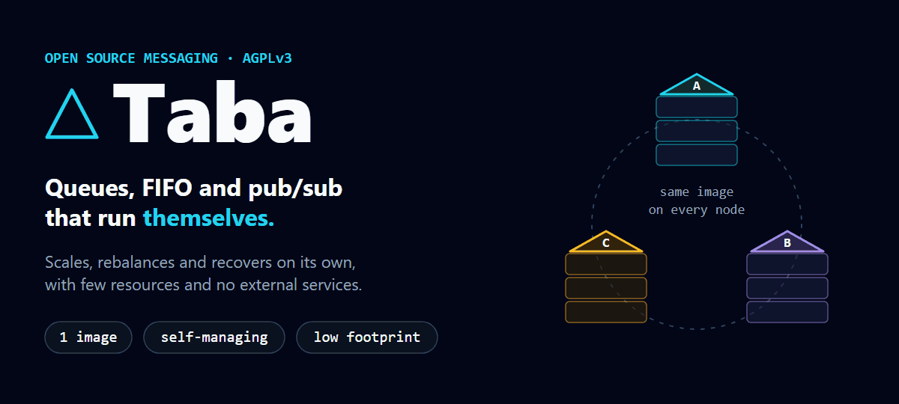
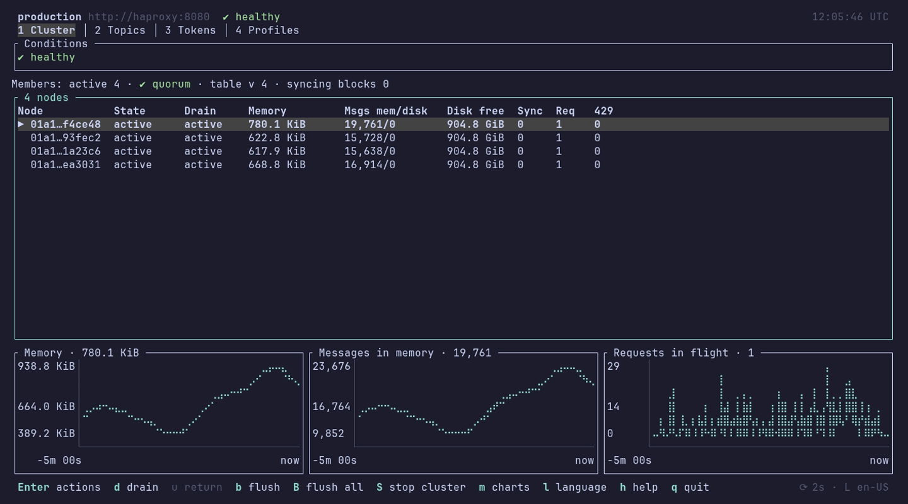
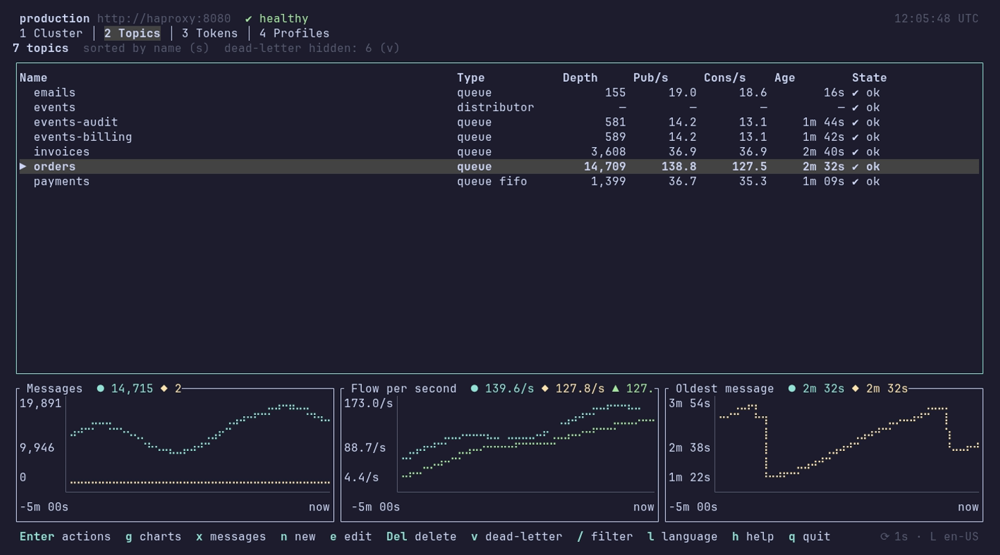
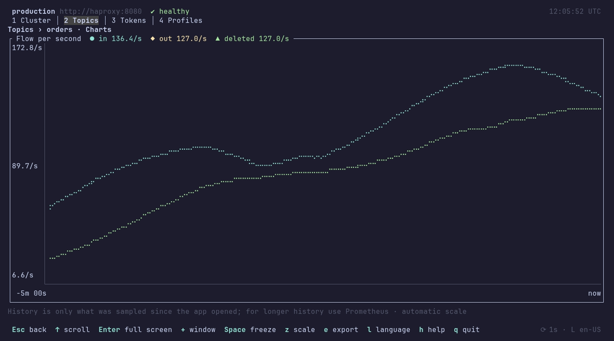
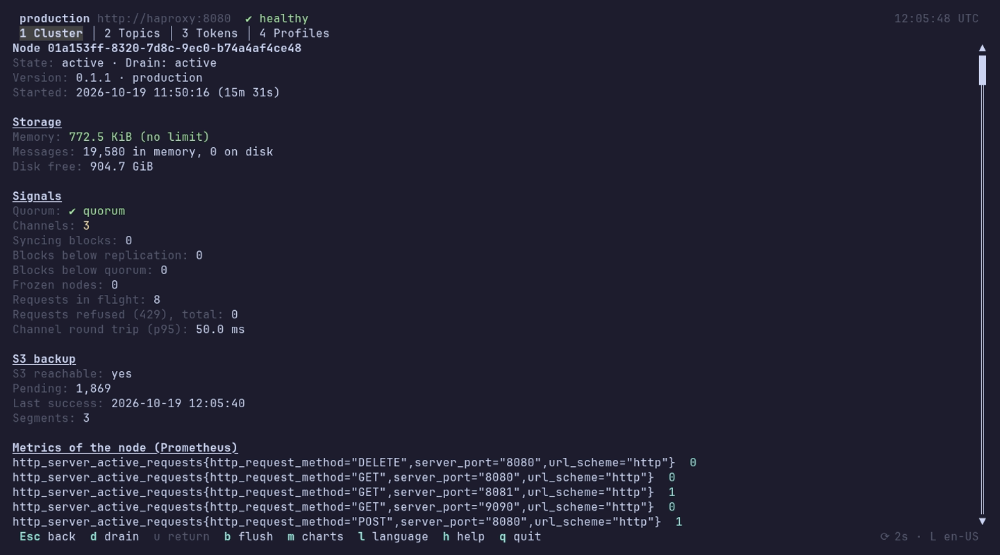
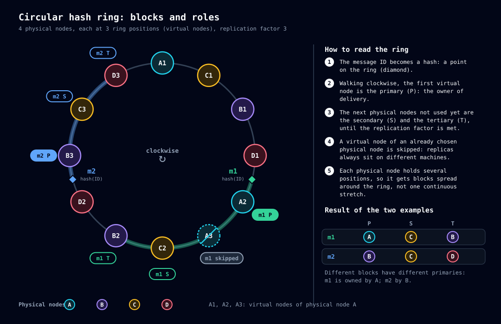
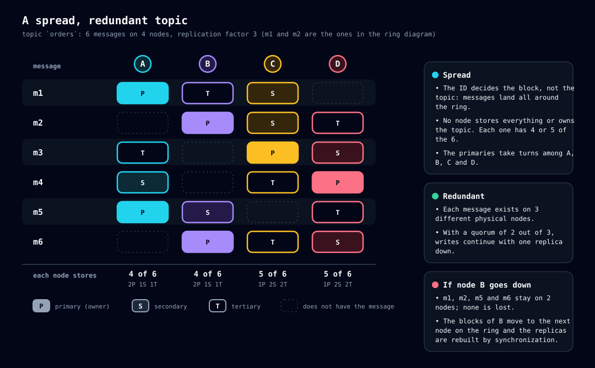

<p align="center">
  
</p>

🇺🇸 **English** | 🇧🇷 [Português (Brasil)](README-pt-BR.md)

[](https://github.com/rafaelpontani/taba/actions/workflows/release.yml) [](https://scorecard.dev/viewer/?uri=github.com/rafaelpontani/taba) [](#verifying-a-release)

**Taba** is a **messaging suite built for efficiency**: queues (like SQS), FIFO queues and pub/sub (like SNS) behind one HTTP API, from **a single Docker image** and with **no external dependencies** (no coordinator, no database, no separate broker). It **manages itself**: add a node and the cluster rebalances; remove one and it hands its work over before leaving, with no downtime; a node that fails is voted out and rejoins by itself. Every message is replicated across nodes and kept in memory, with a **continuous backup to S3**. A **Helm chart**, a **terminal UI** and published packages come with it.

Its goal is to do the work of a message broker with **few resources**: little CPU and memory per message, few machines, and little time spent operating it. If you want to get away from per-message billing, from a cluster of brokers to operate, or from depending on a cloud, Taba is for you.

## Messaging, not streaming

Taba belongs to the class of **message brokers** (RabbitMQ, NATS JetStream, SQS), not to the class of **streaming platforms** (Kafka, Redpanda, Pulsar). They solve different problems, so this README compares Taba only with systems of its own class.

**Why the two cannot be compared.** A streaming platform is an append-only log split into partitions. A consumer does not take a message: it reads the log from a position (an offset) and moves that position forward. That is why it is so fast at writing bytes and replaying them: the broker only appends and reads in sequence, and almost all the work around each message is left to the application:

- **Confirming one message and not the next.** The offset is one number per partition: confirming message 10 confirms 1 to 9. A message that failed in the middle has to be handled by the application, or it blocks the partition.
- **Redelivering only the one that failed, and sending it to a dead-letter queue** after a number of attempts: the application writes this logic (retry topics, a dead-letter topic).
- **Spreading the load:** the number of consumers that work in parallel is capped by the number of partitions; more consumers than partitions stay idle.
- **Expiring a single message, or hiding it for a while** (visibility): the log only expires whole segments, by age or size.

A broker does that work itself, for each message: it records the delivery, waits for the ack, redelivers on the deadline, counts the attempts and moves the message to a dead-letter queue. Measuring both on the same workload compares a log with nothing to do against a broker doing the work the log leaves to the application. The throughput numbers come out of different jobs, so neither one says which system is faster for a queue.

That is why Taba is measured [against brokers of the same class](doc/en-US/38-benchmarks.md#what-the-comparison-measures). If what you need is to replay history or process streams, a streaming platform is the right tool; if you need queues, FIFO and pub/sub with each message handled on its own, Taba is.

## At a glance

| | |
|---|---|
| **Topics** | Queues (one consumer per message, redelivery when not confirmed, dead-letter), **FIFO** queues (order per group and deduplication) and distributors (pub/sub by name prefix) |
| **Cluster** | 3 or more identical nodes, **no coordinator and no single point of failure**. A node that fails is voted out; when it recovers it rejoins by itself |
| **Scaling** | **Horizontal**, in both directions: a new node takes its share of the topics; a leaving node drains first. Autoscaling with KEDA on Kubernetes |
| **Durability** | Each message is confirmed by a **quorum** of nodes (3 copies by default) and backed up **continuously to S3** (AWS, SeaweedFS, MinIO, Ceph...) |
| **Deployment** | One Docker image (58 MB), Docker Compose, or the **Helm chart** at `oci://ghcr.io/rafaelpontani/charts/taba` |
| **Operation** | `taba-cli`, a command line with a **full-screen terminal UI** (cluster health, topics, queue charts), plus Prometheus and OpenTelemetry metrics |
| **Clients** | Plain HTTP from any language; ready connectors for **Java, C#/.NET, Python, PHP, Ruby, Node.js, Go and Rust** (Rust on crates.io, C# on nuget.org), all with no dependencies, plus a driver for the [OpenMessaging Benchmark](connectors/omb/README.md). Applications that use the **AWS SDK (SQS and SNS)** connect with no code change ([gateway](#use-the-aws-sdk-without-changing-your-code)) |
| **License** | Server AGPLv3, connectors Apache-2.0 |

## Why Taba

**Fast by default.** Messages are written to and served from **memory**, replicated across the nodes; the disk only comes in when memory fills up. Consumers read what is already in RAM, with no tuning and no extra configuration. Memory is not split equally: topics with the most reads keep the most messages hot.

**Low operating cost.**
- **Nothing billed per message:** you pay for the machines, nothing else.
- **Little to run:** no broker cluster, no coordinator (ZooKeeper, etcd), no external database. Each node uses about **35 MiB of RAM** while serving the demo load shown below.
- **No one rebalances by hand:** scale out or in and the cluster moves the blocks of topics between nodes by itself, without stopping. Scaling down drains the leaving node first, one node at a time.
- **Backup with almost no S3 cost:** a message consumed before the backup window closes (60 s by default) **never goes to S3**, so fast traffic generates almost no requests to the bucket. What stays is sent in segments.

**Reliable.**
- A write is only confirmed after a **quorum** of nodes holds it in memory.
- Nodes **monitor each other** and vote out the one that fails; it **rejoins by itself** when it comes back.
- The **S3 backup never delays a write** and lets a whole cluster that went down **restore itself** at start (only the last backup window is at risk).
- Every candidate is validated end to end before it becomes a final release: a three-node cluster with nodes crashing, draining and returning, **with no loss of confirmed messages**, plus S3 backup and restore ([docker/validate.sh](docker/validate.sh)).

## Performance

Measured with the [OpenMessaging Benchmark](https://github.com/openmessaging/benchmark) against RabbitMQ (quorum queue), a broker of the same class, on one machine, with the same CPU and memory limits for both and every write confirmed after `fsync`: one node with 4 cores and 3 GB, and a cluster of three nodes with 2 cores and 1.5 GB each. Messages of 1 KB, each one consumed and acknowledged.


- **Throughput:** Taba consumes **2 times** as many messages per second as RabbitMQ on one node (29,200 against 14,800) and **1.8 times** on three nodes (10,000 against 5,600).
- **Latency:** at a fixed 10,000 messages per second, a message takes **2 ms** (p50) from publish to delivery on one node, against 517 ms; on three nodes, 232 ms against 1.2 s, and RabbitMQ does not keep up with the rate there (5,900 per second).
- **Memory at rest:** 21 MB on one node and 87 MB for three nodes, against 227 MB and 534 MB.

NATS JetStream, the other broker of the same class, is in the run too, with the same guarantee (`sync_interval: always`, one fsync per message): on this machine it fails above about 380 messages per second, because each fsync stalls its server and the client gives up after 2 s, so the charts leave it out of the bars and say so. These are numbers of one local run (2026-11-03, a laptop; three rounds of Taba on three nodes at the maximum rate, the median shown), useful to compare the systems with each other, not as absolute numbers. Every chart, the method and how to run it yourself are in the [benchmark guide](doc/en-US/38-benchmarks.md#results).

## See it running

The `taba-cli` terminal UI (`taba-cli tui`) on the Compose cluster, under a demo load ([doc/diagrams/scripts/capture-tui.sh](doc/diagrams/scripts/capture-tui.sh)):

| Cluster health | Topics, with the charts of the selected queue |
|---|---|
|  |  |
| **Publish and consume flow of a queue** | **A node in detail, with its S3 backup** |
|  |  |

Everything the interface does can also be done with one-line commands ([doc/en-US/20b-cli-ui.md](doc/en-US/20b-cli-ui.md)).

## Try it in a minute

With Docker, a three-node cluster (behind an example HAProxy) starts with one command. An init container creates the cluster certificate and the root token, the first node forms the cluster and the other two join:

```bash
docker compose up -d              # three "healthy" nodes in about a minute (public images from Docker Hub)
```

To build the images from this repository instead (for development): `docker compose -f docker-compose.yml -f docker-compose.dev.yml up --build -d`.

Then, with the [`taba-cli`](doc/en-US/20-cli.md), which already ships in the Compose file pointed at the cluster (and with the root token):

```bash
docker compose run --rm taba-cli cluster status -o table             # the three nodes, no conditions
docker compose run --rm taba-cli topic create orders --type queue
echo '{"order": 9001}' | docker compose run --rm -T taba-cli publish orders --stdin
docker compose run --rm taba-cli consume orders --wait 5 --ack      # receive and confirm
```


The client API is also at `http://localhost:8080` for any HTTP client (with `Authorization: Bearer <root token>`; the token is in the `secrets` volume: `docker compose run --rm --entrypoint cat taba-cli /secrets/root-token`; on Windows Git Bash prefix the command with `MSYS_NO_PATHCONV=1`). The Compose file already starts the S3 backup, in a SeaweedFS next to the cluster. `docker compose down -v` deletes everything. HAProxy is just an example: any load balancer works. For a single node, with no cluster, see [Develop on one node](#develop-on-one-node).

**Want a populated cluster to test with?** `docker/seed-demo.sh` deletes everything, starts the cluster, creates a local **`admin` token** (`local-admin`, the way to use Taba: the root token only bootstraps it and is not used outside the containers) and writes it to `docker/.local/admin-token` (ignored by git), points the `local_admin` profile of the `taba-cli` installed on your machine to `http://localhost:8080` and that token (it updates the profile if it exists, otherwise creates it as the default; `--no-profile` skips it), and fills the cluster with queues (balanced, noisy and FIFO) and distributors, 100,000 messages each. Then `taba-cli topic list` just works. Details in [Demo data](doc/en-US/25-testing.md#demo-data-dockerseed-demosh).

> **Careful in production:** stop and update nodes **one at a time** (`docker compose stop` sends `SIGTERM`, which triggers a graceful *drain*). Losing **two nodes in a row** locks a 3-node cluster. Stopping **all** nodes at once loses the messages and topics, unless the S3 backup is on: then the cluster restores itself at start, except for the last backup window. See the [operations guide](doc/en-US/23-operations.md).

## Taba vs. the alternatives

Systems of the same class, the message brokers ([why streaming platforms are not here](#messaging-not-streaming)):

| | **Taba** | SQS + SNS | RabbitMQ | NATS JetStream |
|---|---|---|---|---|
| **Where it runs** | Anywhere: machine, VM, Docker, Kubernetes | AWS only | Wherever you host it, or as a managed service | Wherever you host it, or as a managed service |
| **What to run** | The same image on 3 nodes (1 for dev) | Nothing (managed) | A broker (more nodes for high availability) | A server (3 or more for replicated streams) |
| **Queue and pub/sub** | In the same HTTP API | Two separate services | Queues and exchanges | Subjects, streams and consumers |
| **Work per message** | Ack, redelivery, dead-letter and expiry per message, in the broker | Per message, in the service | Ack, redelivery and dead-letter per message, in the broker | Ack and redelivery per message; no dead-letter queue (an advisory when the attempts run out) |
| **High availability** | Built in: replication by quorum, vote and automatic rejoin | Managed by AWS | Quorum queues on a cluster | Streams replicated by Raft |
| **Scaling** | Add or remove a node: it rebalances by itself | Automatic (managed) | Nodes in the cluster; queue leaders rebalanced by command | Servers in the cluster; streams placed when created and moved by command |
| **Backup** | Continuous to S3, restored at start | Managed by AWS | Definitions export; messages with external tools | Stream snapshots by command |
| **Local development** | The same image as production | An emulator (LocalStack) or an AWS account | The same software | The same software |
| **Billing** | No per-message billing: infrastructure only | Per request | Infrastructure, or a managed plan | Infrastructure, or a managed plan |

## Common questions

**Is Taba a single server?** No. It is a cluster of identical nodes with no coordinator. Three nodes are the recommended minimum for production; one node is the one-node profile, for development.

**Does it scale horizontally?** Yes. The topics are split into blocks on a consistent-hash ring; a new node takes over its share and a node that leaves hands its share over first. On Kubernetes the chart can scale with KEDA.

**What happens if a node goes down?** The others detect it, vote it out and keep serving from the replicas. When it comes back it is re-admitted and synchronized. With 3 nodes the cluster survives one node at a time.

**Does it support S3?** Yes, as a continuous backup of messages, topics and tokens to any S3 that honors conditional writes (AWS S3, SeaweedFS, MinIO, Ceph). The Compose file already starts with it on, in a SeaweedFS. Details in [doc/en-US/33-s3-backup.md](doc/en-US/33-s3-backup.md).

**Is there a Helm chart?** Yes: `oci://ghcr.io/rafaelpontani/charts/taba`, with the S3 backup, Ingress, Prometheus, OpenTelemetry and KEDA autoscaling as options ([Run it on Kubernetes](#run-it-on-kubernetes-helm)).

**Is there a user interface?** Yes, in the terminal: `taba-cli tui` ([See it running](#see-it-running)). There is no web dashboard; for long-term charts, use the Prometheus metrics.

**Can my application that uses Amazon SQS or SNS use Taba?** Yes, with the gateway of the node: you change the endpoint of the SDK and keep the code ([how, with examples in six languages](#use-the-aws-sdk-without-changing-your-code)). It covers SQS (standard and FIFO) and SNS topics that publish to those queues; what is not covered is listed there.

**Is it in production?** Yes. Every version is published to Docker Hub, GHCR, crates.io, nuget.org and GitHub Releases, signed and with provenance ([Verifying a release](#verifying-a-release)).

## Limits

What limits a Taba cluster is the hardware you give it, not a fixed number:

- **How many nodes:** the code has no maximum. Each node takes a share of the hash ring (128 virtual positions per node). The automated tests run clusters of up to 5 nodes, and every candidate release is validated end to end on Compose.
- **How much data:** each message is kept on 3 nodes (`replication.factor`), so the cluster holds about the sum of the nodes' memory and disk divided by 3. Memory can be capped per node (`memory.limit`); above it, messages overflow to the local disk.
- **Message size:** 5 MB by default, configurable per topic.
- **Minimum for production:** 3 nodes. Losing **two nodes in a row** in a 3-node cluster locks the cluster (there is no quorum), and nodes must be stopped and updated **one at a time**.

What Taba does not do:

- **Not a protocol replacement, except the AWS one:** Taba speaks HTTP, and an optional gateway speaks the **SQS and SNS** protocols ([above](#use-the-aws-sdk-without-changing-your-code), with its limits). There is no AMQP or MQTT compatibility yet, so coming from RabbitMQ means switching the client.
- **Not a streaming platform:** stream processing and replaying message history are out of scope ([Messaging, not streaming](#messaging-not-streaming)). For queues and pub/sub, yes; for re-reading the past, no.
- **Out of scope for now:** a web interface, advanced authentication (OAuth/OIDC) and multi-region.
- **Still to come:** the packages of the Java, Node.js, Python, Go, PHP and Ruby connectors (today the files of Node.js, Python, Ruby, Java and PHP are attached to each [Release](https://github.com/rafaelpontani/taba/releases) and Go is read from the repository: [how to install](doc/en-US/21-connectors.md#using-the-connectors-before-they-are-published)). See the [roadmap](doc/en-US/32-roadmap.md) and the [known issues](doc/en-US/36-known-issues.md).

## Develop on one node

For development, one container is enough (a cluster of one, data inside the container, **no authentication and no root token**, so it must never face a network):

```bash
docker run -d --name taba-dev -p 8080:8080 -e TABA_REPLICATION_FACTOR=1 rafaelpontani/taba

# the taba-cli (Linux, macOS, Git Bash; on PowerShell: scripts/install-cli.ps1). It uses http://127.0.0.1:8080 with no token by default
curl -fsSL https://raw.githubusercontent.com/rafaelpontani/taba/main/scripts/install-cli.sh | sh

taba-cli topic create orders --type queue
echo '{"order": 9001}' | taba-cli publish orders --stdin
taba-cli consume orders --wait 5 --ack
docker rm -f taba-dev                  # deletes the node and its data
```

[`scripts/install-cli.sh`](scripts/install-cli.sh) downloads the binary of the latest final Release, checks its SHA256 against `SHA256SUMS` and puts it in `~/.local/bin` (on macOS, Git Bash/MINGW64 and Windows the Releases have no binary, so it runs `cargo install taba-cli` or, without cargo, installs a `taba-cli` that runs the Docker image; [`scripts/install-cli.ps1`](scripts/install-cli.ps1) does the same for PowerShell; `TABA_CLI_VERSION=0.1.1` picks a version, `TABA_CLI_DIR=/usr/local/bin` the folder). Without installing anything, the image works too: `docker run --rm -e TABA_CLI_URL=http://host.docker.internal:8080 rafaelpontani/taba-cli topic list`. Tokens (root and `admin`) exist only with authentication, that is, in the cluster: Compose above or [Helm](#run-it-on-kubernetes-helm) below.

## Run it on Kubernetes (Helm)

The Helm chart is in [deploy/helm/taba/](deploy/helm/taba/). It needs Kubernetes 1.27+ and a default `StorageClass`.

```bash
# a 3-node cluster (the cluster certificate and the root token are generated once, as a Secret)
helm install taba oci://ghcr.io/rafaelpontani/charts/taba -n taba --create-namespace
# or, from a clone of this repository: helm install taba deploy/helm/taba -n taba --create-namespace
helm test taba -n taba
kubectl -n taba get secret taba-secrets -o jsonpath='{.data.root-token}' | base64 -d     # the root token
kubectl -n taba port-forward svc/taba 8080:8080                                          # the API at http://localhost:8080
```

Common setups (all optional, combine as needed):

```bash
# one single node for development (replication.factor=1: no auth, no cluster TLS)
helm install taba deploy/helm/taba -n taba --create-namespace --set config.replication.factor=1

# expose the API through an Ingress (use any maintained Ingress controller)
helm upgrade --install taba deploy/helm/taba -n taba \
  --set ingress.enabled=true --set ingress.className=nginx --set 'ingress.hosts[0].host=taba.example.com' \
  --set 'ingress.hosts[0].paths[0].path=/' --set 'ingress.hosts[0].paths[0].pathType=Prefix'

# S3 backup: a built-in SeaweedFS (testing) or your own bucket (AWS, Ceph, ...)
helm upgrade --install taba deploy/helm/taba -n taba --set seaweedfs.enabled=true
helm upgrade --install taba deploy/helm/taba -n taba --set backup.s3.bucket=my-bucket --set backup.s3.region=us-east-1

# metrics: a ServiceMonitor, a Prometheus or a Telegraf of its own, or OTLP push
helm upgrade --install taba deploy/helm/taba -n taba --set collector.type=prometheus
helm upgrade --install taba deploy/helm/taba -n taba --set otel.endpoint=http://otel-collector:4317

# autoscaling with KEDA (needs KEDA and a Prometheus; never below 3 nodes, scales down one node at a time)
helm upgrade --install taba deploy/helm/taba -n taba \
  --set autoscaling.enabled=true --set autoscaling.prometheus.serverAddress=http://prometheus:9090
```

Get the root token and create an `admin` token with the `taba-cli` (no local install: it runs as a throwaway pod):

```bash
ROOT=$(kubectl -n taba get secret taba-secrets -o jsonpath='{.data.root-token}' | base64 -d | tr -d '\n')

kubectl -n taba run taba-cli --rm -i --restart=Never --image=rafaelpontani/taba-cli:latest \
  --env TABA_CLI_URL=http://taba:8080 --env TABA_CLI_TOKEN="$ROOT" \
  -- token create --name ci-admin --permission admin --token-only
# prints tb_<id>.<secret>: the secret is shown only once, so store it (the cluster keeps just its hash)
```

Only the root token creates, changes or revokes `admin` tokens and stops the cluster; keep it in a vault and use the `admin` (or a narrower one, like `--permission publish,consume --prefix orders-`) day to day. More in [doc/en-US/20-cli.md](doc/en-US/20-cli.md) and [doc/en-US/14-security.md](doc/en-US/14-security.md).

Any node setting goes under `config` in a values file (for example `config.message.max-bytes`). Every value, what the chart creates, the validations it enforces and the safety rules of the autoscaling are in [doc/en-US/34-helm-chart.md](doc/en-US/34-helm-chart.md); the operating modes, each with its bash tests, are in [doc/en-US/35-helm-use-cases.md](doc/en-US/35-helm-use-cases.md).

## The API in four calls

Everything is HTTP. The formal contract (OpenAPI) is not defined yet; the calls below are described in the [client API reference](doc/en-US/16-client-api.md).

| What you want | Call |
|---|---|
| Create a topic (Queue or Distributor) | `POST /topics` |
| Publish a message | `POST /topics/{topic}/messages` |
| Receive messages (long polling of up to 20 s) | `GET /topics/{topic}/messages` |
| Confirm consumption (ack) | `DELETE /topics/{topic}/messages/{id}` |

If the consumer does not confirm in time, the message becomes available again and is redelivered, as in SQS (the default invisibility is 120 s and can be adjusted).

## Connectors

The API is HTTP, so any language can already talk to Taba with the HTTP client it has. On top of that, the project provides **easy-to-use connectors** for the main languages, so you can publish and consume messages in a few lines. They have no external dependencies and run on old versions, up to 15 years old, as long as the platform speaks **TLS 1.2 or higher** (see each one's [base version](doc/en-US/21-connectors.md)):

| Language | Folder | Base version | State | Usage example |
|---|---|---|---|---|
| Java | `connectors/java/` | Java 11 | [ready](connectors/java/README.md) (nine blocking and `CompletableFuture` operations, `subscribe`) | [README](connectors/java/README.md) |
| C# | `connectors/csharp/` | .NET Framework 4.6.1 and .NET 5, 6, 8 and 10 | [ready](connectors/csharp/README.md) (nine async and sync operations, `subscribe`) | [README](connectors/csharp/README.md) |
| Python | `connectors/python/` | 3.9 | [ready](connectors/python/README.md) (synchronous and `asyncio` clients, `subscribe`) | [README](connectors/python/README.md) |
| PHP | `connectors/php/` | 5.6 | [ready](connectors/php/README.md) (nine operations, `subscribe`, consuming with a handler; one thread, so no automatic renewal of the invisibility) | [README](connectors/php/README.md) |
| Ruby | `connectors/ruby/` | 2.1 | [ready](connectors/ruby/README.md) (nine operations, blocks, `subscribe`, `CancelToken`) | [README](connectors/ruby/README.md) |
| Node.js | `connectors/node/` | 18 | [ready](connectors/node/README.md) (nine `Promise` operations, `subscribe`, types included) | [README](connectors/node/README.md) |
| Go | `connectors/go/` | 1.7 | [ready](connectors/go/README.md) (nine operations with `context.Context`, `Subscribe`) | [README](connectors/go/README.md) |
| Rust | `connectors/rust/client/` | 1.70 | synchronous ready ([README](connectors/rust/client/README.md)) | [example](connectors/rust/client/README.md) |

The eight ready connectors (Java, C#, Python, PHP, Ruby, Node.js, Go and Rust) have the same operations, the same defaults and the same errors: the [contract tests](connectors/contract/README.md) run one scenario through each of them against a real node, each in its oldest supported runtime, and then make them read each other's messages (PHP is the one difference: it runs one thread, so it cannot renew the invisibility while a handler runs). Publishing and consuming with an automatic ack (the message is deleted only if the handler does not fail):

```java
// Java
try (TabaClient client = new TabaClient(TabaConfig.of("http://localhost:8080").token(token))) {
    client.publishText("orders", "hello");
    client.consume("orders", new ConsumeOptions().waitTime(20), ctx -> System.out.println(ctx.getMessage().getBodyText()));
}
```

```csharp
// C#
using (var client = new TabaClient(new TabaConfig("http://localhost:8080") { Token = token }))
{
    await client.PublishJsonAsync("orders", new { order = 9001 });
    await client.ConsumeAsync<Order>("orders", async ctx => await ProcessAsync(ctx.Body));
}
```

```python
# Python
with Client("http://localhost:8080", token=token) as client:
    client.publish_json("orders", {"order": 9001})
    client.consume_with("orders", lambda ctx: print(ctx.message.body_text), wait_time=20)
```

```js
// Node.js
const client = new TabaClient({ baseUrl: 'http://localhost:8080', token });
await client.publishJson('orders', { order: 9001 });
await client.consumeWith('orders', { waitTime: 20 }, async ({ message }) => console.log(message.bodyText));
```

```go
// Go
client, _ := taba.NewClient(taba.Config{BaseURL: "http://localhost:8080", Token: token})
client.PublishJSON(ctx, "orders", map[string]int{"order": 9001})
client.ConsumeWith(ctx, "orders", &taba.ConsumeOptions{WaitTime: taba.Int(20)}, func(c *taba.MessageContext) error {
    fmt.Println(c.Message.BodyText())
    return nil // the message is deleted; returning an error keeps it
})
```

```php
// PHP
$client = new TabaClient(new TabaConfig('http://localhost:8080', $token));
$client->publishJson('orders', array('order' => 9001));
$client->consumeWith('orders', function ($context) { echo $context->message->bodyText(); }, array('waitTime' => 20));
```

```ruby
# Ruby
client = Taba::Client.new('http://localhost:8080', token: token)
client.publish_json('orders', order: 9001)
client.consume_with('orders', wait_time: 20) { |context| puts context.message.body_text }
```

```rust
// Rust (feature "serde")
client.publish_object("orders", &Order { number: 9001 })?;
client.consume_typed::<Order, _>("orders", &ConsumeOptions::default(), |d| {
    process_order(&d.body)?;
    Ok(())
})?;
```

Each one also has `subscribe` (the whole consume loop, until it is cancelled) and batch calls (`publishBatch`, `ackBatch`, `changeVisibilityBatch`); see its README.

The `taba-cli`, the client command line ([connectors/rust/cli](connectors/rust/cli/README.md)), is ready and is the shortest way to try a cluster.

**OpenMessaging Benchmark driver.** [`connectors/omb`](connectors/omb/README.md) is a driver for the [OpenMessaging Benchmark](https://github.com/openmessaging/benchmark), written on the Java connector, so Taba can be measured with the same tool and the same workloads as RabbitMQ and NATS. It is what the [benchmark](#performance) uses.

**Terraform and OpenTofu provider.** [`connectors/terraform`](connectors/terraform/README.md) manages queues, distributors and access tokens as code (`rafaelpontani/taba`), with plan, drift detection, import, a guard against removing a queue that still holds messages (`force_destroy`) and an optional `create_or_update` that takes over what already exists. It is on the [Terraform Registry](https://registry.terraform.io/providers/rafaelpontani/taba) (the OpenTofu Registry is reviewing it), and its zips also come with each [Release](https://github.com/rafaelpontani/taba/releases) ([the guide](doc/en-US/40-terraform.md)).

**Pulumi provider.** [`connectors/pulumi`](connectors/pulumi/README.md) is the same provider for Pulumi, with SDKs for TypeScript/JavaScript, Python, .NET and Go (`@rafaelpontani/pulumi-taba`, `pulumi-taba`, `Taba.Pulumi` and a Go module): queues, distributors and access tokens as code, with `preview`, drift detection, import and the same `forceDestroy` and `createOrUpdate`. It is packaged with each [Release](https://github.com/rafaelpontani/taba/releases) and waits for the setup of its package registries ([the guide](doc/en-US/41-pulumi.md)).

Other languages (C and C++ are deferred, with no date) use their own HTTP client. The design is in [the connectors guide](doc/en-US/21-connectors.md).

> The base versions are proposals and may change until confirmed (pending item D68, see [pending items](doc/en-US/31-pending-items.md)).

## Use the AWS SDK without changing your code

An application that already sends to **Amazon SQS** or publishes to **Amazon SNS** topics that feed SQS queues can run on Taba by **changing only the endpoint**. The node has a gateway that speaks the SQS and SNS wire protocols (the JSON and Query protocols, SigV4) and turns each call into a call to the client API, so the queues are ordinary Taba queues: replicated by quorum, backed up to S3 and reachable by the native API and the connectors as well. It is part of the node and of the image, **off by default**, and SQS and SNS are served on **one port**, `9324`.

**Advantages**
- **No code change, no new client:** the SDK you already use (C#, Java, Rust, Go, Python, Node.js, in current and in older versions) keeps working. The same scenarios run against the native SDK of each language in [the gateway contract tests](connectors/gateway-contract/README.md), and against ElasticMQ and moto to show that the tests are right.
- **Leave AWS without rewriting:** no billing per request, and the same queues run on your machine, on a VM or on Kubernetes. The local development is the same image as production, with no emulator.
- **Nothing more to run:** the gateway is inside every node. There is no extra service, no state of its own, and any node serves any call.
- **One system, two doors:** a message sent through the SDK is read by a native connector, and the other way around. Standard and **FIFO** queues, delay, dead-letter, message attributes, long polling and the AWS error codes are supported ([the full list](doc/en-US/39-gateway.md#what-is-supported)).

**Limitations** (each one is an explicit error, never silently ignored; all of them in [doc 39](doc/en-US/39-gateway.md#differences-from-sqs))
- SQS and SNS only. Amazon SNS delivers to **SQS queues only**: no HTTP, e-mail, SMS or Lambda subscribers.
- `RawMessageDelivery=true` and `FilterPolicy` on a subscription are **refused**, FIFO **topics** are refused, and a topic holds up to 20 subscriptions. The notification is not signed, so an application that verifies the SNS signature fails.
- A subscription is a name **prefix**: subscribing `orders` also copies to `orders-eu`, and a topic and a queue cannot share a name.
- The access keys are static and listed in a file (`gateway.aws.credentials-file`); temporary IAM role credentials are not accepted.
- There is no IAM, KMS or CloudWatch here: the queue policy and the encryption attributes are accepted and ignored.

### Run it

With the [Docker Compose cluster](#try-it-in-a-minute) the gateway is **already on** (SQS and SNS on `localhost:9324`), with a demo access key you can use right away:

```bash
docker compose up -d
export AWS_ENDPOINT_URL_SQS=http://localhost:9324 AWS_ENDPOINT_URL_SNS=http://localhost:9324
export AWS_ACCESS_KEY_ID=taba AWS_SECRET_ACCESS_KEY=taba-secret AWS_REGION=us-east-1
```

That key acts with the root token and is only for trying Taba (see [the access keys](doc/en-US/39-gateway.md#the-access-keys)). Or one node for development (no authentication, so any access key is accepted; it must never face a network):

```bash
docker run -d --name taba-dev -p 8080:8080 -p 9324:9324 \
  -e TABA_REPLICATION_FACTOR=1 -e TABA_GATEWAY_SQS_ENABLED=true -e TABA_GATEWAY_SNS_ENABLED=true \
  rafaelpontani/taba
```

Point the SDK at it. Current SDKs read the endpoint from the environment, so **the code does not change at all**:

```bash
export AWS_ENDPOINT_URL_SQS=http://localhost:9324
export AWS_ENDPOINT_URL_SNS=http://localhost:9324
export AWS_ACCESS_KEY_ID=test AWS_SECRET_ACCESS_KEY=test AWS_REGION=us-east-1   # any value while the authentication is off
```

Older SDK versions (before the endpoint variable) take it in the code, as every example below does. In a cluster the authentication is on: each application gets an access key that maps to a Taba token (its permissions and topic prefixes) in a credentials file mounted on the nodes. With the [Helm chart](#run-it-on-kubernetes-helm): `kubectl create secret generic aws-keys --from-file=credentials.json` and `helm install taba oci://ghcr.io/rafaelpontani/charts/taba --set gateway.sqs.enabled=true --set gateway.sns.enabled=true --set gateway.credentialsSecret.name=aws-keys --set gateway.sqs.publicUrl=https://queues.example.com`. The file format, the permissions and the settings are in [the gateway guide](doc/en-US/39-gateway.md#the-access-keys) and [the configuration](doc/en-US/22-configuration.md#gateway-for-the-aws-sdks).

### Connect

In every example the queue is called `orders`: that is the SQS queue name and also the name of the Taba topic (queue), so `taba-cli consume orders` reads the same messages. SQS does not use the name in the message calls, it uses the **queue URL** (`QueueUrl`). You get it from the name: `CreateQueue` (creates the queue, or returns the one that exists) or `GetQueueUrl` return `http://localhost:9324/000000000000/orders`, and that URL is what goes in `SendMessage`, `ReceiveMessage` and `DeleteMessage`. The `QueueArn` (`arn:aws:sqs:us-east-1:000000000000:orders`) is the identification of the queue that SNS uses in the subscription.

```python
# Python (boto3): create a queue, send, receive and delete
import boto3

sqs = boto3.client("sqs", region_name="us-east-1", endpoint_url="http://localhost:9324")
url = sqs.create_queue(QueueName="orders")["QueueUrl"]   # CreateQueue takes the NAME and returns the URL; the other calls use the URL
sqs.send_message(QueueUrl=url, MessageBody='{"order": 9001}')
for m in sqs.receive_message(QueueUrl=url, WaitTimeSeconds=5).get("Messages", []):
    print(m["Body"])
    sqs.delete_message(QueueUrl=url, ReceiptHandle=m["ReceiptHandle"])
```

SNS publishing to the same queue:

```python
sns = boto3.client("sns", region_name="us-east-1", endpoint_url="http://localhost:9324")
topic = sns.create_topic(Name="events")["TopicArn"]
queue_arn = sqs.get_queue_attributes(QueueUrl=url, AttributeNames=["QueueArn"])["Attributes"]["QueueArn"]   # arn:aws:sqs:us-east-1:000000000000:orders
sns.subscribe(TopicArn=topic, Protocol="sqs", Endpoint=queue_arn)   # the queue "orders" now gets every publication
sns.publish(TopicArn=topic, Message="hello", Subject="greeting")
```

```js
// Node.js (AWS SDK v3)
import { SQSClient, CreateQueueCommand, SendMessageCommand, ReceiveMessageCommand } from "@aws-sdk/client-sqs";

const sqs = new SQSClient({ region: "us-east-1", endpoint: "http://localhost:9324" });
const { QueueUrl } = await sqs.send(new CreateQueueCommand({ QueueName: "orders" }));   // the name goes in, the URL comes out
await sqs.send(new SendMessageCommand({ QueueUrl, MessageBody: "hello" }));
const { Messages } = await sqs.send(new ReceiveMessageCommand({ QueueUrl, WaitTimeSeconds: 5 }));
```

```java
// Java (AWS SDK v2)
SqsClient sqs = SqsClient.builder()
    .region(Region.US_EAST_1)
    .endpointOverride(URI.create("http://localhost:9324"))
    .build();
String url = sqs.createQueue(r -> r.queueName("orders")).queueUrl();   // the name goes in, the URL comes out
sqs.sendMessage(r -> r.queueUrl(url).messageBody("hello"));
```

```csharp
// C# (AWSSDK.SQS)
var sqs = new AmazonSQSClient(new AmazonSQSConfig { ServiceURL = "http://localhost:9324", AuthenticationRegion = "us-east-1" });
var url = (await sqs.CreateQueueAsync("orders")).QueueUrl;   // the name goes in, the URL comes out
await sqs.SendMessageAsync(new SendMessageRequest { QueueUrl = url, MessageBody = "hello" });
```

```go
// Go (aws-sdk-go-v2)
cfg, _ := config.LoadDefaultConfig(ctx, config.WithRegion("us-east-1"))
client := sqs.NewFromConfig(cfg, func(o *sqs.Options) { o.BaseEndpoint = aws.String("http://localhost:9324") })
created, _ := client.CreateQueue(ctx, &sqs.CreateQueueInput{QueueName: aws.String("orders")})   // the name goes in, the URL comes out
client.SendMessage(ctx, &sqs.SendMessageInput{QueueUrl: created.QueueUrl, MessageBody: aws.String("hello")})
```

```rust
// Rust (aws-sdk-sqs)
let shared = aws_config::defaults(BehaviorVersion::latest()).region("us-east-1").load().await;
let conf = aws_sdk_sqs::config::Builder::from(&shared).endpoint_url("http://localhost:9324").build();
let client = aws_sdk_sqs::Client::from_conf(conf);
let url = client.create_queue().queue_name("orders").send().await?.queue_url().unwrap().to_string();   // the name goes in, the URL comes out
client.send_message().queue_url(&url).message_body("hello").send().await?;
```

And the same message with no SDK at all, through the native API (the body of a message sent without attributes is stored as it is):

```bash
taba-cli consume orders --wait 5 --ack
```

## How it works inside

**Taba** comes from **T**opics, **A**synchronous, **B**alanced and **A**utonomous (in Portuguese: **T**ópicos **A**ssíncronos **B**alanceados e **A**utogeridos). In Tupi, *taba* is the **village**: each node is a hut, the cluster is the village, and messages move between them without you having to take care of it.


| Letter | Promise | How Taba delivers |
|---|---|---|
| **T**opics | A lean API, with queue (single delivery) and prefix-based distribution in one place. | You send to a topic with HTTP verbs and choose the type: Queue Topic or Distributor Topic. |
| **A**synchronous | The producer sends and moves on. | A write is confirmed in memory by a configurable number of nodes; the disk only comes in on overflow. |
| **B**alanced | No node carries everything alone. | A consistent-hash ring splits topics into blocks and replicates them across several nodes. |
| **A**utonomous | No coordinator and no manual operation. | Nodes discover each other, monitor each other and vote out whoever fails. When the node returns, it is re-admitted. |



*The hash ring splits the work among the nodes.*



*A topic spread across the cluster and replicated: if a node goes down, the village stays up.*

## Verifying a release

Every version is built and published only by the [release workflow](.github/workflows/release.yml), from the commit of its tag, after every test passes. Each artifact can be checked independently, with no trust in this repository's word:

| Artifact | Where | Proof |
|---|---|---|
| Images `taba` and `taba-cli` | Docker Hub (`rafaelpontani/…`) and GHCR (`ghcr.io/rafaelpontani/…`) | SLSA provenance, SBOM, cosign signature; label `org.opencontainers.image.revision` = commit |
| Binaries, NuGet packages, chart | [GitHub Releases](https://github.com/rafaelpontani/taba/releases) (immutable) | `SHA256SUMS` and an attestation for each file |
| Crates `taba-client`, `taba-cli` | crates.io | Trusted Publishing from the workflow; `.cargo_vcs_info.json` with the commit |
| Packages `Taba.Client*` | nuget.org | Trusted Publishing; `<repository commit>` and the Release link in the `.nuspec`; SourceLink |
| Helm chart | `oci://ghcr.io/rafaelpontani/charts/taba` | cosign signature and attestation; `appVersion` = the version |

```bash
# images (any tag: 0.1.0, 0.1, 0, latest... all point to the same digest)
gh attestation verify oci://ghcr.io/rafaelpontani/taba:latest -R rafaelpontani/taba
cosign verify ghcr.io/rafaelpontani/taba:latest \
  --certificate-identity-regexp '^https://github.com/rafaelpontani/taba/.github/workflows/release.yml@refs/heads/(main|release)$' \
  --certificate-oidc-issuer https://token.actions.githubusercontent.com

# files of a Release
VERSION=0.1.1
gh release download "v$VERSION" -R rafaelpontani/taba && sha256sum -c SHA256SUMS
gh attestation verify "taba-$VERSION-x86_64-unknown-linux-musl" -R rafaelpontani/taba

# the commit inside the binary
docker run --rm rafaelpontani/taba:latest --version     # taba 0.1.1 (commit <sha>)
```

Versions: `main` publishes finals (`v0.1.0`) and `release` publishes candidates (`v0.1.0-rc.N`). The floating tags (`v0.1`, `v0`, `latest`, `0.1-rc`, `rc`...) only move to the highest version of their line. The full flow is in [CI/CD and releases](doc/en-US/27-ci-cd.md); to report a vulnerability, see [SECURITY.md](SECURITY.md).

## Documentation

The documentation lives in [doc/](doc/README.md), one folder per language: start at [doc/en-US/README.md](doc/en-US/README.md) for English (AI-friendly summaries are in [llms.txt](llms.txt) and [doc/en-US/llms.txt](doc/en-US/llms.txt)) or at [doc/pt-BR/README.md](doc/pt-BR/README.md) for Brazilian Portuguese. Both folders have the same content and every change goes to all of them. Other languages will be added as sibling folders. The code, identifiers, routes, configuration keys and error codes are in English.

## License

- **Server** (`crates/`, the `taba` image, the Helm chart and the rest of the repository): [GNU AGPLv3](LICENSE).
- **Connectors** (`connectors/`: `taba-client`, `taba-cli` and the `Taba.Client*` packages): [Apache-2.0](connectors/LICENSE).

Contributions are welcome: see [CONTRIBUTING.md](CONTRIBUTING.md). A pull request is merged after its author signs the [CLA](CLA.md), once.
