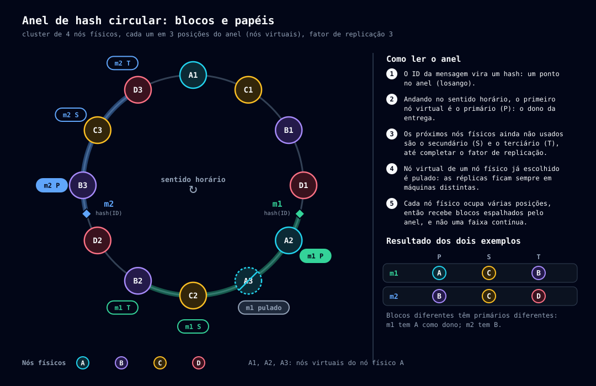
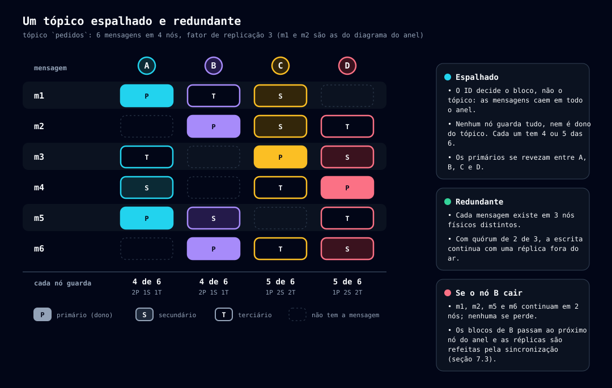

# Particionamento e replicação

[← Índice](README.md)

## 7. Particionamento e replicação de mensagens
 
### 7.1 Hash circular (consistent hashing)

*Como uma mensagem chega ao primário, ao secundário e ao terciário. Fonte: [gerar-hash.mjs](diagramas/scripts/gerar-hash.mjs).*

- O cluster particiona as mensagens em **blocos de mensagem**, distribuídos em um **anel de hash circular** (consistent hashing).
- Cada nó físico pode representar múltiplos **nós virtuais** no anel; o **número de nós virtuais é configurável**, melhorando a distribuição dos blocos entre os nós físicos.
- Os nós responsáveis por um bloco (primário, secundário, terciário etc.) são sempre **nós físicos distintos**: ao percorrer o anel em busca das réplicas, posições de nós virtuais de um nó físico já escolhido são puladas.
- O **primário** do bloco é o **dono da entrega** das mensagens dele ([13-entrega-de-mensagens.md](13-entrega-de-mensagens.md), seção 12.7). Qualquer nó calcula o primário de uma mensagem a partir do ID e da tabela de membros.
- Quando um nó sobe, ele assume blocos de mensagem como **primário**, **secundário**, **terciário** etc., conforme o **número de réplicas persistentes** exigido para uma mensagem. **Padrão: 3 réplicas.**
- **O tópico fica o mais espalhado e redundante possível.** O bloco é decidido pelo **ID da mensagem**, não pelo tópico: as mensagens de um mesmo tópico caem em todo o anel, cada uma com seu primário e suas réplicas em nós físicos distintos. Nenhum nó guarda o tópico inteiro nem é dono dele (a exceção é administrativa: uma fila volátil tem um **nó gestor**, escolhido pelo hash do `id` do tópico no mesmo anel, que só decide a exclusão por ociosidade — [15-topicos-distribuidor.md](15-topicos-distribuidor.md), seção 14.5), e a perda de um nó deixa cada mensagem ainda em pelo menos `replication.factor − 1` nós.

*O tópico `pedidos` em 4 nós, fator 3: os papéis de cada nó em cada mensagem (m1 e m2 são as do diagrama do anel). Fonte: [gerar-hash.mjs](diagramas/scripts/gerar-hash.mjs).*
### 7.2 Procedimento de recebimento de uma mensagem (registro + commit, quórum mínimo)

*Fonte: [recepcao.json](diagramas/fonte/recepcao.json).*

1. **Ler a configuração:** número total de réplicas (`replication.factor`, padrão 3) e o **quórum mínimo de confirmação** (`write.quorum`, padrão maioria simples de `replication.factor` — ex.: 2 em 3). O quórum **sempre conta o primário como confirmação obrigatória**, mais `write.quorum - 1` de quaisquer outras réplicas — nunca um quórum formado só por secundário/terciário. Motivo: só o primário decide o que é entregável (seção 12.7); se ele ficar de fora do quórum, a escrita pode ser considerada "durável" antes de estar visível a qualquer consumidor.
2. A partir do **GUID v7 (ID)** da mensagem, gerado pelo nó coordenador ao receber a requisição (antes da fase de registro) e ordenável por tempo, calcular no anel de hash circular **qual bloco de mensagens** deve persistir a mensagem, determinando os nós responsáveis: primário, secundário, terciário etc.
3. **Entregar a todos os nós responsáveis** (as `replication.factor` réplicas, não só o quórum) um pedido de **registro** da mensagem.
4. Assim que o **quórum de confirmações do registro** é atingido (primário incluso), o coordenador **decide commitar**: chama a rota de commit nos nós do quórum e, em paralelo — sem bloquear a resposta ao cliente — continua o registro + commit nas réplicas restantes.
5. Com o **commit confirmado no quórum** (primário incluso), **retornar o ID da mensagem** ao cliente. As réplicas fora do quórum ainda podem estar pendentes nesse instante.
6. **Falha antes do quórum ser fechado:** repetir a chamada ao nó que falhou conforme a configuração de retry (`write.retry.attempts`, `write.retry.backoff`). Esgotados os retries **sem que o quórum (com o primário) tenha sido atingido**, retornar **erro ao cliente** e enviar **rollback** a todos os nós que já haviam confirmado o registro, para descartar o registro pendente. Um registro sem commit também expira sozinho após `write.pending.ttl`; o rollback só acelera a liberação de recursos. **Antes do quórum decidir, a operação pode sempre ser abortada** — nenhum nó efetivou nada de forma que outro dependa dele.
7. **Falha depois do quórum decidido** (nas réplicas restantes, seja na fase de registro ou de commit delas): a decisão de commitar **não volta atrás**, mesmo que réplicas fora do quórum ainda estejam falhando ou pendentes — **nunca há rollback** nessa altura, pois o quórum (com o primário) já pode ter efetivado a mensagem. O coordenador **insiste** (registro + commit) nas réplicas que faltam, dentro de um **teto de tempo configurável** (`write.commit.timeout`):
   - **Confirmado dentro do teto:** a réplica passa a contar como durável normalmente, sem novo aviso ao cliente (a resposta já foi dada no passo 5).
   - **Teto esgotado sem confirmação em alguma réplica:** o bloco fica temporariamente **abaixo do fator de replicação pleno** (mas nunca abaixo do quórum, que já está garantido) — isso é tratado como o mesmo tipo de **evento isolado** das demais falhas pontuais deste protocolo (princípio 6, [07-principios-design.md](07-principios-design.md)), não uma falha de saúde do nó: gera um evento de observabilidade (`under-replicated`, não crítico), e o coordenador continua tentando em segundo plano — o commit é idempotente, repeti-lo não tem custo de correção.
> Este mesmo protocolo de duas fases (registro → commit) é reutilizado para registro e desregistro de nó (seção 6.2/6.3), para a definição de tópicos (seção 3.3) e para a recuperação de mensagens de um nó que retorna ao cluster (seção 6.6) — **porém esses três usos exigem confirmação de todos os nós, sem quórum reduzido**: são operações raras e pesadas (afetam o roteamento do anel inteiro ou a tabela de tópicos inteira), sem o caminho crítico de latência que justifica o quórum nas mensagens. A distinção entre rollback (só antes da decisão) e retry com teto configurável (depois da decisão) vale igualmente nos dois casos — só muda **quando** a decisão é tomada: no quórum (mensagens) ou em todos os nós (cluster/tópicos).
 
### 7.3 Entrada de um nó e sincronização distribuída de blocos
 
Quando um nó novo assume responsabilidade sobre um ou mais blocos do anel (como primário, secundário etc.), a sincronização é **escopada apenas aos blocos afetados** — o restante do cluster continua operando normalmente, sem bloqueio global.
 
Como a mesma mensagem existe em várias réplicas (uma por nó responsável pelo bloco), a sincronização **puxa os dados de forma distribuída entre todos os nós que já possuem o bloco**, em vez de sobrecarregar um único nó de origem. O procedimento:
 
1. O nó novo solicita a **todos os nós responsáveis pelo bloco** a lista de **IDs de mensagens** que cada um possui para aquele bloco (`GET /cluster/blocks/{id}/ids`, um stream NDJSON ordenado por ID, seção 8.2.1 de [06-api.md](06-api.md)). Uma mensagem já deletada (ack concluído) antes desta listagem **não é um caso especial**: ela simplesmente não aparece em nenhuma lista, porque cada nó a apaga ao confirmar o ack (seção 12.4 de [13-entrega-de-mensagens.md](13-entrega-de-mensagens.md)) — não há tombstone permanente a manter.
2. Consolida as respostas em uma lista única de IDs a sincronizar, pela **união** das listas recebidas (não a interseção — uma réplica pode ter recebido uma mensagem que outra ainda não recebeu). Como cada stream já vem ordenado, a união é um *merge* ordenado dos streams, sem materializar todas as listas em memória.
3. Com a lista de IDs em mãos, **divide-a em faixas** e **distribui (balanceia) as chamadas** `GET /cluster/blocks/{id}/messages?from=&to=` entre os nós de origem, cada uma devolvendo um stream com as mensagens da faixa, até obter todas as mensagens do bloco (as linhas dos streams são gravadas no log de carga, passo 4) — evitando concentrar a carga de leitura em um único nó. O que faltar numa faixa é buscado em outro nó, e a rota por ID único (`/cluster/blocks/{id}/messages/{messageId}`) é o último recurso. Um stream cortado é retomado pelo último ID lido.
4. **Log de carga e log de eventos.** Enquanto o nó se sincroniza ele já consta na tabela de membros, então continua recebendo o protocolo normal do cluster, mas **nada é processado na hora**: tudo o que chega de outros nós é **descarregado em arquivos de log**, em disco, e processado depois, em sequência. São dois logs, em `${storage.dir}/_sync/`, que nunca se misturam:
   - **Log de carga** (`carga.log`): as linhas dos streams de sincronização (definições de tópico do passo de tópicos e mensagens dos blocos, passos 1 a 3). É a base: o estado de outros nós em algum instante do passado.
   - **Log de eventos** (`eventos.log`): os eventos ao vivo, **na ordem de chegada** — registro, commit e rollback de definições de tópico, de mensagens, de invisibilidade e de acks. O nó **confirma o registro depois de gravar no log** (por isso conta para o quórum normalmente), mas só aplica o evento no replay. É o que antes era o "log de deleções pendentes", agora para todos os tipos de evento.
5. **Processamento em sequência.** O nó processa os logs numa ordem fixa, e só termina quando tudo foi processado:
   1. **Carga de tópicos:** aplica o `carga.log` das definições de tópico. Os tópicos vêm antes de qualquer mensagem, então uma mensagem de um tópico que o nó ainda não conhecia não é problema: ela está no log de eventos e só é aplicada depois.
   2. **Carga de blocos:** aplica o `carga.log` das mensagens, bloco a bloco.
   3. **Replay do log de eventos**, do primeiro ao último, **por cima** da base. O replay é idempotente e o evento vence a carga: aplicar de novo um evento que a carga já refletia não muda nada (criar o que existe pelo `id`, gravar o mesmo `invisibleUntil`, apagar o que não existe), e um ack ou uma remoção no log apaga o que a carga trouxe velho. Por isso o `commit` não precisa carregar nada além do que a operação já carrega: a ordem de aplicação (base, depois eventos) é que garante o resultado, e o commit de tópico não precisa levar a definição completa.
   4. **Sem mudança de membros no meio:** o cluster não aceita outra entrada, saída ou rebalanceamento enquanto um nó que entrou ainda não ficou pronto (seção 6.8 de [04-cluster.md](04-cluster.md)). Os blocos do nó, portanto, não mudam durante a sincronização, e o log de eventos não traz mudanças da tabela de membros.
   5. **Verificação final:** com o log quase vazio, o nó **repete as listagens** (passo 1 desta seção e a de tópicos) só para o que pretende manter e descarta o que já não aparece em nenhum nó de origem. Cobre a janela residual: um ack cujo pedido nunca chegou a este nó, porque os nós responsáveis foram calculados um instante antes de ele assumir a posição no anel.
   6. **Troca para o modo normal (*cutover*):** ao começar o replay, o processador guarda **em memória a posição** (a linha) em que está no log de eventos e avança até o fim; o log continua recebendo linhas novas enquanto isso. Quando o processador **alcança o fim**, a entrada de eventos no log é **fechada** e, no mesmo instante e sob o mesmo controle (nenhum evento cai entre os dois modos), o nó passa a **processar os eventos em tempo real**, direto, na sequência de chegada. O log é então **descartado**, junto com o log de carga, e o nó fica íntegro.
6. **Pronto.** Só depois do passo 5 (cargas aplicadas, log processado até o fim e descartado, verificação final feita) o nó fica **íntegro** e **pronto**: reconstrói as listas de prontos e de invisíveis dos blocos de que é primário ([14-invisibilidade.md](14-invisibilidade.md), seção 13.7), recebe o estado inicial dos sinais do canal ([13-entrega-de-mensagens.md](13-entrega-de-mensagens.md), seção 12.9), passa a assumir as filas voláteis que lhe cabem ([15-topicos-distribuidor.md](15-topicos-distribuidor.md), seção 14.6) e `/health/ready` passa a responder com sucesso. Até lá o nó **não coordena e não entrega mensagens**, e só participa do cluster gravando no log. As chamadas das rotas de cliente que chegam a ele são **repassadas a outro nó** (seção 6.9 de [04-cluster.md](04-cluster.md)), então o cliente não vê erro. **Falha da sincronização:** se o disco enche ou falha, ou o log passa de `cluster.sync.log.max-bytes`, o nó entra em **falha**, sinaliza isso ao cluster, e os demais ficam liberados para votar o desregistro dele (seção 6.3 de [04-cluster.md](04-cluster.md)). Sem nó de origem para uma carga, o nó tenta de novo e, esgotado `cluster.sync.timeout`, cai no mesmo caminho.

> Mesmo com os passos 4 e 5, resta uma janela mínima — um ack cujo pedido nunca chegou a este nó, nem ao log, por ter sido calculado antes de ele assumir a posição no anel e concluído entre a verificação final e a troca para o modo normal — que não é impedida por construção. É tratada como o mesmo tipo de exceção rara da "falha ao recuperar uma mensagem específica" abaixo: um evento observável, não uma falha de saúde do nó, e não justifica manter uma estrutura de tombstones só para fechar esse instante.
**Falha ao recuperar uma mensagem específica:** se, durante a sincronização, uma mensagem constante na lista de IDs **não for encontrada em nenhum nó/log** (nenhuma réplica consegue fornecê-la), isso **não compromete a saúde do nó** nem interrompe a sincronização do bloco — apenas gera um **evento de falha de perda de mensagem** (mensagem inconsistente/perdida) para investigação, e a sincronização segue para as demais mensagens. Esse evento é o que permite, mais tarde, que um nó que retorne ao cluster (seção 6.6) reconheça e recupere mensagens que estavam registradas como perdidas.
 
> Para blocos muito grandes, relistar todos os IDs a cada sincronização pode ser custoso; uma otimização futura (ex.: merkle tree / hashing incremental por faixa) pode evitar esse custo — ver seção 10.

