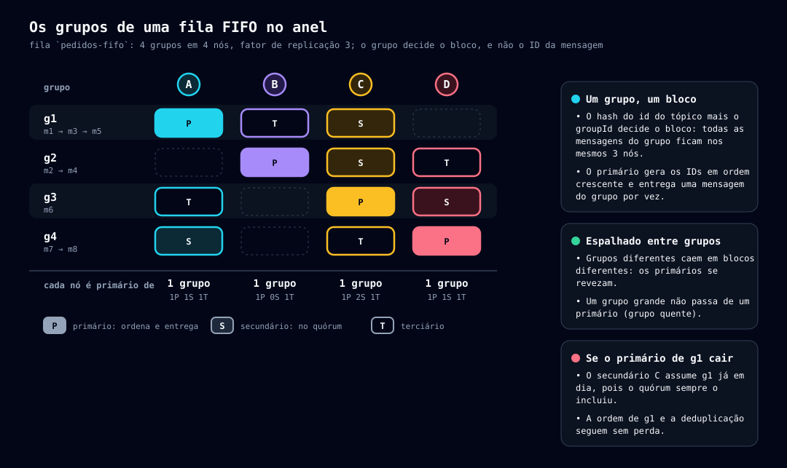

# Fila FIFO

[← Índice](README.md)

## 16. Fila FIFO: ordem por grupo

Uma fila (QT) pode ser **FIFO**: as mensagens de um mesmo **grupo** (`groupId`) são entregues **na ordem em que foram publicadas**, **uma por vez**, e grupos diferentes andam em paralelo. É o análogo da fila FIFO do Amazon SQS (análogo, não equivalente). A ordem vale **dentro do grupo**; não existe ordem entre grupos nem no tópico inteiro.

> Nomes de parâmetros e rotas são **propostas**, como no restante da documentação ([10-configuracao.md](10-configuracao.md)).

### 16.1 Nomenclatura e garantias

| Nome | Sigla | Tipo na API | Descrição |
|---|---|---|---|
| **Fila FIFO** (*Queue Topic FIFO*) | **QTF** | `queue` com `fifo: true` | Um QT que entrega cada grupo em ordem, uma mensagem por vez, e deduplica as publicações (seção 16.7). Pode ser volátil. |

Garantias da QTF:

- **Ordem por grupo:** a mensagem seguinte de um grupo só é entregue depois do ack da anterior (ou da saída dela por `ttl` ou dead-letter, seção 16.6).
- **At-least-once:** a semântica de entrega continua a da seção 12 de [13-entrega-de-mensagens.md](13-entrega-de-mensagens.md): uma mensagem pode ser entregue mais de uma vez se o ack não chegar no prazo, mas continua sendo a cabeça do grupo, então a ordem se mantém.
- **Sem duplicatas de publicação** dentro da janela de deduplicação (seção 16.7).
- **Um produtor que publica em sequência** (espera a resposta de uma publicação antes da seguinte) tem a ordem preservada. Produtores concorrentes no mesmo grupo ficam na ordem em que chegam ao primário do grupo (seção 16.4).

### 16.2 Definição e API

- **Criação:** `POST /topics` aceita `fifo: true` num tópico `queue`. O campo é **imutável** (como `volatile`) e faz parte da definição do tópico ([02-arquitetura.md](02-arquitetura.md), seção 3.3). Combina com fila volátil e com dead-letter. Um Tópico Distribuidor não pode ser FIFO.
- **Fator de replicação:** a QTF exige `replication.factor` de pelo menos **2** (seção 16.5). Num cluster de produção configurado com fator 1, a criação é recusada com `422`. No modo desenvolvimento a regra não se aplica (seção 16.12).
- **Publicação:** `POST /topics/{topic}/messages?groupId=...&deduplicationId=...`.
  - `groupId` é **obrigatório** (1 a 128 caracteres, `A-Za-z0-9_-.:`). Ausente ou inválido: `400`.
  - `deduplicationId` é opcional (mesmos caracteres, 1 a 128). Ausente, vale o hash do conteúdo (seção 16.7). Numa fila que não é FIFO, o parâmetro é recusado com `400`.
  - A resposta traz o `id` da mensagem. Numa publicação **duplicada**, traz o `id` da original e `duplicate: true`.
- **Consumo:** o `GET` é o mesmo. Cada mensagem volta com `groupId` e `deduplicationId`. `autoCreate=true` aceita `fifo=true` ([15-topicos-distribuidor.md](15-topicos-distribuidor.md), seção 14.4).
- **Ack e alteração da invisibilidade (`PUT .../visibility`):** iguais aos da fila comum.

### 16.3 Colocação: o grupo decide o bloco

Na fila comum o bloco vem do hash do **ID da mensagem** (seção 7.1 de [05-particionamento-replicacao.md](05-particionamento-replicacao.md)), e por isso o tópico se espalha por todo o anel. Na QTF a posição no anel é:

```
posição = hash(id do tópico + ":" + groupId)
```

Todas as mensagens de um grupo caem **no mesmo bloco**: o mesmo primário, o mesmo secundário e as mesmas réplicas. O primário é o dono da entrega (seção 12.7) e, na QTF, também quem **ordena** as publicações do grupo. Nenhum nó precisa conhecer a sequência do tópico inteiro: cada um conhece só a dos grupos de que é primário, e ela está toda local.

- Usa-se o `id` (GUID v7) do tópico, não o nome: recriar o tópico gera outro `id`, como na seção 14.3.
- O **tópico continua espalhado entre grupos**: grupos diferentes têm posições diferentes. Um grupo, porém, vive todo num bloco (seção 16.10).
- A coluna da posição no anel, no banco do tópico ([02-arquitetura.md](02-arquitetura.md), seção 3.2), passa a guardar a **posição de colocação**, seja ela o hash do ID (fila comum) ou o do grupo (QTF). Os streams e a limpeza de blocos por faixa (seção 7.3) funcionam sem mudança.
- A **dead-letter** de uma QTF usa, para a posição, o `id` da **fila de origem** (e o `groupId` da mensagem). Assim a mensagem que estoura `maxDeliveries` continua caindo no mesmo bloco e o movimento segue sendo **uma operação só** (seção 12.10).



*Fonte: [gerar-hash.mjs](diagramas/scripts/gerar-hash.mjs).*

### 16.4 Publicação: o primário do grupo coordena


*Fonte: [fifo-publicacao.json](diagramas/fonte/fifo-publicacao.json).*

1. O cliente publica em **qualquer nó**, como sempre. Esse nó calcula a posição do grupo (seção 16.3), acha o **primário** e **repassa a publicação a ele**, no mecanismo de repasse da seção 6.9 de [04-cluster.md](04-cluster.md). Se o próprio nó é o primário, não há repasse.
2. O **primário coordena**: é ele quem gera o ID, confere a deduplicação (seção 16.7) e faz o registro + commit da seção 7.2, com o quórum da seção 16.5.
3. **ID monotônico por grupo.** O primário gera o GUID v7 como `max(agora, último ID do grupo + 1)`, usando os bits de contador do GUID v7 quando duas publicações caem no mesmo milissegundo. Dentro do grupo, os IDs crescem na ordem em que o primário aceitou as publicações, mesmo que o relógio dele esteja atrasado em relação ao de um primário anterior. A **ordem de entrega do grupo é a ordem do ID**.
4. A resposta volta ao nó que repassou, e este a devolve ao cliente.

**Regras do repasse na QTF:**

- **O primário confere o dono.** Ao receber uma publicação repassada, o primário recalcula quem é o dono do grupo pela própria tabela de membros. Se não for ele, responde `421` e o nó repassador tenta de novo, com a tabela atualizada, até `fifo.forward.max-attempts`. Esgotado, `503` com `Retry-After`. Isso evita que dois nós gerem IDs do mesmo grupo quando as tabelas divergem por um instante.
- **Repetição segura.** Na fila comum o repasse não repete depois de enviado o corpo, para não duplicar (seção 6.9). Na QTF a repetição é segura, porque o primário deduplica: o repasse e o cliente podem repetir uma publicação que deu `502` ou `504`.
- **Primário ainda sincronizando.** Quando uma entrada de nó muda o primário de um grupo, o nó novo só coordena depois de ficar pronto (seção 7.3). Até lá, as publicações desse grupo respondem `503` com `Retry-After`, o mesmo efeito de "não entrega por ninguém" da seção 12.7. Deixar o primário antigo coordenar criaria dois geradores de ID para o mesmo grupo.
- **Primário fora do ar e ainda não desregistrado:** as publicações do grupo respondem `503` até o desregistro. Na fila comum, uma nova tentativa gera outro ID e cai em outro bloco; na QTF a colocação é determinística. É o preço da ordem.

### 16.5 Quórum e failover

Na QTF, o quórum de escrita, de entrega e de ack (`write.quorum`) **sempre inclui o primário e o secundário** do bloco do grupo, e nunca fica abaixo de 2. As demais réplicas continuam sendo confirmadas em segundo plano, como na seção 7.2.

**Por que o secundário.** Quando o primário sai, quem herda os blocos dele é o próximo nó físico do anel: o secundário. Suponha o grupo `g` com A (primário), B (secundário) e C (terciário), e o quórum comum (primário mais qualquer outra réplica):

1. O consumidor confirma `m1`. O A decide o commit do ack com o quórum A + C; o B ainda não recebeu.
2. Como `m1` foi confirmada, o A libera `m2` a outro consumidor.
3. O A cai antes de o B receber o ack de `m1`.
4. O B assume e, na visão dele, `m1` ainda é a cabeça do grupo. Entrega `m1` de novo, depois de `m2`: o consumidor vê `m1, m2, m1`.

Com o secundário sempre no quórum, o B já tem o ack de `m1` quando o A libera `m2`, então o novo primário nunca está defasado. O mesmo vale para a deduplicação: o novo primário herda os registros (seção 16.7).

Consequências:

- `replication.factor` mínimo de 2. Quórum maior que 2 (`write.quorum` configurado) continua valendo, e inclui sempre o primário e o secundário.
- Se o secundário está fora do ar e ainda não foi desregistrado, a escrita, a entrega e o ack **do grupo** respondem `503`, mesmo com o terciário saudável. Isso some quando o secundário é desregistrado e a posição dele passa ao próximo nó.
- Fora do alcance: primário e secundário caindo juntos, o limite de qualquer replicação com fator 3 e perda de dois nós.

### 16.6 Entrega: um grupo, uma mensagem em voo

> A entrega da seção 12 vale, com as diferenças abaixo. Um grupo é **livre** quando não tem mensagem invisível (em voo) e tem mensagens prontas; **ocupado** quando tem uma mensagem em voo.

- **Lista de prontos.** Em vez da sanfona por ID (seção 12.6), a lista da QTF tem **uma entrada por grupo livre**: o ID da mensagem mais antiga do grupo (a cabeça). Fica ordenada pela cabeça mais antiga, isto é, pelo ID. A thread de reposição acha as cabeças pelo índice `(grupo, id)` do banco do tópico (e pelo índice em memória, para as mensagens em memória). Mensagens com `deleteAt` (seção 16.7) não entram.
- **Entrega.** O `GET` (e o `take`, seção 12.8) tira da lista a cabeça mais antiga, com o mesmo registro + commit de invisibilidade da seção 12.2. No commit, o grupo passa a **ocupado** e sai da lista.
- **Entre grupos livres vale a cabeça mais antiga.** A entrega justa por faixas da seção 12.11 **não vale** na QTF: a justiça entre remetentes vem de cada grupo ocupar no máximo um lugar na entrega. As contagens por grupo continuam existindo para as métricas (`/stats/topics/{topic}/groups`).
- **`maxMessages`.** Cada mensagem do lote vem de um grupo **diferente**. O lote traz o que estiver pronto, até `maxMessages`. Várias mensagens do mesmo grupo no mesmo `GET` não são suportadas (uma por grupo).
- **Reentrega.** Vencida a invisibilidade sem ack, a **mesma** mensagem volta como cabeça do grupo, que volta a ser livre (seção 13.6 de [14-invisibilidade.md](14-invisibilidade.md)). A alteração com `visibilityTimeout: 0` faz o mesmo.
- **Ack.** O ack da cabeça libera o grupo, e a mensagem seguinte entra na lista.
- **Limite de entregas (`maxDeliveries`).** A mensagem que o atinge sem ack vai para o dead-letter e **o grupo segue** com a próxima, como no SQS. Gera o evento `message-dead-lettered`. Quando o grupo segue, a ordem do grupo é mantida para as mensagens restantes; a que saiu fica de fora.
- **Expiração (`ttl`).** Uma mensagem vencida por `ttl` é descartada onde estiver, e se era a cabeça, o grupo é **liberado** e segue com a próxima.
- **Mudança de dono.** Ao assumir um bloco, o novo primário refaz a lista a partir dos metadados e do índice `(grupo, id)`. Um grupo com mensagem invisível no futuro entra como **ocupado**, com o vencimento na lista de invisíveis (seção 13.7 de [14-invisibilidade.md](14-invisibilidade.md)).

### 16.7 Deduplicação

A QTF não duplica publicações repetidas dentro de uma **janela** (`fifo.dedup.window`, padrão **5 minutos**, como no SQS).

- **Metadado da mensagem.** O `deduplicationId` é um metadado imutável, como o `groupId`: guardado com a mensagem (em memória, ou na coluna `deduplicationId` da tabela `mensagens`, com índice por `(grupo, deduplicationId)`), replicado no registro + commit da publicação, levado pelos streams de sincronização e devolvido no `GET`. Sem `deduplicationId` na publicação, o primário o preenche com o **SHA-256 do corpo**, em hexadecimal, então toda mensagem da QTF o tem.
- **Escopo: o grupo.** Quem confere é o primário do grupo, o único nó que vê todas as publicações dele, sem consultar outros nós. O mesmo `deduplicationId` em grupos diferentes **não** é deduplicado. Difere do SQS, que também permite o escopo da fila inteira.
- **Duplicata.** Uma publicação cuja chave já existe no grupo, dentro da janela, **não cria mensagem**: responde sucesso com o `id` da original e `duplicate: true`, sem registro nem commit. A janela conta a partir do instante do ID da original, e a checagem ignora o que já passou dela.
- **Concorrência.** Duas publicações simultâneas com a mesma chave são serializadas pelo primário: a segunda espera o resultado da primeira. Se esta commitou, devolve o mesmo `id`; se sofreu rollback, segue como nova.
- **Retry seguro.** Como o primário deduplica, o cliente (e o repasse, seção 16.4) pode repetir uma publicação sem risco de duplicar.

**Ack na QTF: exclusão lógica com data.** A deduplicação deve valer pela janela inteira, também depois do ack. Por isso, na QTF o ack **não apaga a linha**:

- O ack grava o metadado `deleteAt` (data absoluta, `instante do ID + fifo.dedup.window`) e apaga só o **corpo** (`${topico}/${id}.json` e a cópia em memória) e os metadados de entrega (`invisibleUntil`, `receiptToken`, `deliveryCount`). Fica a linha curta: `id`, posição no anel, `grupo`, `deduplicationId` e `deleteAt`. Se `deleteAt` já passou no ack, a linha é apagada na hora, como no ack comum. O mesmo vale para a mensagem que vai ao dead-letter.
- **Existe em todos os nós.** A linha é replicada pelos mesmos caminhos da mensagem: o `deduplicationId` no registro + commit da publicação, e o `deleteAt` no registro + commit do ack, decididos por quórum. Com o secundário sempre no quórum (seção 16.5), um novo primário por falha **herda a deduplicação sem perda**.
- **Varredura.** Cada nó apaga as linhas vencidas pelo índice de `deleteAt`, a cada `retention.sweep.interval`, sem propagar nada, como no `ttl` (seção 12.10).
- **Quem ignora a linha com `deleteAt`:** a lista de prontos, os contadores de fila e de grupo, `depth`, o `ttl`, o `MIN(id)` de `oldestMessageAt`, a reposição, o `GET`, a alteração da invisibilidade e um segundo ack (que respondem como mensagem inexistente). Só a checagem de deduplicação e a varredura a enxergam.
- **Exceção ao "sem tombstone"** (seção 12.4 de [13-entrega-de-mensagens.md](13-entrega-de-mensagens.md)): é um registro com prazo, só na QTF. A fila comum continua apagando no ack.
- **Sincronização.** Como é uma linha comum, a listagem de IDs (`/cluster/blocks/{id}/ids`) e o stream de mensagens (`/cluster/blocks/{id}/messages`) a incluem, sem corpo e com `deleteAt`, e o banco de eventos grava o `deleteAt` de forma idempotente (seção 7.3 de [05-particionamento-replicacao.md](05-particionamento-replicacao.md)). Não há rota nova.

**Cuidado com o hash padrão.** Duas mensagens legítimas e idênticas, no mesmo grupo e dentro da janela, viram uma só, em silêncio. Quem precisa de mensagens iguais em sequência deve enviar um `deduplicationId` próprio.

### 16.8 Tópico Distribuidor, fila volátil e dead-letter

- **Distribuidor.** Um DT pode ter filas FIFO entre os destinos. O `groupId` e o `deduplicationId` informados vão para **todas** as cópias (seção 14.2 de [15-topicos-distribuidor.md](15-topicos-distribuidor.md)). Cópia **sem `groupId`** para uma fila FIFO falha **só naquela fila** (`distributor-partial`, `400` no item), sem desfazer as demais. Sem `deduplicationId`, cada cópia usa o hash do corpo; a deduplicação é por fila e grupo. Como cada cópia é coordenada pelo primário do grupo da fila de destino, a ordem por grupo se mantém em cada fila.
- **Fila volátil.** A QTF pode ser volátil, com as regras da seção 14.3.
- **Dead-letter.** Nasce e morre com a fila, como na seção 12.10, mas **não é FIFO**: é uma fila comum, para consulta e reprocessamento. Reaproveita o `id` da fila de origem só para a posição no anel (seção 16.3).

### 16.9 Parâmetros

| Parâmetro | Chave sugerida | Padrão |
|---|---|---|
| Janela de deduplicação | `fifo.dedup.window` | **300 s** |
| Entradas do índice de deduplicação em memória | `fifo.dedup.index.max-entries` | A definir |
| Tentativas do repasse ao primário | `fifo.forward.max-attempts` | A definir |

Detalhes em [10-configuracao.md](10-configuracao.md).

### 16.10 Limites e custos

- **Grupo quente, nó quente.** Um grupo vive num único bloco: a vazão dele é a de um primário, e o backlog dele precisa caber nos discos dos nós do bloco. A distribuição só é boa com **muitos grupos**. A condição `noisy-group` ([11-observabilidade.md](11-observabilidade.md)) indica o grupo que concentra a fila.
- **Salto extra.** Com o balanceador espalhando as chamadas, `(N−1)/N` das publicações FIFO fazem um salto interno a mais, com o corpo inteiro (até `message.max-bytes`). Entra no dimensionamento da rede entre nós.
- **Hash do corpo.** O SHA-256 é calculado no primário a cada publicação sem `deduplicationId`: CPU a mais para corpos grandes.
- **Relógio do primário.** A janela de deduplicação depende do instante do ID, gerado pelo primário. Um relógio adiantado alonga a janela; o ID monotônico (seção 16.4) limita o efeito.
- **Escrita no ack.** O ack da QTF atualiza uma linha no banco do tópico, inclusive para a mensagem que estava só em memória, uma escrita que a fila comum não faz.
- **Pausa na mudança do anel.** Um bloco em sincronização não entrega (seção 12.7), então os grupos dele pausam, como na fila comum.

### 16.11 Observabilidade

Detalhes em [11-observabilidade.md](11-observabilidade.md).

| Item | Descrição |
|---|---|
| `msg.fifo.deduplicated` (métrica) | Publicações descartadas por deduplicação. |
| `msg.fifo.forward` (métrica) | Publicações repassadas ao primário do grupo, por resultado (`ok`, `misdirected`, `error`). |
| `msg.fifo.groups.busy` (métrica) | Grupos com mensagem em voo neste nó. |
| `group-stalled` (condição do tópico) | Um grupo cuja cabeça já foi entregue mais de `stats.topics.group-stalled-deliveries` vezes: o grupo está preso numa mensagem que ninguém confirma. |

### 16.12 Modo desenvolvimento

> **Modo desenvolvimento** (seção 6.4 de [04-cluster.md](04-cluster.md)): a QTF funciona igual, com contagem exata. O nó é o primário de todos os grupos, então não há repasse, e o quórum vale 1 (a exigência de secundário e de `replication.factor` 2 não se aplica). A ordem, a entrega por grupo e a deduplicação são as mesmas. O drain serve de save, e a retomada mantém os grupos e as linhas com `deleteAt`.

### 16.13 Alternativas descartadas

- **Fila inteira num bloco só:** equivale a um grupo único e limita a vazão da fila a um nó.
- **Sequenciador por grupo com dados espalhados por ID:** manteria o tópico espalhado, mas cada entrega precisaria consultar o sequenciador e buscar a mensagem em outro nó, com um salto extra por entrega.
