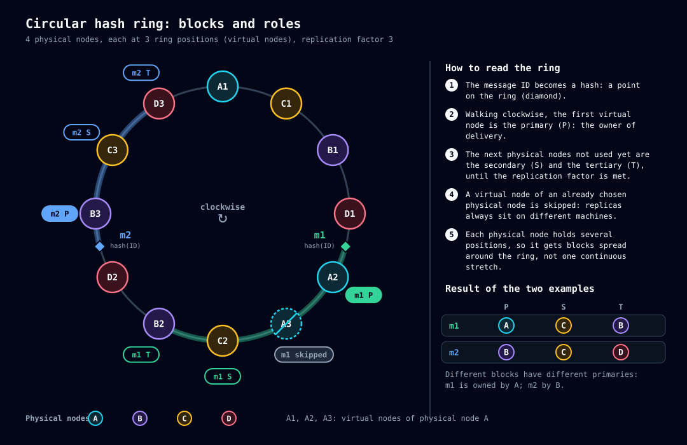
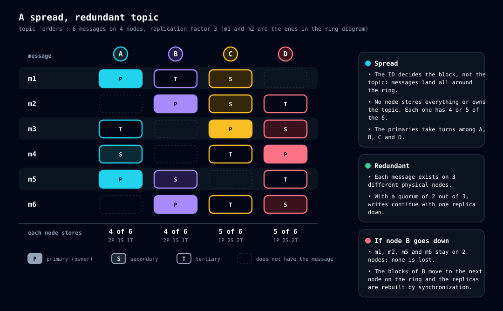

# Ring and replication

> Read first: [03-concepts.md](03-concepts.md). Read next: [10-publishing.md](10-publishing.md) (what happens when the message arrives) and [07-cluster.md](07-cluster.md) (what happens when the ring changes).

## The problem

A topic can have millions of messages and the cluster has several nodes. It is necessary to decide, **with no coordinator**, where each message goes, so that (1) the load is spread, (2) losing a node does not lose messages and (3) **any node** reaches the same answer looking only at the member table.

## The solution: circular hash (*consistent hashing*)

Taba uses **a single ring**. The implementation is pure logic in `core/ring` (no I/O): given only the set of node IDs and the number of virtual nodes, any node reaches the same result.

**Step by step:**

1. **Position.** Every key becomes a 64-bit number: the **first 8 bytes of the SHA-256** of the key.
2. **Nodes on the ring.** Each physical node occupies `ring.virtual-nodes` positions (default **128**), computed as the hash of `<nodeId>#<i>`. More positions per node mean a more uniform distribution.
3. **Block.** A **block** is the arc that **ends** at a virtual-node position. A position `p` belongs to the first virtual node with position `>= p`, wrapping around the end of the ring. The block identifier (`BlockId`) is the position of that virtual node, written as **16 lowercase hexadecimal digits**; it is the `{id}` of the `/cluster/blocks/{id}/...` routes.
4. **Roles.** The owner of the virtual node that closes the block is the **primary**. The replicas follow **in the direction of the ring**, always on **distinct physical nodes**: virtual-node positions of an already chosen node are skipped. The number of replicas is `replication.factor` (default **3**): primary, secondary, tertiary.

## The primary is the delivery owner

The **primary** of a message's block is the message's **delivery owner**: it is the only node that puts it in the ready list and decides invisibility ([12-delivery.md](12-delivery.md)). The replicas keep the copy and the `ttl`, and take over the owner role when the ring changes and they become primary.

That is why, on write, the quorum **always includes the primary**: if it were left out, the message could be considered durable before being visible to any consumer ([10-publishing.md](10-publishing.md)).

## The topic is spread out

The block is decided by the **message ID** (which is a GUID v7, sortable by time), not by the topic. The hash undoes the time order that the high bits of the GUID carry, so the messages of one topic spread over **the whole ring**:

- No node stores the entire topic or is its "owner".
- Each message has its own primary and replicas.
- With one node lost, each message is still on at least `replication.factor − 1` nodes.

## One ring, four questions

The same ring answers four different questions, only changing **the key** that becomes a position (`core/ring`):

| Question | Key | Who answers | Where it is used |
|---|---|---|---|
| Where does the **message** live? | message `id` | primary + replicas of the block | Publishing, delivery, ack ([10-publishing.md](10-publishing.md)) |
| Where does a **FIFO queue group** live? | `<topic id>:<groupId>` | primary + replicas of the group's block | All the messages of the group fall in the same block, and the primary orders them ([09-topics.md](09-topics.md)) |
| Who **manages** the volatile queue? | topic `id` | the primary of the position (the **managing node**) | Decides exclusion for idleness ([09-topics.md](09-topics.md)) |
| Who is the **definition owner** of a topic or token? | `topic:<name>` or `token:<id>` | the first active node at the position | Decides and numbers the definition changes ([08-storage.md](08-storage.md)) |

## When the ring changes

The ring is **derived from the member table**: when a node joins or leaves, everyone recomputes. Consequences:

| Event | What happens to the blocks |
|---|---|
| Node **joins** | Takes blocks (as primary, secondary…); **synchronizes** each one from the nodes that already have it ([07-cluster.md](07-cluster.md)). Only becomes ready afterwards. |
| Node **leaves** (exclusion for failure or drain) | The ring is recomputed without it. Those that were already replicas take over with no load; the redundancy of its messages stays at `replication.factor − 1` until a new node joins (decision D116, accepted). |
| Node **loses** a block | **Does not delete right away**: keeps the messages and can serve as a synchronization source. It only deletes when **the whole cluster is healthy** (no node synchronizing, no vote or membership change). That way, if the new node fails, the old one is responsible again without losing anything. |
| Primary down, but still in the table | Writes to the block **fail** with `503` and `Retry-After` (`cluster.quorum-unavailable`); the secondary does **not** take over coordination. When the exclusion goes through, the block's heir becomes primary. |

## One-node profile

With a single node, the ring has one node, which is primary of all the blocks. `ring.virtual-nodes` has no practical effect, there is no rebalancing, and `replication.factor` and `write.quorum` are 1.

## Known limits

- **PRB-039:** listing the IDs of a block reads the rows by position range, but scans the in-memory map of the whole topic at each chunk — cost proportional to the topic, not to the block ([31-pending-items.md](31-pending-items.md)).
- **D93:** the position computation and the `BlockId` format were fixed in the implementation; the formal decision has not been recorded yet.

## Sources and evidence

- `crates/taba-node/src/core/ring/mod.rs` (`position`, `message_position`, `fifo_position`, `topic_position`, `definition_position`, `Ring::new`, `block_of`, `owners`, `primary`, `blocks_of`).
- `crates/taba-node/src/cluster/replication/` (who receives and who coordinates) and `cluster/sync/mod.rs` (block load).
- Use cases: UC-ANE (ring, blocks and roles), UC-ESC (quorum), UC-SIN (synchronization), UC-FIF-023 (group in the same block); see [26a](26a-implemented-use-cases.md).
- History: `05-particionamento-replicacao.md`.
