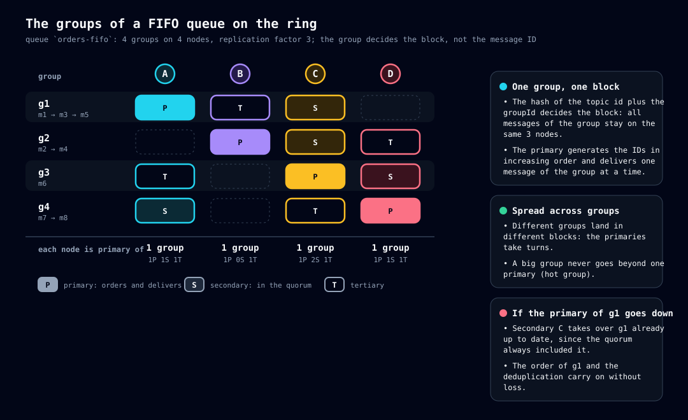

# Topic types

> Read first: [03-concepts.md](03-concepts.md). Read next: [10-publishing.md](10-publishing.md) and [12-delivery.md](12-delivery.md).

## Two types and two attributes

The topic's `type` field has only two values. The **FIFO queue** and the **volatile queue** are **attributes** of a queue, not separate types:

| Name | Acronym | In the API | In one sentence |
|---|---|---|---|
| **Queue topic** | QT | `type: "queue"` | Stores messages and delivers each one to **one** consumer |
| **Distributor topic** | DT | `type: "distributor"` | **Stores nothing**: copies each publication to the queues whose name starts with one of its prefixes |
| **Volatile queue** | QTV | `queue` + `volatile: true` | A queue that **disappears by itself** if it is left without a consumer |
| **FIFO queue** | QTF | `queue` + `fifo: true` | A queue that delivers each **group** in order, one message at a time, and deduplicates publications |

QT is the analogue of Amazon SQS and DT is the analogue of Amazon SNS. They are analogues, **not** equivalents: DT has no subscribers or delivery protocols (e-mail, HTTP); it only copies to queues.

## How to choose

| I need… | Use |
|---|---|
| One task per worker (parallel processing) | **Queue** |
| Several systems to receive the same event | **Distributor** + one queue per system (name with the prefix) |
| A reply queue for an ephemeral consumer, which I do not want to clean up | **Volatile queue** (can be created by the `GET` itself) |
| Keep the order of events of the same entity (an order, a customer) and avoid duplicates | **FIFO queue**, with the entity's `groupId` |


## Fields of a topic definition

Creation: `POST /topics`. The response and the reads return the same object.

| Field | Applies to | Description |
|---|---|---|
| `name` | all | API key. Characters `A-Za-z0-9_-` (the name becomes a folder; uppercase is handled, see [08-storage.md](08-storage.md)) |
| `type` | all | `queue` or `distributor`. **Immutable** |
| `id` | all | GUID v7, generated at creation. Recreating the name generates another `id` |
| `tags` | all | Key/value pairs, sent as attributes to the telemetry |
| `prefixes` | DT | 1 to 20 prefixes (1 to 100 characters each, same set as the name; empty is refused). Changeable by `PATCH` |
| `volatile` | queue | `true` for a volatile queue. **Immutable** |
| `idleTimeout` | volatile queue | Seconds without a consumer until deletion (default **600**; limit 60 s to 7 days) |
| `fifo` | queue | `true` for FIFO. **Immutable**. Does not apply to a distributor |
| `maxMessageBytes`, `ttl`, `maxDeliveries` | queue | Optional; without them the node defaults apply. The response carries the **effective** value in `effective` |
| `deadLetter`, `source` | read-only | Appear on the dead-letter queue (see below) |

The limits are in [19-errors-and-limits.md](19-errors-and-limits.md).

## Queue (QT)

It is the basic type. You publish with `POST /topics/{topic}/messages`, consume with `GET` and confirm with `DELETE` ([12-delivery.md](12-delivery.md)). Messages spread over **the whole ring** by the `id` of each one ([06-ring-and-replication.md](06-ring-and-replication.md)).

### Dead-letter

Every queue has a `{queue}-dead-letter` queue (suffix configurable in `topics.dead-letter.suffix`), **created and deleted together** with it. It receives the message that reaches `maxDeliveries` without an ack. It has no definition of its own: it uses the settings of the source queue, **read-only**, and otherwise it is an ordinary queue (inspection and reprocessing). It appears in `GET /topics` with `"deadLetter": true` and `"source": "<queue>"`. It is **not FIFO**, even if the source is. A `GET` on it **does not count** as a consumer for the volatile queue.

## Distributor (DT)

A DT is only a **definition**: name, tags and the list of prefixes. It has no messages, ready list or delivery owner. It is **never consumed**: `GET` and ack on a DT answer `409 topic.wrong-type`.


**Publishing** (`POST /topics/{dt}/messages`):

1. The node that receives the call **matches the prefixes** against the topic table (which every node has). Only **queues** match: a DT is never a destination (avoids loops) and the dead-letter queue does not match either.
2. For each queue that matched, it generates an **independent copy**, with its **own ID**, and publishes it through the normal procedure of that queue ([10-publishing.md](10-publishing.md)). Each copy falls on different blocks and nodes.
3. The copies are **independent**: the failure of one does not undo the others and there is no global rollback.
4. The response goes out after all the copies and carries the result **per queue**.

```bash
curl -s -X POST localhost:8080/topics/pedidos-dist/messages -H 'Content-Type: application/json' -d '{"a":1}'
# {"deliveries":[{"id":"01a1363a-4e96-…","topic":"pedidos-eu"},
#                {"id":"01a1363a-4e96-…","topic":"pedidos-us"}],"matched":2}
```

**Rules:**

- A queue that matches **several prefixes of the same DT** receives **one** copy; with prefixes of **different DTs**, one from each.
- **No queue matching is not an error:** the response is a success with an empty list and the message is discarded (event `taba.distributor.no_target`).
- The match is made **at publish time**, over the queues that exist then. A queue created later receives nothing retroactively.
- **Partial failure** is not a DT error: it answers `200` and each item carries the `id` of the copy **or** the `error` of that queue (event `taba.distributor.partial`).
- The publication's `groupId` and `deduplicationId` go in **all** the copies. A copy **without `groupId`** to a FIFO queue fails **only for that queue** (`400` in the item).
- **Ceiling:** `topics.distributor.max-targets` (no limit by default). If set and the publication matches more queues, it is **refused entirely** (`422`, no copy).

## Volatile queue (QTV)

A queue with `volatile: true` is **deleted**, with its messages, if it stays without a consumer for longer than `idleTimeout`.

- **What counts as a consumer:** **any** `GET /topics/{topic}/messages`, with or without a message, with or without long polling. The instant is recorded at the **start** of the call. **Publishing does not count:** a volatile queue with only producers is deleted and the messages are lost (intentional).
- **When the clock starts:** at creation. The deadline is `max(createdAt, last GET on any node) + idleTimeout`.
- **`PATCH`** can change `idleTimeout`; `volatile` is immutable.

### Automatic creation by `GET`

```bash
curl -s "localhost:8080/topics/volat/messages?autoCreate=true&idleTimeout=120&tag.time=financeiro"
# {"messages":[]}   ← the queue "volat" now exists, volatile, with idleTimeout 120
```

| Parameter | Description |
|---|---|
| `autoCreate` | `true` creates the queue if it does not exist |
| `volatile` | Default **`true`** with `autoCreate`; `false` creates a persistent queue |
| `fifo` | `true` creates a FIFO queue |
| `idleTimeout` | Seconds (default 600, `topics.volatile.idle-timeout.default`) |
| `tag.<key>` | Tags of the queue |

**Rules:** it only creates a **queue** (never a DT). It is **idempotent**: if the queue already exists, the creation parameters are **ignored** and the `GET` proceeds normally; if the name belongs to a DT, `409`. Several consumers starting together race for the creation: whoever loses treats it as "already exists". The first `GET` pays the register + commit on all nodes, once per queue. With `topics.volatile.max-count` set and reached, the creation is refused with `422` (the check is local; simultaneous creations may go a little over the ceiling). Without `autoCreate`, a nonexistent topic gives `404`.

### The managing node

The one who decides to delete a volatile queue is its **managing node**: the **primary of the ring position of the hash of the topic's `id`**. Any node reaches the same manager without an election. The manager takes care **only of the topic's life**, never of the messages or the delivery. The list of queues it manages is **derived** at each pass (every 200 ms), not stored: it changes by itself with the member and topic tables.


Cycle for each managed queue:

1. **Schedules** the check for `createdAt + idleTimeout`.
2. At the deadline it does the **final check**: asks **all the nodes** (`GET /cluster/topics/{id}/idle`) how long ago the last `GET` was. Each one answers a **duration**, not an instant, so as not to depend on synchronized clocks.
3. If some node had a `GET` more recent than `idleTimeout`, it **reschedules** for the remaining time.
4. If **all** answered and none had a `GET` in the interval, it **deletes** through the same register + commit as `DELETE /topics/{topic}`, carrying the **`id`**: each node only accepts if the current topic with that name still has that `id`. A queue deleted and recreated along the way is never deleted by mistake.

**Safety of the check:** a node that **does not answer** prevents the deletion (new attempt every `topics.volatile.idle-check.retry-interval`, default 30 s; event `taba.volatile.check_blocked`). A node **with no record** of a `GET` answers the time since it started, so a restart can only **postpone** the deletion. Manager down: none of its queues is deleted; **the queue keeps working**.

**When the ring changes**, the new manager **does the idleness query immediately** (with a small random spread, `topics.volatile.takeover.jitter`, default 2 s) instead of starting from zero: the true state is on the nodes. A deletion started by the old manager and another by the new one are harmless: the second finds the topic already deleted (or with another `id`).

**Accepted races:** a `GET` that arrives between the final check and the commit receives `404` (or recreates the queue, with `autoCreate`, with a new `id` and without the old messages); a consumer with an invisible message receives `404` when trying the ack after the deletion.

## FIFO queue (QTF)

In a FIFO queue, the messages of the same **group** (`groupId`) are delivered **in publication order, one at a time**, and different groups run **in parallel**. The order holds **within the group**; there is no order between groups or in the whole topic. It is the analogue of the SQS FIFO queue.

**Guarantees:**

- **Order per group:** the next message is only delivered after the ack of the previous one (or after it leaves by `ttl` or dead-letter).
- **At least once:** if the ack does not arrive in time, the same message is redelivered; it is still the head of the group, so the order is kept.
- **No publication duplicates** within the deduplication window.
- A producer that publishes in sequence (waits for the response before the next) has the order preserved. Concurrent producers in the same group stay in the order in which they reach the group's primary.

### Create and use

```bash
curl -s -X POST localhost:8080/topics -H 'Content-Type: application/json' \
  -d '{"name":"ordens","type":"queue","fifo":true}'
curl -s -X POST "localhost:8080/topics/ordens/messages?groupId=g1&deduplicationId=d1" -d '{"n":1}'
# {"duplicate":false,"id":"01a1363a-5434-…"}
curl -s -X POST "localhost:8080/topics/ordens/messages?groupId=g1&deduplicationId=d1" -d '{"n":1}'
# {"duplicate":true,"id":"01a1363a-5434-…"}      ← the same key: returns the id of the original
curl -s -X POST localhost:8080/topics/ordens/messages -d '{"n":3}'
# 400 {"code":"validation.group-id-required",…}
```

- `groupId` is **required** (1 to 128 characters, `A-Za-z0-9_-.:`). `deduplicationId` is optional (same characters); on a queue that is **not** FIFO the parameter is refused with `400`.
- The delivered message carries `groupId` and `deduplicationId`.
- It requires `replication.factor` ≥ **2** (refuses with `422` in a production cluster with factor 1). In development mode, it does not.

### Where the group lives

In the ordinary queue the block comes from the message `id`. In FIFO the position is `hash(topic id + ":" + groupId)`: **all the messages of a group fall in the same block**, with the same primary and the same replicas. The primary is the delivery owner **and** the one that **orders** the publications of the group. The topic is spread **across groups**, not within one.



### Publishing: the group's primary coordinates


1. The client publishes to **any node**; it computes the group position, finds the **primary** and **forwards the publication to it** (`POST /cluster/topics/{topic}/fifo/publish`).
2. The **primary coordinates**: generates the ID, checks deduplication and does the register + commit.
3. **Monotonic ID per group:** `max(now, last ID of the group + 1)`, using the counter bits of the GUID v7; the delivery order of the group is the ID order.
4. **The primary checks the owner:** if it is not the owner, it answers `421`; whoever forwarded waits `write.retry.backoff`, re-reads **its own** table and tries again, up to `fifo.forward.max-attempts` (default 3); when exhausted, `503`.
5. **Safe repetition:** since the primary deduplicates, the client and the forwarding may repeat a publication that gave `502`/`504`.
6. **Primary still synchronizing or down** (and still in the table): the group's publications answer `503` until it is ready or excluded. That is the price of order: in the ordinary queue a retry generates another ID and falls on another block.

### Quorum: primary **and** secondary

In FIFO the quorum for write, delivery and ack **always includes the primary and the secondary**, and is never smaller than 2. Reason: when the primary leaves, the secondary inherits the block. If the secondary could be behind, the new primary could **redeliver an already confirmed message**: the consumer would see `m1, m2, m1`. With the secondary always in the quorum, the new primary is **never** behind (and also inherits the deduplication). If the secondary is down and still in the table, the **group's** operations answer `503` even with a healthy tertiary.

The `receiptToken` of a FIFO message is `{position in 16 hexadecimals}-{guid}`: the ack reaches **any** node, which only has the `id` and the receipt, and must find the responsible nodes without knowing the group. To the client it remains opaque; a malformed receipt is `409 message.stale-receipt`.

### Delivery: one group, one message in flight

A group is **free** when it has no message in flight and has ready ones; **busy** when it has one in flight.

- The **ready list** has **one entry per free group**: the head (the oldest). Delivery takes the oldest head from any free group, and the group becomes busy.
- **Between groups the oldest head wins.** Fair delivery by bands does **not** apply in FIFO: fairness comes from each group occupying at most one place.
- **`maxMessages`:** each message of the batch comes from a **different** group.
- **Redelivery:** once invisibility expires without an ack, the **same** message comes back as the head. `visibilityTimeout: 0` does the same.
- **`maxDeliveries`:** the message that reaches it goes to the dead-letter and **the group continues** with the next one, as in SQS.
- **`ttl`:** an expired message leaves wherever it is; if it was the head, the group is **released**.
- **Owner change:** the new primary rebuilds the list from the metadata; a group with a message invisible in the future enters as **busy**.

### Deduplication

The FIFO queue does not duplicate repeated publications within a **window** (`fifo.dedup.window`, default **300 s**).

- **Key:** the `deduplicationId`; if absent, the **SHA-256 of the body bytes** (the `contentType` does not count). Every message of the queue has one.
- **Scope: the group.** Whoever checks is the group's primary. The same key in different groups is **not** a duplicate.
- **Duplicate:** does not create a message; answers success with the `id` of the original and `duplicate: true`. The window counts from the instant of the original's ID. Two simultaneous publications with the same key are serialized.
- **Ack is a logical delete:** for deduplication to hold for the **whole** window, the ack **does not delete the row**: it writes `deleteAt` (`ID instant + window`) and deletes only the **body** and the delivery metadata. The short row is replicated through the same paths and **swept** when `deleteAt` passes (`retention.sweep.interval`). These rows stay out of all lists and counts.

> ⚠️ **Beware of the default key:** two legitimate, **identical** messages in the same group, within the window, silently become one. Whoever needs equal messages in sequence must send their own `deduplicationId`.

### Limits and costs

- **Hot group, hot node:** a group lives in a single block; its throughput is that of one primary. Distribution is only good with **many groups** (the topic condition `noisy-group` points to the group that concentrates the queue).
- **Extra hop:** `(N−1)/N` of the publications make an internal hop with the whole body.
- **Body hash:** extra CPU on the primary for large bodies without `deduplicationId`.
- **Primary clock:** the window depends on the instant of the ID generated by the primary; the monotonic ID limits the effect.
- **Write on ack:** the ack updates a row in the topic database, including for a message that was only in memory.
- **Pause:** a block in synchronization does not deliver, so its groups pause.

## Comparison table

| | Queue | Distributor | Volatile | FIFO |
|---|---|---|---|---|
| Stores messages | yes | **no** | yes | yes |
| Consumable (`GET`) | yes | **no** (`409`) | yes | yes |
| Where the message lives on the ring | by the message `id` | — (copies to queues) | by the message `id` | by the **group** |
| Order | not guaranteed | — | not guaranteed | **per group** |
| Deduplication | no | — | no | **yes** (window) |
| Disappears by itself | no | no | **yes** (`idleTimeout`) | no (unless also volatile) |
| Can be created by `GET` | no | **never** | **yes** | yes (`fifo=true`) |
| Has dead-letter | yes | no | yes | yes (not FIFO) |

## Sources and evidence

- `core/topic` (definition), `engine/topics` (registry and rules), `engine/messages/index` (ready list per group), `cluster/volatile` (manager), `cluster/replication/forward.rs` (FIFO forwarding), `http/topics`, `http/messages`.
- Example responses copied from a real node in development mode.
- Use cases: UC-TOP (topics), UC-DST (distributor), UC-VOL (volatile and manager), UC-FIF (FIFO), UC-GRP (groups); see [26a](26a-implemented-use-cases.md). Tests: `tests/topics.rs`, `fifo.rs`, `fifo_cluster.rs`, `volatile.rs`, `volatile_cluster.rs`.
- History: `15-topicos-distribuidor.md`, `17-topicos-fifo.md`.
