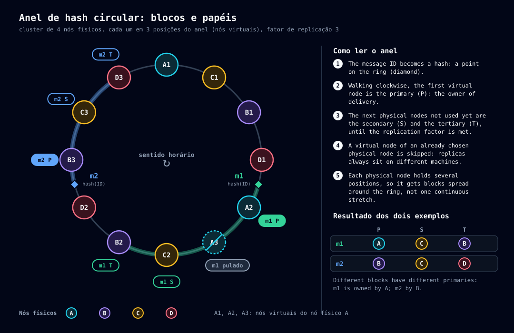

# Anel e replicação

> Leia antes: [03-conceitos.md](03-conceitos.md). Leia depois: [10-publicacao.md](10-publicacao.md) (o que acontece quando a mensagem chega) e [07-cluster.md](07-cluster.md) (o que acontece quando o anel muda).

## O problema

Um tópico pode ter milhões de mensagens e o cluster tem vários nós. É preciso decidir, **sem coordenador**, onde cada mensagem fica, de modo que (1) a carga se espalhe, (2) a perda de um nó não perca mensagens e (3) **qualquer nó** chegue à mesma resposta olhando só a tabela de membros.

## A solução: hash circular (*consistent hashing*)

O Taba usa **um único anel**. A implementação é lógica pura em `core/ring` (sem I/O): dado apenas o conjunto de IDs de nós e o número de nós virtuais, qualquer nó chega ao mesmo resultado.

**Passo a passo:**

1. **Posição.** Toda chave vira um número de 64 bits: os **8 primeiros bytes do SHA-256** da chave.
2. **Nós no anel.** Cada nó físico ocupa `ring.virtual-nodes` posições (padrão **128**), calculadas como o hash de `<nodeId>#<i>`. Mais posições por nó significam uma distribuição mais uniforme.
3. **Bloco.** Um **bloco** é o arco que **termina** numa posição de nó virtual. Uma posição `p` pertence ao primeiro nó virtual com posição `>= p`, dando a volta no fim do anel. O identificador do bloco (`BlockId`) é a posição desse nó virtual, escrita em **16 dígitos hexadecimais minúsculos**; é o `{id}` das rotas `/cluster/blocks/{id}/...`.
4. **Papéis.** O dono do nó virtual que fecha o bloco é o **primário**. As réplicas seguem **no sentido do anel**, sempre em **nós físicos distintos**: posições de nós virtuais de um nó já escolhido são puladas. O número de réplicas é `replication.factor` (padrão **3**): primário, secundário, terciário.

## O primário é o dono da entrega

O **primário** do bloco de uma mensagem é o **dono da entrega** dela: é o único nó que a coloca na lista de prontos e decide a invisibilidade ([12-entrega.md](12-entrega.md)). As réplicas guardam a cópia e o `ttl`, e assumem o papel de dono quando o anel muda e passam a ser primárias.

Por isso, na escrita, o quórum **sempre inclui o primário**: se ele ficasse de fora, a mensagem poderia ser considerada durável antes de estar visível a qualquer consumidor ([10-publicacao.md](10-publicacao.md)).

## O tópico fica espalhado

O bloco é decidido pelo **ID da mensagem** (que é um GUID v7, ordenável no tempo), e não pelo tópico. O hash desfaz a ordem do tempo que os bits altos do GUID carregam, então as mensagens de um mesmo tópico se espalham por **todo o anel**:

- Nenhum nó guarda o tópico inteiro nem é "dono" dele.
- Cada mensagem tem primário e réplicas próprios.
- Perdido um nó, cada mensagem ainda está em pelo menos `replication.factor − 1` nós.

## Um anel, quatro perguntas

O mesmo anel responde a quatro perguntas diferentes, só mudando **a chave** que vira posição (`core/ring`):

| Pergunta | Chave | Quem responde | Onde se usa |
|---|---|---|---|
| Onde mora a **mensagem**? | `id` da mensagem | primário + réplicas do bloco | Publicação, entrega, ack ([10-publicacao.md](10-publicacao.md)) |
| Onde mora um **grupo de fila FIFO**? | `<id do tópico>:<groupId>` | primário + réplicas do bloco do grupo | Todas as mensagens do grupo caem no mesmo bloco, e o primário as ordena ([09-topicos.md](09-topicos.md)) |
| Quem **gerencia** a fila volátil? | `id` do tópico | o primário da posição (o **nó gestor**) | Decide a exclusão por ociosidade ([09-topicos.md](09-topicos.md)) |
| Quem é o **dono da definição** de um tópico ou token? | `topic:<nome>` ou `token:<id>` | o primeiro nó ativo na posição | Decide e numera as mudanças de definição ([08-armazenamento.md](08-armazenamento.md)) |

## Quando o anel muda

O anel é **derivado da tabela de membros**: quando um nó entra ou sai, todos recalculam. Consequências:

| Evento | O que acontece com os blocos |
|---|---|
| Nó **entra** | Assume blocos (como primário, secundário…); **sincroniza** cada um a partir dos nós que já o têm ([07-cluster.md](07-cluster.md)). Só fica pronto depois. |
| Nó **sai** (exclusão por falha ou drain) | O anel é recalculado sem ele. Os que já eram réplicas assumem sem carga; a redundância das mensagens dele fica em `replication.factor − 1` até entrar um nó novo (decisão D116, aceita). |
| Nó **perde** um bloco | **Não apaga na hora**: guarda as mensagens e pode servir de origem de sincronização. Só apaga quando **todo o cluster está íntegro** (nenhum nó sincronizando, nenhuma votação ou mudança de membros). Assim, se o nó novo falhar, o antigo volta a ser o responsável sem perder nada. |
| Primário fora do ar, mas ainda na tabela | As escritas do bloco **falham** com `503` e `Retry-After` (`cluster.quorum-unavailable`); o secundário **não** assume a coordenação. Quando a exclusão sai, o herdeiro do bloco vira primário. |

## Modo desenvolvimento

Com um nó só, o anel tem um nó, que é primário de todos os blocos. `ring.virtual-nodes` não tem efeito prático, não há rebalanceamento, e `replication.factor` e `write.quorum` valem 1.

## Limites conhecidos

- **PRB-039:** a listagem de IDs de um bloco lê as linhas por faixa de posição, mas varre o mapa em memória do tópico inteiro a cada trecho — custo proporcional ao tópico, não ao bloco ([31-pendencias.md](31-pendencias.md)).
- **D93:** o cálculo de posição e o formato do `BlockId` foram fixados na implementação; a decisão formal ainda não foi registrada.

## Fontes e provas

- `crates/taba-node/src/core/ring/mod.rs` (`position`, `message_position`, `fifo_position`, `topic_position`, `definition_position`, `Ring::new`, `block_of`, `owners`, `primary`, `blocks_of`).
- `crates/taba-node/src/cluster/replication/` (quem recebe e quem coordena) e `cluster/sync/mod.rs` (carga de blocos).
- Casos de uso: UC-ANE (anel, blocos e papéis), UC-ESC (quórum), UC-SIN (sincronização), UC-FIF-023 (grupo no mesmo bloco); veja [26a](26a-casos-de-uso-implementados.md).
- Histórico: `05-particionamento-replicacao.md`.
