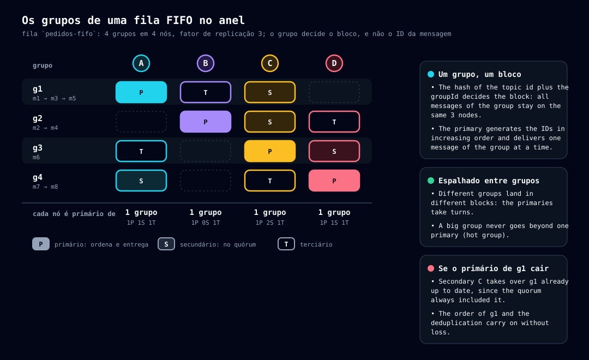

# Tipos de tópico

> Leia antes: [03-conceitos.md](03-conceitos.md). Leia depois: [10-publicacao.md](10-publicacao.md) e [12-entrega.md](12-entrega.md).

## Dois tipos e dois atributos

O campo `type` do tópico só tem dois valores. A **fila FIFO** e a **fila volátil** são **atributos** de uma fila, não tipos à parte:

| Nome | Sigla | Na API | Em uma frase |
|---|---|---|---|
| **Tópico Fila** | QT | `type: "queue"` | Guarda mensagens e entrega cada uma a **um** consumidor |
| **Tópico Distribuidor** | DT | `type: "distributor"` | **Não guarda** nada: copia cada publicação para as filas cujo nome começa com um dos seus prefixos |
| **Fila volátil** | QTV | `queue` + `volatile: true` | Fila que **some sozinha** se ficar sem consumidor |
| **Fila FIFO** | QTF | `queue` + `fifo: true` | Fila que entrega cada **grupo** em ordem, uma mensagem por vez, e deduplica publicações |

O QT é o análogo do Amazon SQS e o DT é o análogo do Amazon SNS. São análogos, **não** equivalentes: o DT não tem assinantes nem protocolos de entrega (e-mail, HTTP); só copia para filas.

## Como escolher

| Preciso de… | Use |
|---|---|
| Uma tarefa por trabalhador (processamento em paralelo) | **Fila** |
| Que vários sistemas recebam o mesmo evento | **Distribuidor** + uma fila por sistema (nome com o prefixo) |
| Fila de resposta de um consumidor efêmero, que não quero limpar | **Fila volátil** (pode ser criada pelo próprio `GET`) |
| Manter a ordem de eventos de uma mesma entidade (um pedido, um cliente) e evitar duplicatas | **Fila FIFO**, com o `groupId` da entidade |


## Campos da definição de um tópico

Criação: `POST /topics`. A resposta e as leituras trazem o mesmo objeto.

| Campo | Aplica-se a | Descrição |
|---|---|---|
| `name` | todos | Chave da API. Caracteres `A-Za-z0-9_-` (o nome vira pasta; maiúsculas são tratadas, ver [08-armazenamento.md](08-armazenamento.md)) |
| `type` | todos | `queue` ou `distributor`. **Imutável** |
| `id` | todos | GUID v7, gerado na criação. Recriar o nome gera outro `id` |
| `tags` | todos | Pares chave/valor, enviados como atributos à telemetria |
| `prefixes` | DT | 1 a 20 prefixos (1 a 100 caracteres cada, mesmo conjunto do nome; vazio é recusado). Alteráveis por `PATCH` |
| `volatile` | fila | `true` para fila volátil. **Imutável** |
| `idleTimeout` | fila volátil | Segundos sem consumidor até a exclusão (padrão **600**; limite 60 s a 7 dias) |
| `fifo` | fila | `true` para FIFO. **Imutável**. Não vale para distribuidor |
| `maxMessageBytes`, `ttl`, `maxDeliveries` | fila | Opcionais; sem eles valem os padrões do nó. A resposta traz o valor **efetivo** em `effective` |
| `deadLetter`, `source` | só leitura | Aparecem na fila de dead-letter (ver abaixo) |

Os limites estão em [19-erros-e-limites.md](19-erros-e-limites.md).

## Fila (QT)

É o tipo básico. Publica-se com `POST /topics/{topic}/messages`, consome-se com `GET` e confirma-se com `DELETE` ([12-entrega.md](12-entrega.md)). As mensagens se espalham por **todo o anel** pelo `id` de cada uma ([06-anel-e-replicacao.md](06-anel-e-replicacao.md)).

### Dead-letter

Toda fila tem uma fila `{fila}-dead-letter` (sufixo configurável em `topics.dead-letter.suffix`), **criada e excluída junto** com ela. Recebe a mensagem que atinge `maxDeliveries` sem ack. Não tem definição própria: usa as configurações da fila de origem, **somente leitura**, e no mais é uma fila comum (consulta e reprocessamento). Aparece em `GET /topics` com `"deadLetter": true` e `"source": "<fila>"`. **Não é FIFO**, mesmo se a origem for. Um `GET` nela **não conta** como consumidor para a fila volátil.

## Distribuidor (DT)

Um DT é só uma **definição**: nome, tags e a lista de prefixos. Não tem mensagens, lista de prontos nem dono de entrega. **Nunca é consumido**: `GET` e ack num DT respondem `409 topic.wrong-type`.


**Publicar** (`POST /topics/{dt}/messages`):

1. O nó que recebe a chamada **casa os prefixos** com a tabela de tópicos (que todo nó tem). Só **filas** casam: um DT nunca é destino (evita laços) e a fila de dead-letter também não.
2. Para cada fila que casou, gera uma **cópia independente**, com **ID próprio**, e a publica pelo procedimento normal daquela fila ([10-publicacao.md](10-publicacao.md)). Cada cópia cai em blocos e nós diferentes.
3. As cópias são **independentes**: a falha de uma não desfaz as outras e não há rollback global.
4. A resposta sai depois de todas as cópias e traz o resultado **por fila**.

```bash
curl -s -X POST localhost:8080/topics/pedidos-dist/messages -H 'Content-Type: application/json' -d '{"a":1}'
# {"deliveries":[{"id":"01a1363a-4e96-…","topic":"pedidos-eu"},
#                {"id":"01a1363a-4e96-…","topic":"pedidos-us"}],"matched":2}
```

**Regras:**

- Uma fila que casa com **vários prefixos do mesmo DT** recebe **uma** cópia; com prefixos de **DTs diferentes**, uma de cada.
- **Sem fila casando não é erro:** a resposta é sucesso com lista vazia e a mensagem é descartada (evento `taba.distributor.no_target`).
- O casamento é feito **na hora da publicação**, sobre as filas que existem então. Fila criada depois não recebe nada retroativo.
- **Falha parcial** não é erro do DT: responde `200` e cada item traz o `id` da cópia **ou** o `error` daquela fila (evento `taba.distributor.partial`).
- O `groupId` e o `deduplicationId` da publicação vão em **todas** as cópias. Cópia **sem `groupId`** para uma fila FIFO falha **só naquela fila** (`400` no item).
- **Teto:** `topics.distributor.max-targets` (sem limite por padrão). Se definido e a publicação casa com mais filas, ela é **recusada inteira** (`422`, nenhuma cópia).

## Fila volátil (QTV)

Uma fila com `volatile: true` é **excluída**, com suas mensagens, se ficar sem consumidor por mais de `idleTimeout`.

- **O que conta como consumidor:** **qualquer** `GET /topics/{topic}/messages`, com ou sem mensagem, com ou sem long polling. O instante é registrado no **começo** da chamada. **Publicar não conta:** uma fila volátil só com produtores é excluída e as mensagens se perdem (intencional).
- **Quando o relógio começa:** na criação. O prazo é `max(createdAt, último GET em qualquer nó) + idleTimeout`.
- **`PATCH`** pode mudar `idleTimeout`; `volatile` é imutável.

### Criação automática pelo `GET`

```bash
curl -s "localhost:8080/topics/volat/messages?autoCreate=true&idleTimeout=120&tag.time=financeiro"
# {"messages":[]}   ← a fila "volat" passou a existir, volátil, com idleTimeout 120
```

| Parâmetro | Descrição |
|---|---|
| `autoCreate` | `true` cria a fila se não existir |
| `volatile` | Padrão **`true`** com `autoCreate`; `false` cria uma fila persistente |
| `fifo` | `true` cria uma fila FIFO |
| `idleTimeout` | Segundos (padrão 600, `topics.volatile.idle-timeout.default`) |
| `tag.<chave>` | Tags da fila |

**Regras:** só cria **fila** (nunca DT). É **idempotente**: se a fila já existe, os parâmetros de criação são **ignorados** e o `GET` segue normal; se o nome pertence a um DT, `409`. Vários consumidores subindo juntos disputam a criação: quem perde trata como "já existe". O primeiro `GET` paga o registro + commit em todos os nós, uma vez por fila. Com `topics.volatile.max-count` definido e atingido, a criação é recusada com `422` (a checagem é local; criações simultâneas podem passar um pouco do teto). Sem `autoCreate`, um tópico inexistente dá `404`.

### O nó gestor

Quem decide excluir uma fila volátil é o **nó gestor** dela: o **primário da posição do hash do `id` do tópico** no anel. Qualquer nó chega ao mesmo gestor sem eleição. O gestor cuida **só da vida do tópico**, nunca das mensagens nem da entrega. A lista de filas que ele gerencia é **derivada** a cada passada (a cada 200 ms), não guardada: muda sozinha com as tabelas de membros e de tópicos.


Ciclo para cada fila gerenciada:

1. **Agenda** a verificação para `createdAt + idleTimeout`.
2. No vencimento faz a **verificação final**: pergunta a **todos os nós** (`GET /cluster/topics/{id}/idle`) há quanto tempo foi o último `GET`. Cada um responde uma **duração**, não um instante, para não depender de relógios sincronizados.
3. Se algum nó teve `GET` mais recente que o `idleTimeout`, **reagenda** para o prazo restante.
4. Se **todos** responderam e nenhum teve `GET` no intervalo, **exclui** pelo mesmo registro + commit do `DELETE /topics/{topic}`, carregando o **`id`**: cada nó só aceita se o tópico atual com aquele nome ainda tiver esse `id`. Uma fila excluída e recriada no meio do caminho nunca é apagada por engano.

**Segurança da verificação:** um nó que **não responde** impede a exclusão (nova tentativa a cada `topics.volatile.idle-check.retry-interval`, padrão 30 s; evento `taba.volatile.check_blocked`). Um nó **sem registro** de `GET` responde o tempo desde que subiu, então um reinício só pode **adiar** a exclusão. Gestor fora do ar: nenhuma fila dele é excluída; **a fila segue funcionando**.

**Quando o anel muda**, o novo gestor **faz a consulta de ociosidade na hora** (com um pequeno espalhamento aleatório, `topics.volatile.takeover.jitter`, padrão 2 s) em vez de partir de zero: o estado de verdade está nos nós. Uma exclusão iniciada pelo gestor antigo e outra pelo novo são inofensivas: a segunda encontra o tópico já excluído (ou com outro `id`).

**Corridas aceitas:** um `GET` que chega entre a verificação final e o commit recebe `404` (ou recria a fila, com `autoCreate`, com `id` novo e sem as mensagens antigas); um consumidor com mensagem invisível recebe `404` ao tentar o ack depois da exclusão.

## Fila FIFO (QTF)

Numa fila FIFO, as mensagens do mesmo **grupo** (`groupId`) são entregues **na ordem de publicação, uma por vez**, e grupos diferentes andam **em paralelo**. A ordem vale **dentro do grupo**; não há ordem entre grupos nem no tópico inteiro. É o análogo da fila FIFO do SQS.

**Garantias:**

- **Ordem por grupo:** a mensagem seguinte só é entregue depois do ack da anterior (ou de ela sair por `ttl` ou dead-letter).
- **Pelo menos uma vez:** se o ack não chega a tempo, a mesma mensagem é reentregue; continua sendo a cabeça do grupo, então a ordem se mantém.
- **Sem duplicatas de publicação** dentro da janela de deduplicação.
- Um produtor que publica em sequência (espera a resposta antes da próxima) tem a ordem preservada. Produtores concorrentes no mesmo grupo ficam na ordem em que chegam ao primário do grupo.

### Criar e usar

```bash
curl -s -X POST localhost:8080/topics -H 'Content-Type: application/json' \
  -d '{"name":"ordens","type":"queue","fifo":true}'
curl -s -X POST "localhost:8080/topics/ordens/messages?groupId=g1&deduplicationId=d1" -d '{"n":1}'
# {"duplicate":false,"id":"01a1363a-5434-…"}
curl -s -X POST "localhost:8080/topics/ordens/messages?groupId=g1&deduplicationId=d1" -d '{"n":1}'
# {"duplicate":true,"id":"01a1363a-5434-…"}      ← a mesma chave: devolve o id da original
curl -s -X POST localhost:8080/topics/ordens/messages -d '{"n":3}'
# 400 {"code":"validation.group-id-required",…}
```

- `groupId` é **obrigatório** (1 a 128 caracteres, `A-Za-z0-9_-.:`). `deduplicationId` é opcional (mesmos caracteres); numa fila que **não** é FIFO o parâmetro é recusado com `400`.
- A mensagem entregue traz `groupId` e `deduplicationId`.
- Aceita qualquer `replication.factor`: o quórum da FIFO é `min(2, fator)` (primário e secundário; com fator 1, só o primário).

### Onde o grupo mora

Na fila comum o bloco vem do `id` da mensagem. Na FIFO a posição é `hash(id do tópico + ":" + groupId)`: **todas as mensagens de um grupo caem no mesmo bloco**, com o mesmo primário e as mesmas réplicas. O primário é o dono da entrega **e** quem **ordena** as publicações do grupo. O tópico fica espalhado **entre grupos**, não dentro de um.



### Publicar: o primário do grupo coordena


1. O cliente publica em **qualquer nó**; ele calcula a posição do grupo, acha o **primário** e **repassa a publicação a ele** (`POST /cluster/topics/{topic}/fifo/publish`).
2. O **primário coordena**: gera o ID, confere a deduplicação e faz o registro + commit.
3. **ID monotônico por grupo:** `max(agora, último ID do grupo + 1)`, usando os bits de contador do GUID v7; a ordem de entrega do grupo é a ordem do ID.
4. **O primário confere o dono:** se não for ele, responde `421`; quem repassou espera `write.retry.backoff`, relê a **própria** tabela e tenta de novo, até `fifo.forward.max-attempts` (padrão 3); esgotado, `503`.
5. **Repetição segura:** como o primário deduplica, o cliente e o repasse podem repetir uma publicação que deu `502`/`504`.
6. **Primário ainda sincronizando ou fora do ar** (e ainda na tabela): as publicações do grupo respondem `503` até ele ficar pronto ou ser excluído. É o preço da ordem: na fila comum uma nova tentativa gera outro ID e cai em outro bloco.

### Quórum: primário **e** secundário

Na FIFO o quórum de escrita, entrega e ack **sempre inclui o primário e o secundário**, e nunca é menor que 2. Motivo: quando o primário sai, o secundário herda o bloco. Se o secundário pudesse estar defasado, o novo primário poderia **reentregar uma mensagem já confirmada**: o consumidor veria `m1, m2, m1`. Com o secundário sempre no quórum, o novo primário **nunca** está defasado (e herda também a deduplicação). Se o secundário está fora do ar e ainda na tabela, as operações **do grupo** respondem `503` mesmo com o terciário saudável.

O `receiptToken` de uma mensagem FIFO é `{posição em 16 hexadecimais}-{guid}`: o ack chega a **qualquer** nó, que só tem o `id` e o recibo, e precisa achar os responsáveis sem conhecer o grupo. Para o cliente continua opaco; um recibo malformado é `409 message.stale-receipt`.

### Entrega: um grupo, uma mensagem em voo

Um grupo está **livre** quando não tem mensagem em voo e tem prontas; **ocupado** quando tem uma em voo.

- A **lista de prontos** tem **uma entrada por grupo livre**: a cabeça (a mais antiga). A entrega tira a cabeça mais antiga de qualquer grupo livre, e o grupo passa a ocupado.
- **Entre grupos vale a cabeça mais antiga.** A entrega justa por faixas **não** vale na FIFO: a justiça vem de cada grupo ocupar no máximo um lugar.
- **`maxMessages`:** cada mensagem do lote vem de um grupo **diferente**.
- **Reentrega:** vencida a invisibilidade sem ack, a **mesma** mensagem volta como cabeça. `visibilityTimeout: 0` faz o mesmo.
- **`maxDeliveries`:** a mensagem que o atinge vai para a dead-letter e **o grupo segue** com a próxima, como no SQS.
- **`ttl`:** uma mensagem vencida sai de onde estiver; se era a cabeça, o grupo é **liberado**.
- **Mudança de dono:** o novo primário refaz a lista dos metadados; um grupo com mensagem invisível no futuro entra como **ocupado**.

### Deduplicação

A fila FIFO não duplica publicações repetidas dentro de uma **janela** (`fifo.dedup.window`, padrão **300 s**).

- **Chave:** o `deduplicationId`; se ausente, o **SHA-256 dos bytes do corpo** (o `contentType` não entra). Toda mensagem da fila tem um.
- **Escopo: o grupo.** Quem confere é o primário do grupo. A mesma chave em grupos diferentes **não** é duplicata.
- **Duplicata:** não cria mensagem; responde sucesso com o `id` da original e `duplicate: true`. A janela conta a partir do instante do ID da original. Duas publicações simultâneas com a mesma chave são serializadas.
- **Ack é exclusão lógica:** para a deduplicação valer pela janela **inteira**, o ack **não apaga a linha**: grava `deleteAt` (`instante do ID + janela`) e apaga só o **corpo** e os metadados de entrega. A linha curta é replicada pelos mesmos caminhos e **varrida** quando `deleteAt` passa (`retention.sweep.interval`). Essas linhas ficam fora de todas as listas e contagens.

> ⚠️ **Cuidado com a chave padrão:** duas mensagens legítimas e **idênticas** no mesmo grupo, dentro da janela, viram uma só, em silêncio. Quem precisa de mensagens iguais em sequência deve enviar um `deduplicationId` próprio.

### Limites e custos

- **Grupo quente, nó quente:** um grupo vive num bloco só; a vazão dele é a de um primário. A distribuição só é boa com **muitos grupos** (a condição de tópico `noisy-group` aponta o grupo que concentra a fila).
- **Salto extra:** `(N−1)/N` das publicações fazem um salto interno com o corpo inteiro.
- **Hash do corpo:** CPU extra no primário para corpos grandes sem `deduplicationId`.
- **Relógio do primário:** a janela depende do instante do ID gerado pelo primário; o ID monotônico limita o efeito.
- **Escrita no ack:** o ack atualiza uma linha no banco do tópico, inclusive para mensagem que estava só em memória.
- **Pausa:** um bloco em sincronização não entrega, então os grupos dele pausam.

## Quadro comparativo

| | Fila | Distribuidor | Volátil | FIFO |
|---|---|---|---|---|
| Guarda mensagens | sim | **não** | sim | sim |
| Consumível (`GET`) | sim | **não** (`409`) | sim | sim |
| Onde a mensagem mora no anel | pelo `id` da mensagem | — (copia para filas) | pelo `id` da mensagem | pelo **grupo** |
| Ordem | não garantida | — | não garantida | **por grupo** |
| Deduplicação | não | — | não | **sim** (janela) |
| Some sozinho | não | não | **sim** (`idleTimeout`) | não (a menos que também volátil) |
| Pode ser criado pelo `GET` | não | **nunca** | **sim** | sim (`fifo=true`) |
| Tem dead-letter | sim | não | sim | sim (não FIFO) |

## Fontes e provas

- `core/topic` (definição), `engine/topics` (registro e regras), `engine/messages/index` (lista de prontos por grupo), `cluster/volatile` (gestor), `cluster/replication/forward.rs` (repasse FIFO), `http/topics`, `http/messages`.
- Respostas dos exemplos copiadas de um nó real, sozinho (perfil de um nó).
- Casos de uso: UC-TOP (tópicos), UC-DST (distribuidor), UC-VOL (volátil e gestor), UC-FIF (FIFO), UC-GRP (grupos); veja [26a](26a-casos-de-uso-implementados.md). Testes: `tests/topics.rs`, `fifo.rs`, `fifo_cluster.rs`, `volatile.rs`, `volatile_cluster.rs`.
- Histórico: `15-topicos-distribuidor.md`, `17-topicos-fifo.md`.
