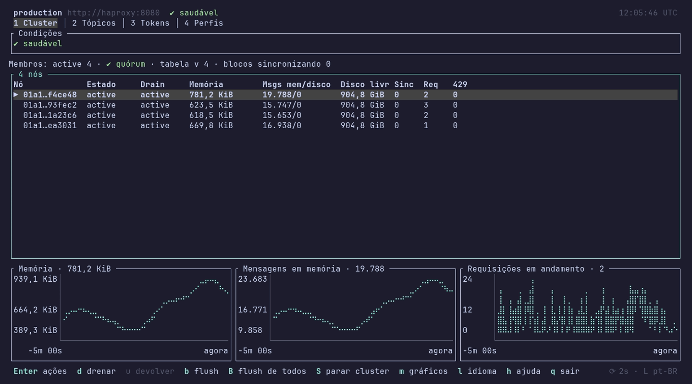
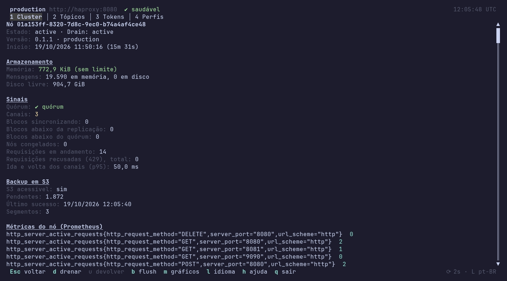
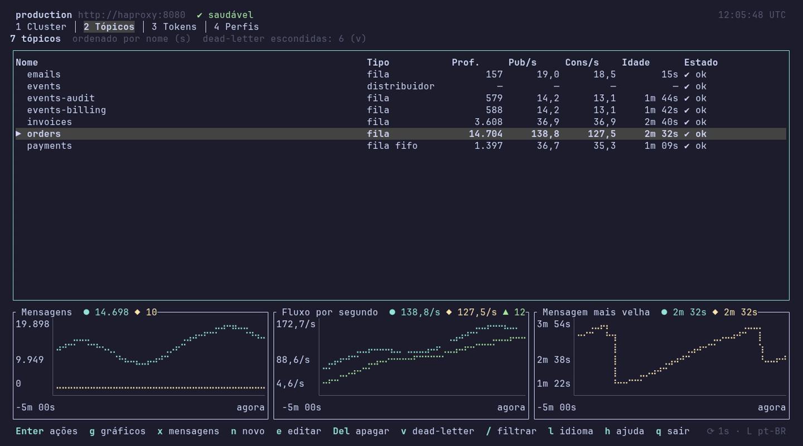
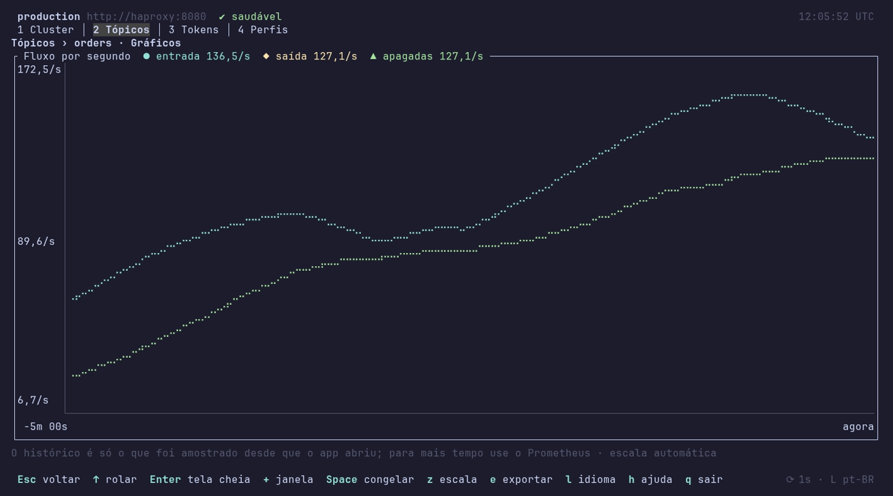

# Interface em tela cheia do `taba-cli` (TUI)

> **Status: 🟨 parcial.** Estão prontos o **Cluster**, os **Tópicos** (lista, formulários, gráficos e mensagens), os **Tokens** e os **Perfis**. Faltam escutar mensagens em laço, repetir uma publicação, pesquisar e ordenar as mensagens lidas e as abas Configuração e Grupos de um tópico (veja [Ainda não existe](#ainda-não-existe)). Os comandos de uma linha só, em [20-cli.md](20-cli.md).

`taba-cli tui` abre uma interface de terminal, em tela cheia, para **acompanhar e operar** um cluster: ver a saúde dos nós, drená-los, criar e apagar tópicos, ver os gráficos de uma fila, publicar e ler mensagens, gerenciar tokens e trocar de perfil. Ela usa o **mesmo perfil, o mesmo token e as mesmas rotas** dos comandos ([20-cli.md](20-cli.md)); **não cria nada no servidor**, e tudo o que ela faz também se faz pelos comandos.

## Abrir

```bash
taba-cli                                  # num terminal, abre a interface
taba-cli tui --profile homologacao        # com um perfil específico
taba-cli tui --lang pt-BR --history-retention 30m
```

| Opção | Variável | Padrão | O que faz |
|---|---|---|---|
| `--profile <nome>` | `TABA_CLI_PROFILE` | o perfil padrão | Qual perfil usar. Fixa a escolha: a caixa de escolha do perfil não abre |
| `--lang <código>` | `TABA_CLI_LANG` | o do sistema | Idioma: `en-US` ou `pt-BR` |
| `--no-mouse` | — | mouse ligado | Não captura o mouse (a roda de rolagem) |
| `--history-retention <tempo>` | — | `1h` (no máximo `6h`) | Quanto histórico dos gráficos guardar |
| `--history-interval <tempo>` | — | `5s` (no mínimo `1s`) | De quanto em quanto tempo medir para os gráficos |
| — | `NO_COLOR` | — | Se existir e não for vazia, tira as cores |
| — | `TABA_CLI_ASCII` | — | Com `1`, troca ícones e barras por ASCII (também vale quando o locale não é UTF-8) |

- **Precisa de um terminal** (entrada e saída). Fora dele `taba-cli tui` imprime a ajuda e sai com `2`; `taba-cli` sem comando faz o mesmo.
- **Tamanho mínimo: 60 colunas por 16 linhas.** Abaixo disso um aviso substitui a tela; ao redimensionar, ela volta sozinha. A interface é pensada para 80×24 ou mais.
- A interface é a feature `tui` do Cargo, **ligada por padrão** nos binários e na imagem Docker. Uma compilação com `--no-default-features` não a tem e `tui` responde com um erro de uso.
- Os comandos diretos (`topic list`, `publish`…) **não** ligam o terminal em modo cru: só `tui` faz isso.

## Configurar

A interface lê o mesmo `config.yml` dos perfis ([20-cli.md](20-cli.md#perfis)). Além dos perfis, ele guarda duas seções que são só dela:

```yaml
ui:
  language: pt-BR
history:
  retention: 1h
  interval: 5s
```

| Chave | Quem grava | Padrão | O que faz |
|---|---|---|---|
| `ui.language` | a tecla `l` | o idioma do sistema | O idioma escolhido, lembrado para a próxima vez |
| `history.retention` | você | `1h` | Quanto histórico dos gráficos guardar (`90`, `90s`, `5m`, `1h`; no máximo `6h`) |
| `history.interval` | você | `5s` | O intervalo das medições (mínimo `1s`) |

- **Idioma**, o primeiro que existir: `--lang` → `TABA_CLI_LANG` → `ui.language` → o idioma do sistema (`LC_ALL`, `LC_MESSAGES`, `LANG`; no Windows, o da interface) → `en-US`. `pt`, `pt_BR` e `pt-BR.UTF-8` valem como `pt-BR`. A tecla `l` troca na hora e grava em `ui.language`. Traduzem-se rótulos, dicas e avisos; **não** se traduzem teclas, rotas, campos JSON, códigos de erro nem os nomes de condições, e o `message` do servidor aparece como ele mandou.
- **Histórico:** as medições valem **só durante a sessão** (memória; nada vai ao disco). Um gráfico aberto cedo diz quantos minutos há. Para histórico longo use o Prometheus ([13-observabilidade.md](13-observabilidade.md)). A opção da linha de comando vence a chave do arquivo.
- **Qual perfil abre:** `--profile`, `TABA_CLI_PROFILE` ou `TABA_CLI_URL` fixam a escolha. Sem nenhum deles e com **mais de um** perfil, abre uma caixa para escolher, com o perfil padrão (●) já selecionado: `Enter` conecta e `Esc` usa o padrão. Com **um** perfil só, assume-o sem perguntar. **Sem nenhum perfil**, abre o formulário do primeiro (já marcado como padrão); `Esc` o pula e usa o endereço embutido (`http://127.0.0.1:8080`, sem token). Nada é lido do servidor antes da escolha. A tecla `o` abre a mesma caixa em qualquer tela, e aí `Esc` só a fecha.
- **O token** vem do perfil (`token-file` ou `token`). Quase tudo o que a interface mostra e faz sobre o cluster pede o **token raiz** ou `admin` (tabela abaixo); com um token comum ela mostra a lista de nós e diz o que falta.

### O que cada ação pede do token

A interface habilita ou desabilita cada ação **antes** de chamar, e uma ação que não pode rodar aparece apagada **com o motivo**; quem decide é sempre o servidor ([14-seguranca.md](14-seguranca.md)). `manage` e `admin` **incluem** `create`, `publish` e `consume`.

| Ação | Token mínimo |
|---|---|
| Ver a lista de nós, os tópicos e as estatísticas (dentro dos prefixos do token) | qualquer token válido |
| Criar um tópico | `create` |
| Editar, apagar ou **esvaziar** um tópico | `manage` sobre o tópico |
| Publicar uma mensagem | `publish` |
| Ler, confirmar e devolver mensagens | `consume` |
| Aba Tokens; condições, detalhe, gráficos, drain, retorno e backup de nós | `admin` (ou o token raiz) |
| Parar o cluster; criar, alterar ou revogar um token `admin` | o token raiz |

## A tela

```text
 taba-cli · local · http://127.0.0.1:8080        ● saudável         14:32 UTC
 [1 Cluster]  2 Tópicos   3 Tokens   4 Perfis
┌──────────────────────────────────────────────────────────────────────────┐
│                       o conteúdo da aba em foco                          │
└──────────────────────────────────────────────────────────────────────────┘
 Enter ações · n novo · / filtrar · h ajuda · q sair             ⟳ 2s  pt-BR
```

*(Ilustrativa: o desenho de verdade muda com a aba e com a largura.)*

- **Linha de status:** o perfil, a URL, a **pior condição** do cluster (sempre uma palavra **e** um ícone, nunca só cor) e o relógio (UTC). Quando um nó não respondeu à leitura aparece o selo **incompleto: nó X não respondeu**; a interface nunca soma nós por conta própria.
- **Abas:** Cluster, Tópicos, Tokens e Perfis (`1` a `4`). **Não há aba de mensagens**: uma mensagem sempre pertence a um tópico, então elas se abrem a partir da aba Tópicos.
- **Rodapé:** as teclas da tela em foco, o estado da atualização (`⟳ 2s`, pausado, ou **velho** com a hora do último dado bom) e o idioma. Em 80 colunas algumas dicas são cortadas; `h` mostra todas.
- **Sem conexão, `401`, `403`, `429` ou `503`:** o quadro mostra `✖ offline` (ou o que falta) **sem apagar o último dado bom**, tenta de novo com intervalos crescentes (até 30 s) e obedece o `Retry-After`. Nunca trava.
- **Rolagem:** tudo rola (setas, `PgUp`/`PgDn`, `Home`/`End` e a roda do mouse); a barra de rolagem só aparece quando o conteúdo excede. O mouse é opcional: **toda ação tem tecla**. Só a roda é usada (o clique não faz nada).
- **Atualização:** o Cluster a cada 2 s; as listas de tópicos e tokens a cada 5–10 s; pausa quando um formulário ou caixa está aberto.

## Teclas

Setas e teclas do Vim fazem o mesmo (`↑↓` e `k j`). As letras são mnemônicas e **iguais nos dois idiomas**. Letra minúscula é a ação comum; maiúscula é a crítica ou a de "todos". `h` (ou `?`, `F1`) mostra a lista completa da tela em foco, e `:` abre a **paleta de comandos**, que acha qualquer ação pelo nome (no idioma atual ou em inglês) e a executa.

| Teclas | Ação |
|---|---|
| `1` a `4` · `[` `]` · `Alt+←` `Alt+→` | Ir a uma aba · anterior / seguinte |
| `Tab` · `Shift+Tab` | Painel seguinte / anterior |
| `↑ ↓` `k j` · `PgUp PgDn` `Ctrl+u Ctrl+d` · `Home End` | Mover · rolar · primeiro / último (`g G` também, onde `g` não é outra ação) |
| `Enter` | Numa lista: abre o **menu de ações** do item selecionado (dentro de uma caixa: confirma) |
| `Esc` | Fecha ou cancela; sobe um nível (da tela cheia de um gráfico à lista de gráficos, daí ao tópico) |
| `/` · `s` `S` | Filtrar por parte do nome · ordenar / inverter |
| `r` · `p` | Atualizar agora · pausar ou retomar a atualização |
| `l` · `o` | Idioma · trocar de perfil |
| `h` `?` `F1` · `:` | Ajuda · paleta de comandos |
| `Ctrl+s` | Enviar o formulário aberto |
| `q` `Ctrl+c` | Sair (se há um formulário alterado, pergunta) |

| Tela | Teclas próprias |
|---|---|
| **Cluster** | `Enter` ações do nó · `i` detalhe · `d` drenar · `u` devolver · `b` flush de backup deste nó · `B` flush de todos · `S` parar o cluster · `m` gráficos do cluster |
| **Tópicos** | `Enter` ações do tópico · `n` novo · `e` editar · `Del` `d` apagar · `v` mostrar ou esconder as dead-letter · `i` resumo · `g` gráficos · `x` mensagens |
| **Mensagens** (de um tópico) | `Enter` abrir a mensagem · `p` publicar · `r` ler · `a` confirmar (ack) · `A` confirmar todas · `v` devolver à fila · `P` esvaziar a fila · `Esc` volta à lista |
| **Gráficos** (nó ou tópico) | `↑ ↓ Home End` escolhem o gráfico · `Enter` tela cheia · `+` `-` janela · `Espaço` congela · `z` escala · `e` exportar CSV |
| **Tokens** | `Enter` ações do token · `n` novo · `e` editar · `c` clonar · `Del` `x` revogar |
| **Perfis** | `Enter` ações do perfil · `c` conectar · `n` novo · `e` editar · `d` tornar padrão · `Del` `x` remover · `t` testar a conexão |

**Formulários.** `Tab` e `Shift+Tab` (ou `↑ ↓` entre campos) andam pelos campos, `Espaço` marca uma caixa, `←` `→` trocam uma opção, `Ctrl+s` envia e `Esc` cancela. O erro do servidor (`código: mensagem`) aparece **dentro** do formulário, que continua aberto. Uma colagem em bloco funciona em qualquer campo de texto (e AltGr, como `/` e `@` no teclado ABNT2, também).

**Confirmações.** Uma ação que apaga ou interrompe pede confirmação e o botão padrão é **Cancelar**. Para *parar o cluster*, *apagar um tópico* e *esvaziar a fila* a pessoa **digita o nome** (do cluster ou do tópico).

### O menu de ações

`Enter` numa linha de Tópicos, Tokens, Perfis ou da lista de nós abre um menu do que se pode fazer **com aquele item**, com o nome do alvo em cada entrada (por exemplo *Editar o tópico*, *Apagar o tópico*, *Publicar uma mensagem*, *Ler mensagens*) para não confundir um tópico com uma mensagem. `↑ ↓` escolhem, `Enter` executa, `Esc` fecha. Uma entrada que não pode rodar agora aparece apagada, e a linha sob o menu diz o motivo. As teclas de atalho de cada tela continuam valendo direto da lista.

| Item | Entradas do menu |
|---|---|
| Tópico | Resumo · Gráficos · Publicar uma mensagem · Ler mensagens · Esvaziar a fila · Editar · Apagar |
| Nó | Detalhe · Gráficos · Drenar · Devolver · Flush deste nó · Flush de todos · Parar o cluster |
| Token | Editar · Clonar · Revogar |
| Perfil | Conectar · Editar · Tornar padrão · Testar · Remover |

## Cluster



A aba Cluster mostra, de cima para baixo, as **condições** ativas do cluster (a pior primeiro, com ícone e palavra; sem nenhuma, uma linha "saudável"; `Enter` numa condição explica o que significa e o que fazer), a **tabela de nós** e, embaixo, **três gráficos do nó selecionado** (memória, mensagens em memória e requisições em andamento). `Tab` alterna entre as condições e os nós.

- **Tabela de nós:** id (início…fim, porque os ids de nós criados juntos começam iguais), estado, drain, memória como barra com %, mensagens em disco, blocos em sincronização e requisições em andamento; a partir de 100 colunas, também disco livre e rejeições `429`. Um nó inacessível fica vermelho e diz isso; um nó sem limite de memória (modo desenvolvimento) mostra "sem limite".
- **Detalhe do nó** (`i`): id, estado, drain, versão, início e tempo no ar; memória contra o limite (amarelo a 80 %, vermelho a 95 %); mensagens em memória e em disco; os sinais do nó (canais, quórum, blocos em sincronização, abaixo da replicação, nós congelados); e o **backup S3**, só quando está configurado (acessível, pendentes, último sucesso, segmentos).
- **Drenar** (`d`): mostra o que acontece e acompanha `pendingMessages` até `drained`. Um nó em drain ou drenado oferece **devolver** (`u`); ele volta como nó novo. Um cluster de **um só nó** em drain recusa tudo, inclusive o próprio retorno (`503 cluster.node-draining`): é um limite do servidor (PRB-061).
- **Flush de backup** (`b` um nó, `B` todos): mostra um relatório por nó (completo ou não, pendentes, tempo esgotado). Sem S3 configurado o servidor responde `422 backup.not-configured` e a interface diz isso.
- **Parar o cluster** (`S`): pede o **nome do cluster digitado**. Os nós ficam `drained` e continuam como processos; pará-los é com o orquestrador.
- **Gráficos do cluster** (`m`): uma **lista de seis indicadores à esquerda** (memória contra o limite, mensagens prontas, mensagens em disco, requisições em andamento, rejeições `429`, RTT do canal), cada um com o valor atual; o gráfico do indicador sob o cursor aparece ao lado. `↑ ↓` escolhem, `Enter` dá a ele a **tela cheia** e `Esc` volta (primeiro da tela cheia, depois dos gráficos).
- **Com um token comum** a aba mostra só a lista de nós e troca o resto pelo aviso de que o token precisa ser `admin` ou o raiz.



## Tópicos



A lista mostra o nome, o tipo (`fila`, `fila fifo`, `fila vol`, `distribuidor`, `dead-letter`), a profundidade, as taxas de publicação e consumo, a idade da mais antiga e o estado (ícone e a pior condição, sem tradução). A dead-letter fica escondida até `v` e, quando aparece, vem apagada e sem limites no detalhe, pois segue a fila de origem; um distribuidor mostra "—" onde não há fila. `/` filtra por parte do nome e `s` ordena (nome, mais novo, mais antigo, profundidade). A lista lê as páginas de 200 em 200, até 5 000 tópicos. Se as estatísticas falham, a tabela mostra os tópicos sem números e diz "números indisponíveis".

Sob a tabela ficam **três gráficos da fila selecionada**, lado a lado (mensagens, fluxo e idade), com os valores atuais no título; sob um distribuidor aparece o resumo. Eles usam a mesma leitura dos gráficos do tópico, uma por intervalo e só enquanto a lista é mostrada.

- **Criar** (`n`): nome, tipo (fila ou distribuidor), FIFO, volátil, tempo ocioso, bytes máximos da mensagem, ttl, máximo de entregas, tags (`chave=valor`) e prefixos. Os campos que não valem para o tipo ficam travados. A validação é a do envio; o resto é do servidor.
- **Editar** (`e`): tipo, FIFO e volátil aparecem **travados** com o motivo ("não muda depois"). Só o que mudou vai ao servidor, e os três limites aceitam número ou `default` (volta ao padrão do nó).
- **Apagar** (`Del` ou `d`): pede o nome do tópico digitado e avisa que as mensagens (e a dead-letter) se perdem.
- **Resumo** (`i`): numa caixa, o nome, o id, a criação, as tags e os limites.
- **Gráficos do tópico** (`g`): uma tela com a linha `Tópicos › nome · Gráficos`. Na esquerda, a lista de três indicadores, cada um com o valor de agora; ao lado, o gráfico do que está sob o cursor; `Enter` dá a ele a tela cheia.
  - **Mensagens:** visíveis e invisíveis.
  - **Fluxo** por segundo: entrada (publicadas), saída (entregues) e apagadas (ack).
  - **Idade** da mais velha da fila e dos **três maiores grupos** (os grupos barulhentos).
- Um distribuidor não tem fila: não tem gráficos de fila e as teclas que dependem dela são recusadas com o motivo.



## Mensagens de um tópico

`x` na lista (ou *Ler mensagens* e *Publicar uma mensagem* do menu) abre a tela `Tópicos › nome · Mensagens`. No alto ficam os contadores da fila (visíveis, invisíveis, profundidade, a mais antiga); abaixo, a tabela do que **você leu** nesta tela.

> **A API não lista as mensagens de uma fila.** A tabela mostra só o que a interface leu a pedido, e os contadores do alto são a verdade da fila. **Abrir a tela, escolher um tópico ou atualizar nunca lê a fila:** ler é *entregar* (conta uma entrega e deixa a mensagem invisível aos outros consumidores), então só acontece quando você pede.

- **Ler** (`r`): abre um formulário com **quantas mensagens** (padrão 10) e o **tempo de invisibilidade** (padrão 30 s); `Enter` passa de um campo ao seguinte e envia no último. Cada leitura **substitui a lista** pelo que ela trouxe (a primeira linha fica selecionada; se nada veio, a lista fica vazia e uma linha avisa). Linhas de uma leitura anterior somem, e uma mensagem delas ainda retida não pode mais ser confirmada daqui (o recibo estava na linha): ela volta à fila quando o tempo acaba.
- **A tabela:** hora, id, grupo, entregas, estado (`invisível 27s`, `visível de novo`, `apagada`), tamanho e um trecho do corpo.
- **Abrir uma mensagem** (`Enter`): uma caixa com o estado, o grupo, o tipo, o tamanho, as entregas, a hora da leitura e o corpo. Enquanto a retenção dura, os segundos que faltam aparecem ao vivo e há duas ações: `v` **altera o tempo** de invisibilidade (um formulário com 30 s; `0` devolve a mensagem à fila) e `d` (ou `Del`, ou `a`) **apaga** (ack). Quando o tempo **acaba** com a mensagem aberta, a caixa avisa que o recibo não vale mais e que a mensagem **não pode mais ser alterada nem apagada daqui** (a fila volta a entregá-la), e essas teclas ficam apagadas. `Esc`, `Enter` ou `q` fecham a caixa.
- **Como o corpo é mostrado:** por padrão, **exatamente como foi enviado** (pode ser preciso ver os bytes originais). `f` mostra **formatado** quando é JSON válido (reindentado com dois espaços) ou YAML simples (mapas e textos; listas e outros YAML ficam como enviados); um corpo que não é nenhum dos dois avisa e é mostrado como enviado. `b` mostra os bytes **em base64** (linhas de 76). Apertar a tecla em uso volta a *como enviado*, e a borda do corpo diz a forma em uso. Cada linha guarda os primeiros 16 KiB do corpo para essas visões; um corpo maior avisa que foi cortado.
- **Publicar** (`p`): o corpo é um **editor de várias linhas** (linhas numeradas; `Enter` quebra a linha, as setas andam, `↑` na primeira linha e `↓` na última vão ao campo vizinho, uma colagem mantém as linhas), o tipo de conteúdo, a caixa **Corpo em base64**, o id do grupo e o id de deduplicação (a fila FIFO usa os dois). Com a caixa marcada, o texto digitado é lido como base64 e o que se envia são os **bytes decodificados**; um texto que não é base64 é recusado no formulário. `Ctrl+s` envia, e o resultado (id da mensagem, ou a recusa) fica numa linha sob a tabela.
- **Confirmar e devolver:** `a` confirma (apaga) a mensagem selecionada, `A` todas as que ainda estão retidas, `v` devolve a selecionada à fila. O recibo só vale enquanto a mensagem está retida.
- **Esvaziar a fila** (`P`): pede o nome do tópico digitado, diz quantas mensagens se perdem e que **todos os nós** serão avisados. No fim mostra quantas foram removidas, ou a falha `503 cluster.prune-incomplete` com os nós que não concluíram (repetir é seguro). Mensagens publicadas durante o esvaziamento não são cobertas.
- As teclas são recusadas, com o motivo, num **distribuidor** e numa fila **dead-letter** (não se publica nela) e quando o token não tem a permissão (`publish`, `consume` ou `manage`).

## Tokens

Uma tabela com nome, id, permissões, prefixos e validade; o **segredo nunca está na lista**. Um token expirado aparece em vermelho e um que expira em até 7 dias, em amarelo. `/` filtra por parte do nome e `s` ordena (mais novo, mais antigo, nome, id).

- **Criar** (`n`): nome, as permissões (`publish`, `consume`, `create`, `manage`, `admin`), prefixos e validade. `admin` não tem prefixos e só o token raiz pode marcá-lo. A validade aceita vazio ou `none` (sem prazo), `30d` `12h` `90m` (a partir de agora), uma data (`2027-01-31`, início do dia em UTC) ou um instante RFC 3339.
- **O segredo aparece uma vez**, num popup: `c` o copia (OSC 52, se o terminal permitir) e `s` o grava em `taba-token-<id>.txt` na pasta atual (`0600` no Unix, nunca sobre um arquivo existente). Passados 30 s, ou quando a janela perde o foco, ele é escondido (pontos), e `c` ainda o copia. Fechar sem copiar nem salvar pede um segundo `Esc`. Ele nunca vai para um log, um erro ou o aviso do rodapé.
- **Editar** (`e`): só o nome e a validade; permissões e prefixos aparecem travados com o motivo (para mudá-los, **clone**).
- **Clonar** (`c`): abre *Criar* já preenchido. No popup do segredo, a caixa **Revogar o antigo ao fechar** (`r`) começa **desmarcada**.
- **Revogar** (`Del` ou `x`): confirmação que começa em **Cancelar**; vale em todos os nós.
- Sem o token raiz nem `admin`, a aba explica o `403` e qual token está em uso, em vez de mostrar uma lista vazia; sem autenticação no servidor, diz que não há tokens.

## Perfis

A lista mostra os perfis do `config.yml`, com o padrão (●) e o que está em uso. `Enter` abre o menu; `c` **conecta**: as próximas chamadas vão ao servidor do perfil, os históricos e as telas recomeçam, e a resposta que ainda vinha do servidor antigo é descartada.

- **Novo** (`n`) e **editar** (`e`): nome, `url`, `token-file`, `token`, `ca-file` e a caixa do perfil padrão; os outros campos do perfil (`output` e os tempos) são mantidos como estão. `Ctrl+t` testa os valores **ainda não salvos**.
- **Padrão** (`d`), **remover** (`Del` ou `x`, com confirmação em **Cancelar**) e **testar** (`t`, que faz `GET /topics?limit=1`).
- Gravar só troca `default` e `profiles` no arquivo: `ui` e `history` ficam como estão. O arquivo é reescrito inteiro e **comentários feitos à mão não são preservados**.
- Um token digitado no formulário vai para o arquivo **como foi digitado** (o `config.yml` não é criptografado) e a tela nunca o desenha (aparece como pontos); o formulário recomenda o `token-file`.
- O comando `taba-cli profile`, sem subcomando, ainda abre a tela de perfis antiga ([20-cli.md](20-cli.md#perfis)); a aba Perfis a substitui.

## Gráficos: janela, escala e exportação

Valem para os gráficos do nó, do cluster e do tópico.

| Tecla | O que faz |
|---|---|
| `+` · `-` | Janela maior · menor (1, 5, 15, 30 ou 60 min, nunca acima da retenção) |
| `Espaço` | Congela o gráfico (e retoma) |
| `z` | Escala automática, ou a partir do zero |
| `e` | Exporta a série visível em CSV: abre um popup com o nome do arquivo (`taba-<nó>-<série>.csv` ou `taba-<tópico>-charts.csv`) e **nunca grava sobre um arquivo existente** |
| `Enter` · `Esc` | Tela cheia · sair dela |

Cada linha tem nome na legenda **e** marcador próprio, não só cor. O título mostra o valor de agora. As taxas vêm de contadores: um contador que diminui (nó reiniciado) é um reinício, nunca uma taxa negativa. Uma leitura incompleta (`partial`) é guardada marcada como tal. O histórico é só o amostrado desde que a interface abriu, e os números de tópico vêm da leitura **de um nó** quando o servidor devolve só ela (PRB-059), então os totais do cluster podem estar abaixo do real.

## Ainda não existe

| O quê | Situação |
|---|---|
| **Escutar** uma fila (long polling com auto-ack) | Não feito: hoje só se lê sob pedido (`r`). Para um laço contínuo use `taba-cli subscribe` |
| **Repetir** uma publicação *n* vezes | Não feito: use `taba-cli publish --count` |
| **Pesquisar** e **ordenar** as mensagens lidas, e os gráficos da seleção | Não feito |
| Abas **Configuração** e **Grupos** de um tópico | Não feitas; os grupos barulhentos aparecem no gráfico de idade |
| Filtro de tópicos por **tag** e por **condição** | Não feito; só o nome |
| Clique do mouse; layout estreito pensado para menos de 80 colunas | Só a roda do mouse; abaixo de 80 colunas algumas dicas são cortadas |
| **Subir** ou **matar** o processo de um nó | Fora do escopo: é do orquestrador |

## Problemas comuns

| Sintoma | Causa e saída |
|---|---|
| `taba-cli tui` imprime a ajuda e sai com `2` | Não há terminal (entrada ou saída redirecionada); rode num terminal |
| "Preciso de pelo menos 60 colunas por 16 linhas" | Aumente a janela; a tela volta sozinha |
| A aba Cluster só lista os nós e pede o token raiz | O token do perfil não é `admin` nem raiz; use `o` para outro perfil |
| Uma tecla aparece apagada com um motivo na linha de baixo | O token não tem a permissão, o nó não está num estado que aceite a ação |
| Símbolos estranhos no lugar de ícones e barras | `TABA_CLI_ASCII=1` |
| Sem cores | `NO_COLOR` está definida |
| "incompleto: nó X não respondeu" | Um nó não respondeu em 5 s; os números são os dos outros nós |
| A mensagem aberta diz que não pode mais ser alterada | O tempo de invisibilidade acabou; leia de novo (`r`) |
| Tempo de espera e falhas de rede | O rodapé mostra `velho` e a hora do último dado bom; a interface tenta de novo sozinha |

## Fontes e provas

- Código: `connectors/rust/cli/src/tui` (um módulo por pasta, com `tests.rs` ao lado), `src/commands/tui.rs`, `src/settings` e os catálogos de idioma em `connectors/rust/cli/locales/{en-US,pt-BR}.yml` (um teste confere que os dois têm as mesmas chaves).
- Testes: `cargo test -p taba-cli` (testes unitários do núcleo, instantâneos de tela em 80×24 e 120×40 nos dois idiomas em `tests/snapshots/`, `tests/commands.rs`, `tests/packaging.rs` e, opcional, `tests/live_node.rs` contra um nó real com `TABA_LIVE_URL`). A interface ainda não foi exercitada de ponta a ponta num terminal real contra um cluster em Compose.
- As permissões: [14-seguranca.md](14-seguranca.md). As rotas: [16-api-cliente.md](16-api-cliente.md) e [17-api-operacao.md](17-api-operacao.md). Os comandos e os perfis: [20-cli.md](20-cli.md).
